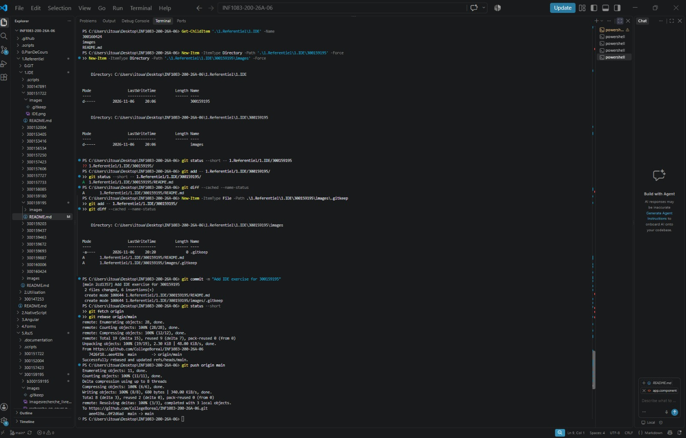

# INF1083 – IDE, Git et GitHub

Numéro d’étudiant : 300159195

J’ai créé mon dossier personnel et un fichier README.md, puis j’ai ajouté et envoyé mon travail sur GitHub avec Git.

## Travail réalisé

