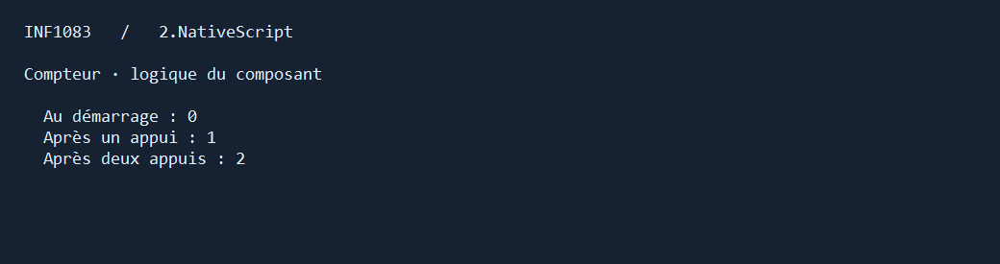

# Premier écran NativeScript

Zakaria Mamssi · INF1083 · Groupe 06

Patron Angular Hello World (`@nativescript/template-blank-ng`). Le composant Home affiche un compteur initialisé à zéro. Le bouton appelle `increment()` et la liaison Angular actualise le libellé.

## Code source

Télécharger et extraire [B300155462.zip](B300155462.zip) avant de lancer les commandes.

## Exécution

Avec Node.js, npm, la CLI NativeScript et un appareil Android ou un émulateur configuré, depuis ce dossier :

```powershell
cd B300155462
npm install
ns run android
```

## Vérification sur appareil

Appuyer deux fois sur « Compter un appui ». Le compteur doit afficher 2.

## Vérification effectuée

Capture des résultats locaux — Compteur · logique du composant.


