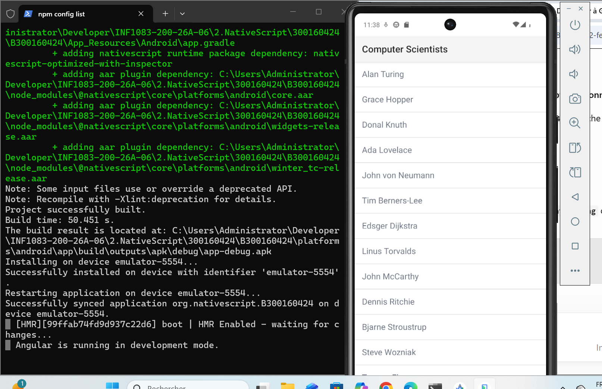

# TP NativeScript – Première application

**Nom :** Youcef  
**ID :** 300160424  
**Cours :** INF1083 – Développement d'applications  
**Date :** 18 octobre 2026

## 1. Introduction

Dans ce travail, j'ai créé ma première application mobile avec NativeScript et Angular. J'ai utilisé PowerShell et Android Studio pour réaliser le travail.

## 2. Création des dossiers

J'ai créé un dossier avec mon identifiant 300160424. Dans ce dossier, j'ai ajouté un fichier README.md et un dossier images pour enregistrer mes captures d'écran.

## 3. Création du projet NativeScript

J'ai utilisé la commande :

`ns create B300160424`

J'ai choisi Angular et le modèle Hello World.

## 4. Exécution de l'application

J'ai utilisé les commandes suivantes :

`cd B300160424`

`adb devices`

`ns run android`

La compilation et l'installation ont réussi sur mon émulateur Android.

## 5. Résultat

Mon application affiche une liste de scientifiques en informatique sur l'émulateur Android.

## 6. Conclusion

Ce travail m'a permis d'apprendre à créer une application avec NativeScript et Angular. J'ai aussi appris à utiliser PowerShell et un émulateur Android pour tester mon application.