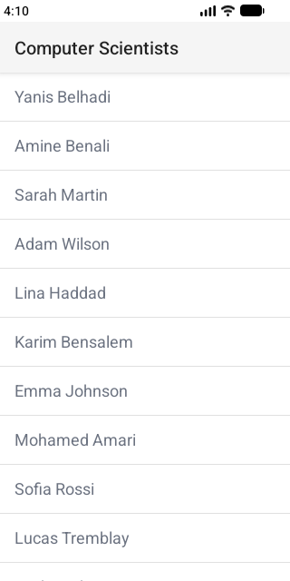

# Projet NativeScript – B300160733

[**Code source et projet exécutable B300160733**](./B300160733/)

## Lancer l’application sur Android

Le test a été effectué avec Node.js 24, le JDK 17, le SDK Android 36 et l’émulateur **Boreal_TP4**. Démarrer l’émulateur, puis exécuter ces commandes dans PowerShell à partir du dossier `2.NativeScript/300160733` du dépôt cloné.

~~~powershell
cd B300160733
npm ci
npm exec --no -- ngc --noEmit
npx --yes nativescript@9.1.2 run android --no-watch --device emulator-5554
~~~

Si l’identifiant de l’émulateur est différent, le relever avec `& "$env:ANDROID_HOME\platform-tools\adb.exe" devices -l` et remplacer `emulator-5554`.

## Présentation

Ce projet a pour objectif de créer, configurer et exécuter une application mobile avec NativeScript et Angular sur un environnement Android.

J’ai d’abord préparé le dossier du projet, créé l’application NativeScript, vérifié la configuration Android et Java, puis lancé l’application sur un émulateur. Enfin, j’ai personnalisé les données affichées dans l’application.

### 1. Création du dossier de travail

J’ai commencé par créer un dossier nommé `B300160733` sur le Bureau. Dans ce dossier, j’ai également créé un fichier `README.md` et un dossier `images` afin d’organiser le projet et les captures d’écran.

~~~powershell
cd $HOME\Desktop
mkdir B300160733
cd B300160733
New-Item README.md
mkdir images
~~~

[Capture de la création du dossier](images/appl%201.png)

### 2. Création du projet NativeScript

J’ai créé le projet NativeScript avec la commande `ns create B300160733`. Pendant la création, j’ai choisi Angular comme type de projet et **Hello World** comme modèle de départ.

[Capture du choix du modèle](images/appl%202.png)

### 3. Vérification de la création du projet

Après l’installation des dépendances, NativeScript a confirmé la création du projet. Je me suis ensuite déplacé dans le dossier du projet avec `cd B300160733` et j’ai vérifié les fichiers avec `dir`.

[Capture des fichiers du projet](images/appl%203.png)

### 4. Diagnostic de l’environnement

J’ai utilisé `ns doctor` pour vérifier la configuration de NativeScript. Le diagnostic a permis d’identifier les éléments qui devaient encore être configurés, notamment `ANDROID_HOME`, le SDK Android, les outils de compilation et le JDK Java.

[Capture du premier diagnostic](images/appl%204.png)

### 5. Configuration Android et Java

J’ai poursuivi l’installation et la configuration des composants Android et Java nécessaires à la compilation de l’application.

[Capture du diagnostic après la configuration](images/nativescript%201.png)

### 6. Installation du JDK

J’ai tenté d’installer Temurin JDK 17 avec la commande `choco install temurin17 -y`. La première tentative a rencontré un problème de permissions et m’a permis d’identifier que cette installation nécessitait des droits administrateur.

[Capture de la tentative d’installation](images/appl%207.png)

### 7. Première exécution de l’application

Après la configuration de l’environnement, j’ai exécuté l’application sur un émulateur Android. La version initiale affichait une liste de scientifiques en informatique, notamment Alan Turing, Grace Hopper, Ada Lovelace et Linus Torvalds.

*Première exécution du modèle Hello World avec la liste Computer Scientists.*

### 8. Personnalisation de l’application

J’ai ensuite modifié les données de l’application afin d’afficher ma propre liste. Chaque fiche présente le nom, la nationalité, le métier et la ville. La liste contient notamment Yanis Belhadi, Amine Benali, Sarah Martin, Adam Wilson, Lina Haddad, Karim Bensalem, Emma Johnson, Mohamed Amari, Sofia Rossi et Lucas Tremblay.

*Liste personnalisée affichée dans l’application d’origine.*

### 9. Résultat final et test sur une copie propre

J’ai ajouté le projet d’origine retrouvé sur le Bureau. Il contient les dix personnes citées ci-dessus et cinq autres fiches.

J’ai installé les dépendances dans une copie propre avec `npm ci`, vérifié la compilation Angular et lancé le projet sur **Boreal_TP4**. J’ai confirmé que les 15 personnes apparaissent en faisant défiler la liste et que la fiche de Yanis Belhadi affiche sa nationalité, son métier et sa ville.

*Nouveau test Android réalisé avec la copie propre du projet publiée dans ce dossier.*

## Conclusion

Ce travail m’a permis de créer une application NativeScript Angular, de configurer l’environnement Android et Java, puis de personnaliser et vérifier les données affichées sur l’émulateur.
