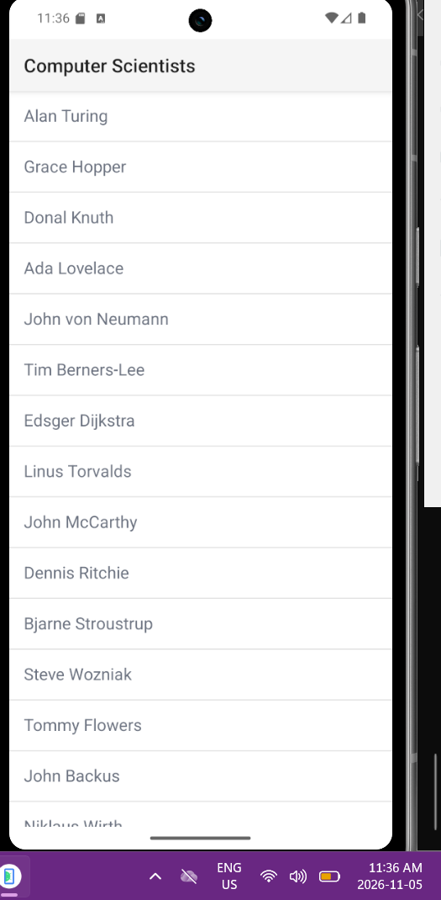
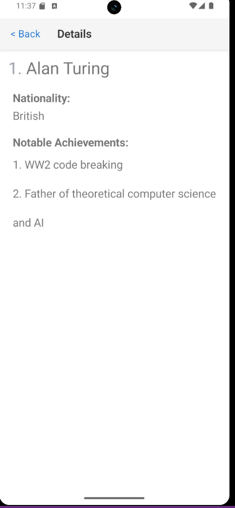

# Première application NativeScript

## Cours
INF1083 – Développement d’applications

## Projet
B300160862

## Description
Application NativeScript avec Angular affichant une liste
de personnalités de l’informatique.

En sélectionnant un nom, une page présente sa nationalité
et ses principales réalisations.

## Exécution
Dans le dossier B300160862, lancer :

ns run android

## Vérifications
- Affichage de la liste : réussi.
- Ouverture de la fiche d’Alan Turing : réussie.s
## Captures d’écran

### Liste des personnalités

### Fiche d’Alan Turing

