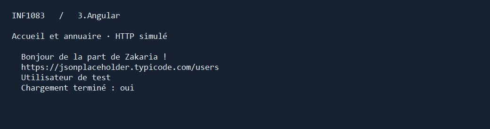

# Angular et API REST

Zakaria Mamssi · INF1083 · Groupe 06

Application web à deux routes. Le bouton de la page Accueil affiche une salutation. La page Utilisateurs charge l’annuaire JSONPlaceholder avec HttpClient et affiche la liste ou une erreur réseau.

## Code source

Télécharger et extraire [B300155462.zip](B300155462.zip) avant de lancer les commandes.

## Exécution

Avec Node.js 22.12+ et npm, depuis ce dossier :

```powershell
cd B300155462
npm install
npm start
```

## Vérification sur appareil ou navigateur

Ouvrir http://localhost:4200, saluer, puis sélectionner Utilisateurs et charger l’annuaire. Couper la connexion et réessayer pour vérifier le message d’erreur.

## Vérification effectuée

Capture des résultats locaux — Accueil et annuaire · HTTP simulé.


