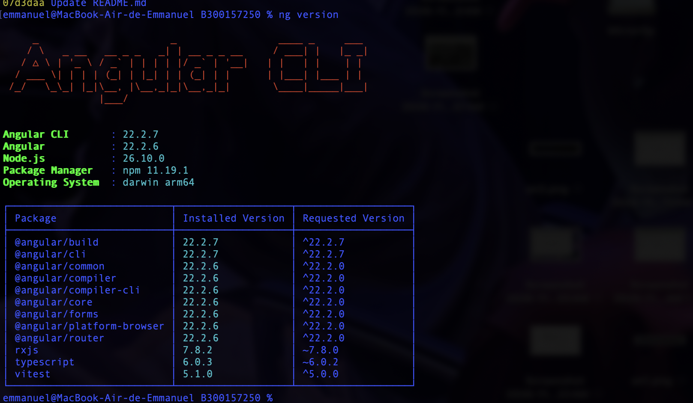
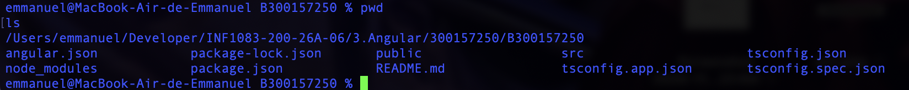
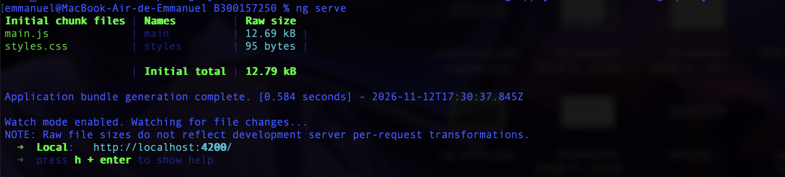
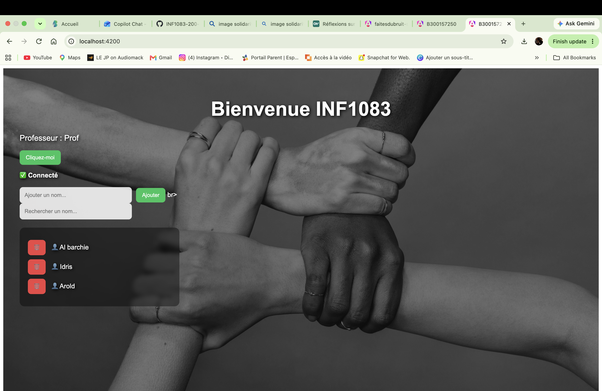

# Laboratoire Angular - INF1083

## Informations de l'étudiant

- Nom : Emmanuel O'Ngoran
- Numéro étudiant : 300157250
- Cours : INF1083
- Technologie : Angular

---

# Introduction

Ce laboratoire avait comme objectif de découvrir Angular et de mettre en pratique les concepts de base du framework. L'application réalisée permet de gérer une liste de noms à l'aide de plusieurs fonctionnalités interactives.

---

# Objectifs du laboratoire

- Installer Angular CLI
- Créer un projet Angular
- Créer un composant personnalisé
- Utiliser le Data Binding
- Utiliser les événements Angular
- Utiliser les directives Angular
- Personnaliser l'interface avec CSS
- Utiliser Git et GitHub

---

# Fonctionnalités réalisées

✅ Création du projet Angular

✅ Création du composant Accueil

✅ Utilisation du Data Binding

✅ Gestion des événements avec le bouton Cliquez-moi

✅ Utilisation de la directive *ngIf

✅ Utilisation de la directive *ngFor

✅ Ajout dynamique de noms

✅ Recherche de noms

✅ Suppression de noms

✅ Personnalisation CSS

✅ Ajout d'une image de fond représentant la solidarité

---

# Technologies utilisées

- Angular
- TypeScript
- HTML
- CSS
- Git
- GitHub

---

# Structure du projet

```text
B300157250
│
├── public
│   └── faitesdubruit-solidarite-main-2.jpg
│
├── src
│   └── app
│       ├── accueil
│       │   ├── accueil.ts
│       │   ├── accueil.html
│       │   └── accueil.css
│       │
│       ├── app.ts
│       └── app.html
│
└── README.md
```

---

# Concepts Angular utilisés

## Data Binding

Le Data Binding permet d'afficher les données provenant du fichier TypeScript dans le HTML.

Exemple :

```html
<h1>{{ titre }}</h1>
<p>{{ nom }}</p>
```

---

## Événements

Le bouton déclenche l'exécution d'une fonction lors d'un clic.

```html
<button (click)="saluer()">
  Cliquez-moi
</button>
```

---

## Directive *ngIf

Permet d'afficher un élément seulement lorsqu'une condition est vraie.

```html
<div *ngIf="connecte">
  ✅ Connecté
</div>
```

---

## Directive *ngFor

Permet d'afficher plusieurs éléments à partir d'une liste.

```html
<li *ngFor="let nom of nomsFiltres">
  {{ nom }}
</li>
```

---

# Fonctionnement de l'application

L'application permet :

- Ajouter un nouveau nom
- Rechercher un nom dans la liste
- Supprimer un nom
- Afficher une liste dynamique
- Utiliser une interface personnalisée avec image de fond

---

# Commandes utilisées

```bash
ng version

ng new B300157250

ng generate component accueil

ng serve

git add .

git commit -m "Laboratoire Angular"

git push origin main
```

---

# Captures d'écran

## Angular CLI

```html

```

---

## Création du projet Angular

```html

```

---

## Création du composant accueil

```html

```

---

## Exécution avec ng serve

```html
<

```

---

## Application Angular

```html

```

---

## Ajout d'un nom

```html

```

---

## Recherche d'un nom

```html

```

---

## Suppression d'un nom

```html

```

---

## Bouton Bonjour

```html

```

---

# Résultat obtenu

L'application développée permet de gérer une liste de noms grâce à Angular. Les utilisateurs peuvent ajouter de nouveaux noms, effectuer des recherches dans la liste et supprimer des éléments. L'application utilise également une image de fond représentant la solidarité afin d'améliorer l'expérience visuelle.

---

# Conclusion

Ce laboratoire m'a permis de me familiariser avec Angular ainsi qu'avec la structure d'une application moderne. J'ai appris à créer des composants, utiliser le Data Binding, gérer les événements, exploiter les directives Angular et personnaliser l'interface avec CSS. Cette activité m'a permis d'acquérir une meilleure compréhension du développement d'applications Web avec Angular.
