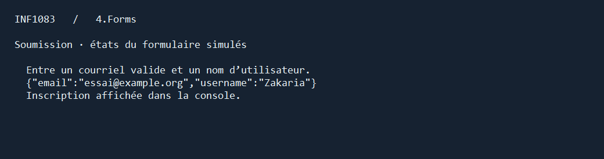

# Formulaire réactif

Zakaria Mamssi · INF1083 · Groupe 06

Le formulaire repose sur FormBuilder, formGroup et deux contrôles. Le courriel doit être valide et le nom doit contenir au moins un caractère visible. Une inscription valide écrit les deux valeurs dans la console.

## Code source

### src/app/home/home.component.ts

~~~typescript
import { Component, inject, NO_ERRORS_SCHEMA } from '@angular/core';
import { FormBuilder, ReactiveFormsModule, Validators } from '@angular/forms';
import { NativeScriptCommonModule, NativeScriptFormsModule } from '@nativescript/angular';

@Component({
  selector: 'Home',
  imports: [NativeScriptCommonModule, NativeScriptFormsModule, ReactiveFormsModule],
  schemas: [NO_ERRORS_SCHEMA],
  templateUrl: './home.component.html',
})
export class HomeComponent {
  signUpForm = inject(FormBuilder).nonNullable.group({
    email: ['', [Validators.required, Validators.email]],
    username: ['', [Validators.required, Validators.pattern(/\S/)]],
  });
  message = '';

  onButtonTap(): void {
    if (this.signUpForm.invalid) {
      this.message = 'Entre un courriel valide et un nom d’utilisateur.';
      return;
    }
    const { email, username } = this.signUpForm.getRawValue();
    console.log(JSON.stringify({ email: email.trim(), username: username.trim() }));
    this.message = 'Inscription affichée dans la console.';
  }
}
~~~

<details>
<summary>src/app.css</summary>

~~~css
@tailwind base;
@tailwind components;
@tailwind utilities;
~~~

</details>

<details>
<summary>src/app/app.component.html</summary>

~~~html
<GridLayout>
  <page-router-outlet></page-router-outlet>
</GridLayout>
~~~

</details>

<details>
<summary>src/app/app.component.ts</summary>

~~~typescript
import { Component, NO_ERRORS_SCHEMA } from '@angular/core';
import { PageRouterOutlet } from '@nativescript/angular';

@Component({
  selector: 'ns-app',
  templateUrl: './app.component.html',
  imports: [PageRouterOutlet],
  schemas: [NO_ERRORS_SCHEMA],
})
export class AppComponent {}
~~~

</details>

<details>
<summary>src/app/app.routes.ts</summary>

~~~typescript
import { Routes } from '@angular/router';

export const routes: Routes = [
  { path: '', redirectTo: '/home', pathMatch: 'full' },
  { path: 'home', loadComponent: () => import('./home/home.component').then(m => m.HomeComponent) },
];
~~~

</details>

<details>
<summary>src/app/home/home.component.html</summary>

~~~html
<ActionBar title="Inscription"></ActionBar>
<StackLayout padding="24" [formGroup]="signUpForm">
  <Label text="Courriel"></Label>
  <TextField formControlName="email" keyboardType="email" autocapitalizationType="none"></TextField>
  <Label text="Nom d’utilisateur"></Label>
  <TextField formControlName="username"></TextField>
  <Button text="S’inscrire" (tap)="onButtonTap()"></Button>
  <Label [text]="message" textWrap="true"></Label>
</StackLayout>
~~~

</details>

<details>
<summary>src/main.ts</summary>

~~~typescript
import {
  bootstrapApplication,
  provideNativeScriptHttpClient,
  provideNativeScriptRouter,
  runNativeScriptAngularApp,
} from '@nativescript/angular';
import { provideZonelessChangeDetection } from '@angular/core';
import { withInterceptorsFromDi } from '@angular/common/http';
import { routes } from './app/app.routes';
import { AppComponent } from './app/app.component';

runNativeScriptAngularApp({
  appModuleBootstrap: () => {
    return bootstrapApplication(AppComponent, {
      providers: [
        provideNativeScriptHttpClient(withInterceptorsFromDi()),
        provideNativeScriptRouter(routes),
        provideZonelessChangeDetection(),
      ],
    });
  },
});
~~~

</details>

<details>
<summary>src/polyfills.ts</summary>

~~~typescript
/**
 * NativeScript Polyfills
 */

// Install @nativescript/core polyfills (XHR, setTimeout, requestAnimationFrame)
import '@nativescript/core/globals';
// Install @nativescript/angular specific polyfills
import '@nativescript/angular/polyfills';
~~~

</details>

## Exécution

Avec Node.js, npm, la CLI NativeScript et un appareil Android ou un émulateur configuré, depuis ce dossier :

```powershell
cd B300155462
npm install
ns run android
```

## Vérification sur appareil

Essayer un formulaire vide, puis entrer essai@example.org et Zakaria. Vérifier le message dans l’application et les deux champs JSON dans la console.

## Vérification effectuée

Capture des résultats locaux — Soumission · états du formulaire simulés.


