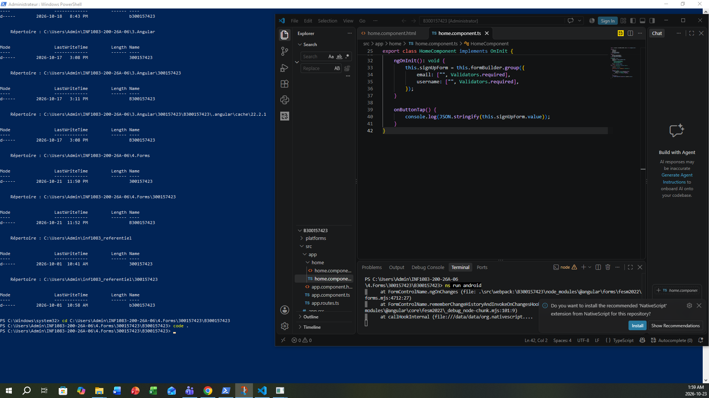
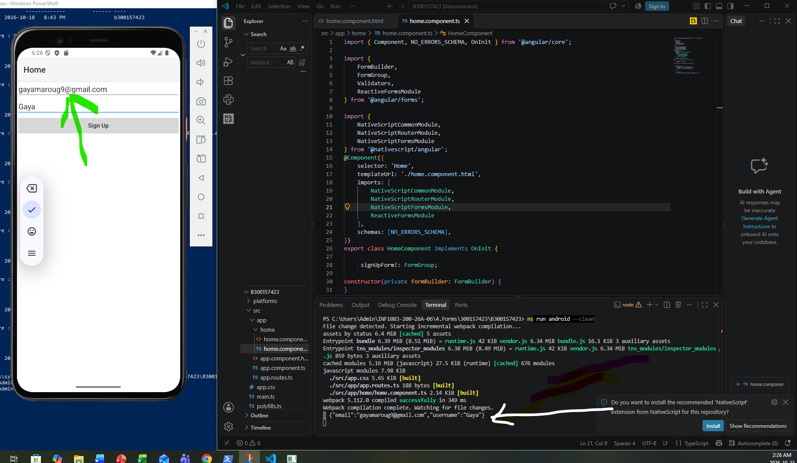
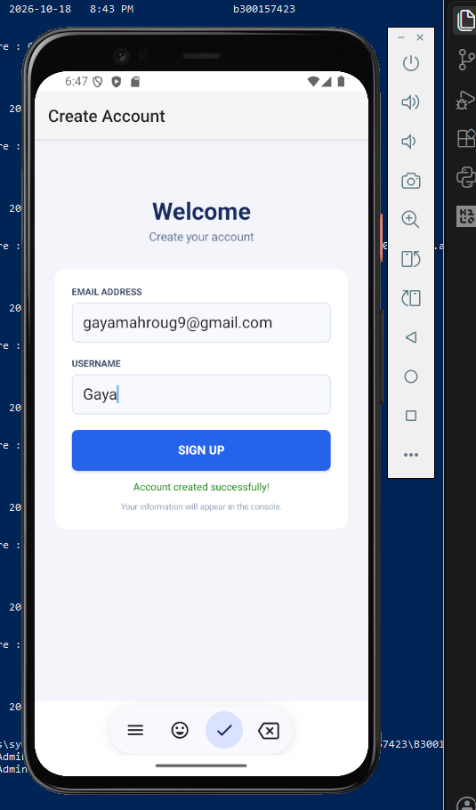
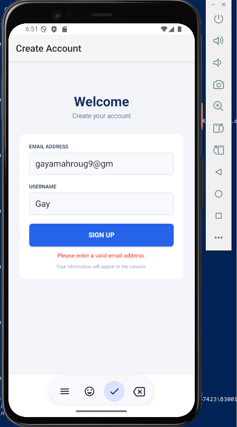

# Laboratoire Forms — Angular ReactiveForms

**Étudiant :** Gaya Mahroug  
**Matricule :** 300157423  
**Cours :** INF1083  
**Projet :** Forms

## 1. Objectif

L'objectif de ce laboratoire est de comprendre et d'utiliser les formulaires réactifs d'Angular (ReactiveForms) avec NativeScript.

## 2. Préparation de l'environnement

J'ai préparé mon environnement de développement avec Node.js, npm et NativeScript.

### Capture 1 — Vérification de l'environnement

## 3. Création du projet

J'ai créé mon projet NativeScript avec Angular et installé les dépendances nécessaires.

### Capture 2 — Création du projet

## 4. Formulaire ReactiveForms

J'ai créé un formulaire contenant deux champs : Email et Username.

Les informations saisies sont récupérées avec Angular ReactiveForms et affichées dans la console.

### Capture 3 — Formulaire

## 5. Personnalisation de l'interface

J'ai modifié l'apparence du formulaire avec CSS pour obtenir une interface plus claire.

### Capture 4 — Interface améliorée

## 6. Validation du formulaire

J'ai ajouté la validation des champs obligatoires et du format de l'adresse courriel.

### Capture 5 — Validation du formulaire

## 7. Résultat

Ce laboratoire m'a permis de pratiquer les formulaires réactifs d'Angular, la validation des données et la personnalisation de l'interface NativeScript.
