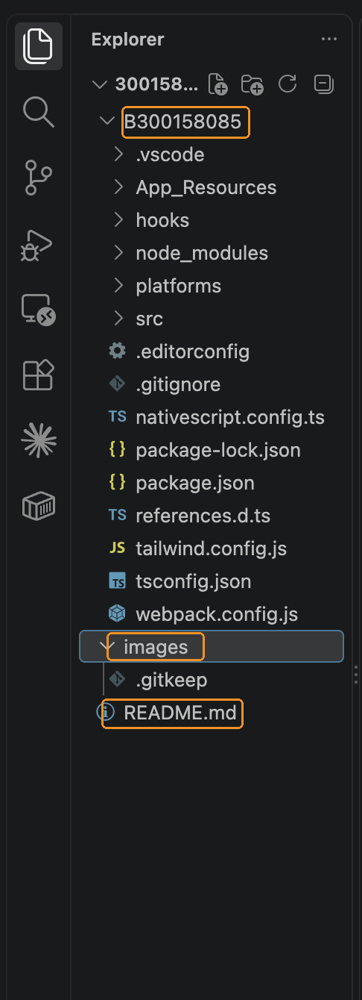
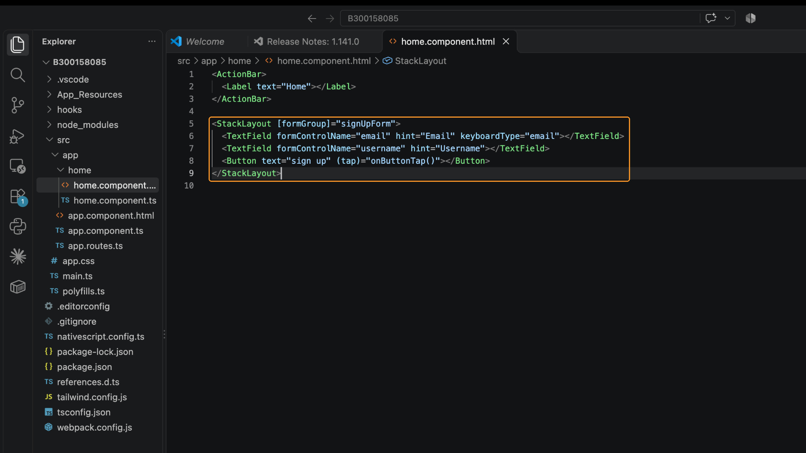
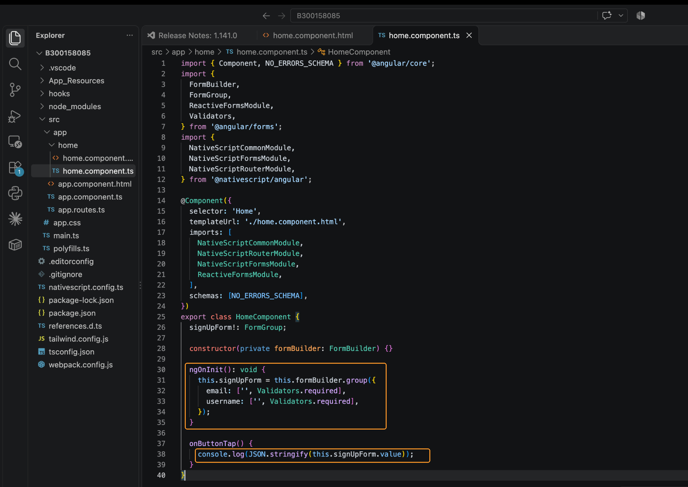
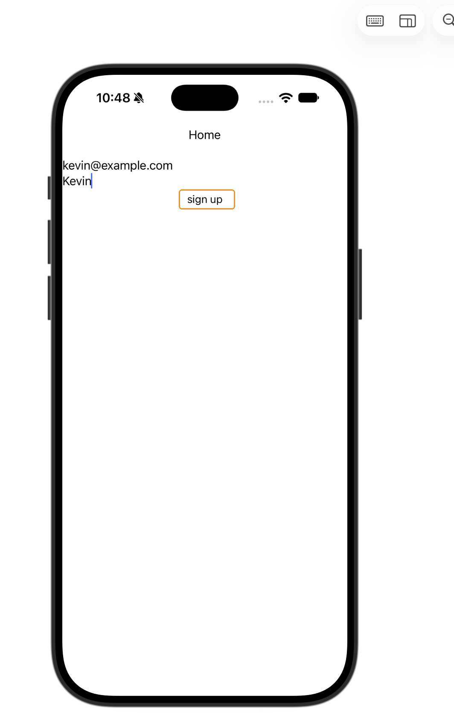
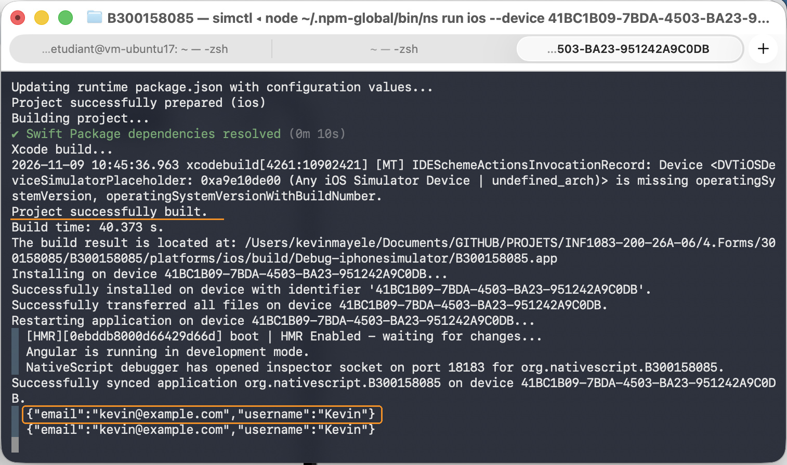

# Laboratoire Forms

**Kevin Mayele - 300158085**  
**INF1083 | NativeScript et Angular**

## Présentation

Pour ce laboratoire, j’ai créé un formulaire avec deux champs : le courriel et le nom d’utilisateur. Le bouton **sign up** permet d’afficher les informations saisies dans la console.

Le projet se trouve dans `4.Forms/300158085/B300158085`. Le dossier étudiant contient aussi ce README et le dossier `images`.



## Création du projet

J’ai utilisé le modèle indiqué dans les consignes :

```bash
ns create B300158085 --template @nativescript/template-blank-ng
```

J’ai ensuite ouvert le projet dans Visual Studio Code pour modifier les fichiers `home.component.html` et `home.component.ts`.

## Modification de la page Home

Dans `home.component.html`, j’ai conservé la barre de titre **Home** et remplacé le `GridLayout` par un `StackLayout`. Les deux champs et le bouton sont ainsi placés verticalement.

```xml
<StackLayout [formGroup]="signUpForm">
  <TextField formControlName="email" hint="Email" keyboardType="email"></TextField>
  <TextField formControlName="username" hint="Username"></TextField>
  <Button text="sign up" (tap)="onButtonTap()"></Button>
</StackLayout>
```

Le formulaire utilise le groupe `signUpForm`. Chaque champ est associé à son contrôle avec `formControlName`, et le bouton appelle la méthode `onButtonTap()`.



## Configuration des champs

Dans `home.component.ts`, j’ai ajouté `FormBuilder`, `FormGroup` et `Validators`. Le constructeur reçoit `FormBuilder`, puis les deux contrôles sont créés dans `ngOnInit()`.

```typescript
signUpForm!: FormGroup;

constructor(private formBuilder: FormBuilder) {}

ngOnInit(): void {
  this.signUpForm = this.formBuilder.group({
    email: ['', Validators.required],
    username: ['', Validators.required],
  });
}
```

Les champs sont vides au départ et sont déclarés obligatoires avec `Validators.required`.

J’ai également ajouté `NativeScriptFormsModule` et `ReactiveFormsModule` aux imports du composant pour prendre en charge les liaisons du formulaire. Le `!` dans la déclaration de `signUpForm` indique que cette propriété sera initialisée dans `ngOnInit()`.



Pour afficher les valeurs, j’ai repris la méthode demandée :

```typescript
onButtonTap() {
  console.log(JSON.stringify(this.signUpForm.value));
}
```

Cette méthode affiche le contenu du formulaire au format JSON. Elle ne bloque pas le clic lorsque les champs sont vides et ne vérifie pas le format du courriel.

## Exécution sur iOS

J’ai testé l’application sur mon Mac avec l’iPhone 18 Pro disponible dans Device Hub.

La commande `ns run ios --emulator` n’a pas fonctionné au premier essai, car le fichier `Simulator.app` était introuvable à l’emplacement recherché. J’ai donc utilisé cette commande pour vérifier si mon appareil était détecté :

```bash
ns device
```

L’iPhone apparaissait bien dans la liste des appareils connectés. J’ai lancé l’application directement sur cet appareil :

```bash
ns run ios --device 41BC1B09-7BDA-4503-BA23-951242A9C0DB
```

La compilation et l’installation ont réussi. Cet identifiant correspond à mon simulateur ; il faut utiliser celui retourné par `ns device` pour lancer le projet sur un autre appareil.

## Résultat obtenu

J’ai rempli le formulaire avec le courriel `kevin@example.com` et le nom d’utilisateur `Kevin`, puis appuyé sur **sign up**.



Le terminal a affiché :

```json
{"email":"kevin@example.com","username":"Kevin"}
```



Les valeurs affichées correspondent à celles saisies dans l’application. Le formulaire répond donc au résultat demandé dans le laboratoire.
