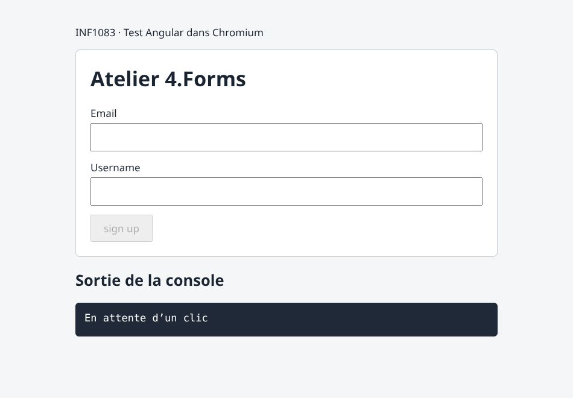
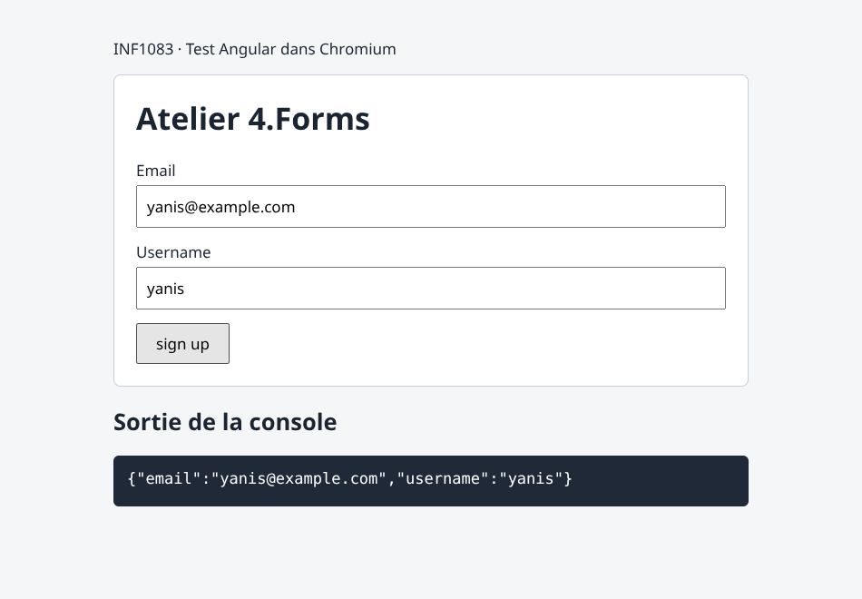
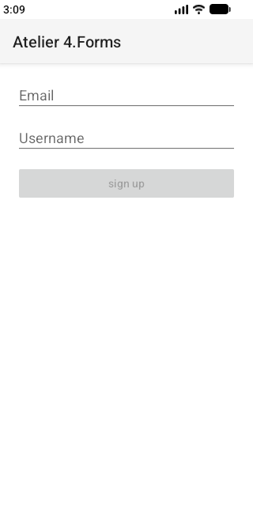
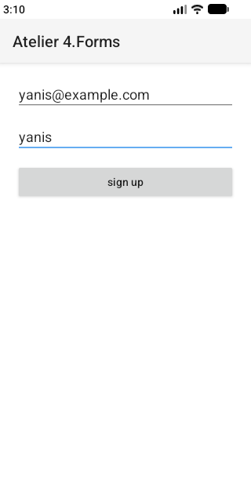

# Atelier 4.Forms — Formulaire réactif

**Cours** INF1083 — Développement d’applications  
**Étudiant** Yanis Belhadi · 300160733

## Objectif

Créer un formulaire d’inscription avec NativeScript et Angular. Le formulaire utilise un `StackLayout` pour afficher les champs Email et Username l’un sous l’autre. Le bouton **sign up** affiche les valeurs du formulaire en JSON dans la console.

## Lancer le projet sur Android

Ouvrir le dossier `300160733` dans VS Code. Dans le terminal intégré, lancer les commandes suivantes. Le projet utilise Node.js 24, Java 17 et le SDK Android 36. Démarrer un émulateur dans Android Studio ou brancher un appareil Android avec le débogage USB activé.

```powershell
cd B300160733
npm ci
npx nativescript@9.1.2 doctor android
npx nativescript@9.1.2 run android
```

## Fonctionnement

- [home.component.html](B300160733/src/app/home/home.component.html) relie le `StackLayout` à `signUpForm` et associe chaque champ à son contrôle avec `formControlName`.
- [home.component.ts](B300160733/src/app/home/home.component.ts) crée les deux contrôles avec `FormBuilder` et `Validators.required`.
- Le bouton reste désactivé tant qu’un champ est vide. Lorsque les deux champs sont remplis, le bouton déclenche `onButtonTap()`. La méthode écrit `JSON.stringify(this.signUpForm.value)` dans le terminal de NativeScript.
- La saisie reste locale au formulaire.

## Test

1. Ouvrir l’application et vérifier que **sign up** est désactivé.
2. Taper `yanis@example.com` dans **Email** et `yanis` dans **Username**.
3. Appuyer sur **sign up** et chercher cette ligne dans le terminal.

```json
{"email":"yanis@example.com","username":"yanis"}
```

## Captures

Les images ci-dessous proviennent d’un test Angular dans Chromium avec la même logique de formulaire et une interface HTML de test. La deuxième image affiche le vrai message capturé dans la console du navigateur.





### Test sur l’émulateur Android Boreal_TP4

Le bouton est grisé lorsque le formulaire est vide. Un appui dans cet état n’a produit aucun message de formulaire dans Logcat. Après avoir saisi le courriel et le nom d’utilisateur, un appui sur **sign up** a produit le message suivant dans la console de l’application.

~~~text
CONSOLE LOG: {"email":"yanis@example.com","username":"yanis"}
~~~





## Référence

[Consignes 4.Forms — Collège Boréal](https://github.com/CollegeBoreal/INF1083-200-26A-06/tree/main/4.Forms)
