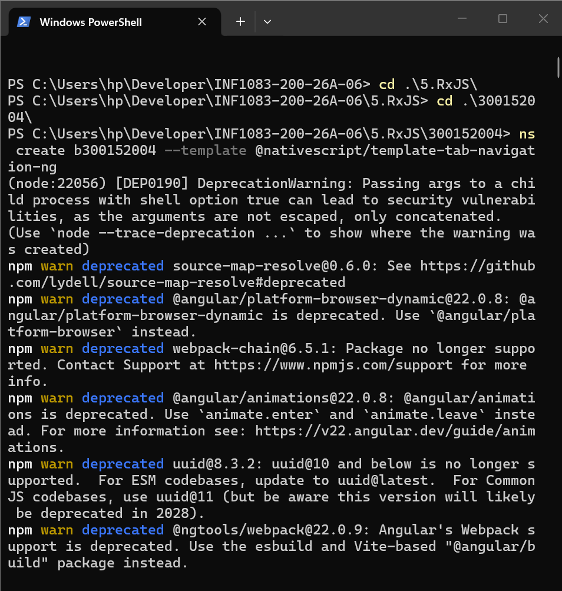
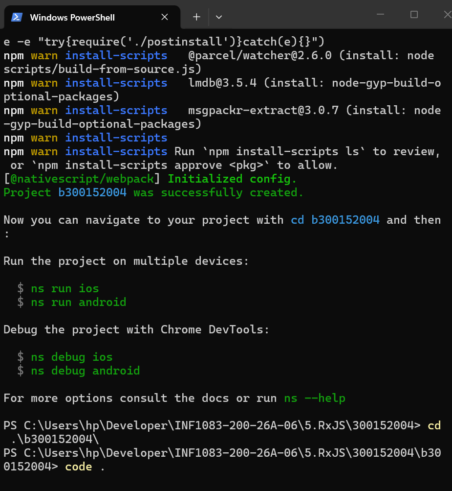
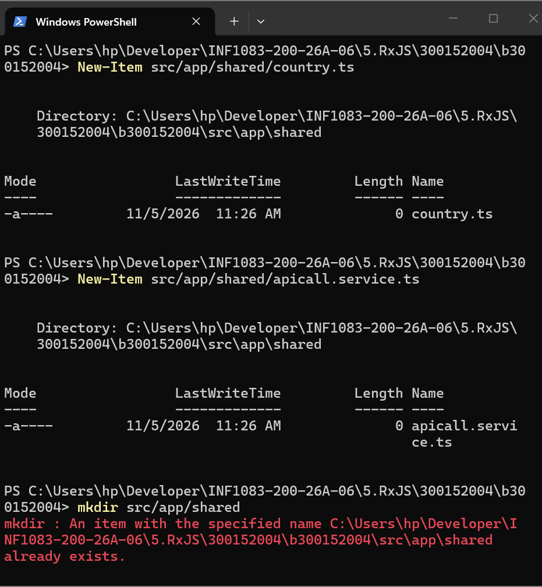
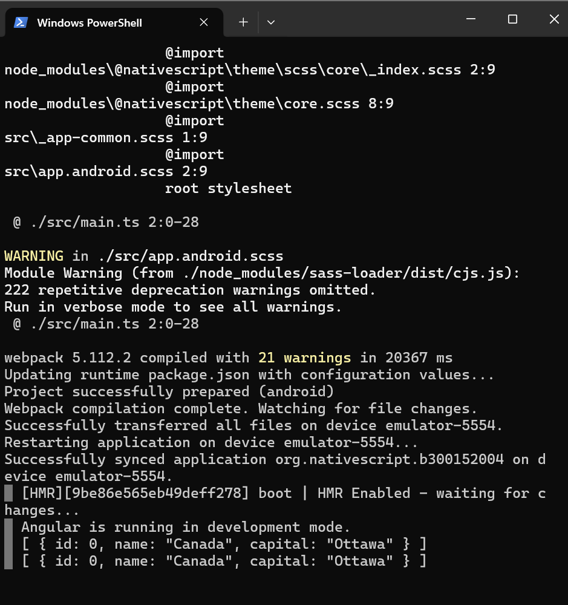
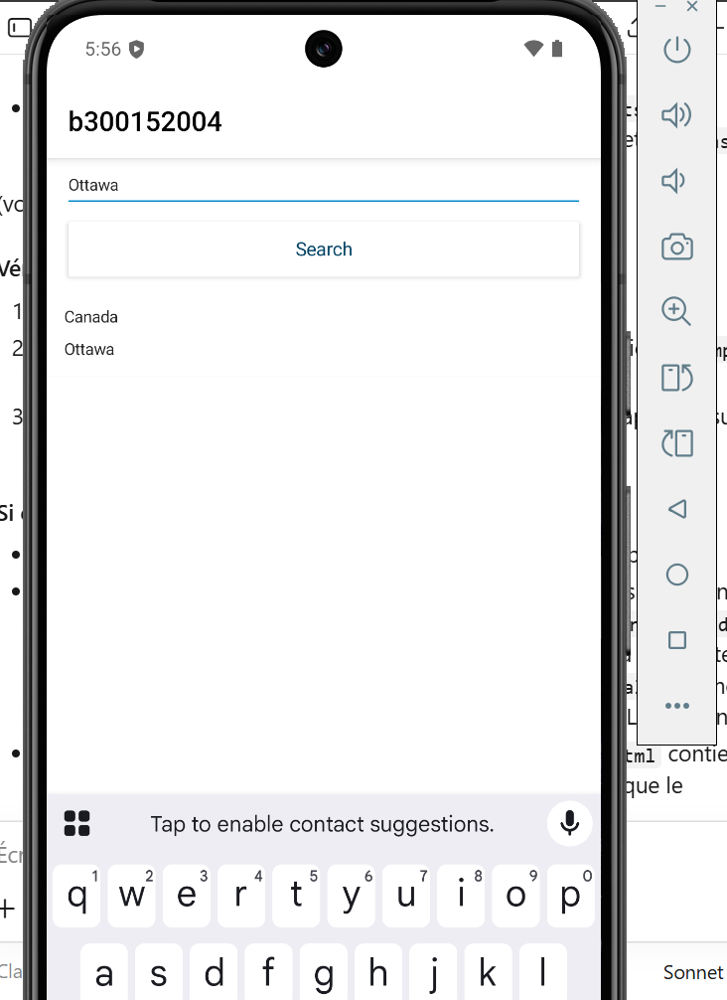

# Application NativeScript Angular
# 300152004

Étape 1 Création du projet

Je me place dans mon dossier `300152004` et je crée le projet avec la commande `ns create b300152004 --template @nativescript/template-tab-navigation-ng`. Les nombreux avertissements `npm warn deprecated` ne bloquent rien : ils concernent seulement des paquets du modèle qui sont devenus obsolètes.

Étape 2 Ouverture dans VS Code

Le message `Project b300152004 was successfully created` confirme que le projet est prêt. Je me déplace dans le dossier `b300152004` avec `cd`, puis j'ouvre le projet dans VS Code avec `code .`.

Étape 3 Modèle de données et service

Comme le modèle récent n'a pas de fichier `angular.json`, je ne peux pas utiliser `ng generate` et je crée donc les fichiers à la main avec `New-Item`. Je crée `country.ts` et `apicall.service.ts` dans `src/app/shared`, et la commande `mkdir` me signale que ce dossier existait déjà, ce qui est sans conséquence.

Étape 4 Lancement sur l'émulateur Android

Je lance l'application avec `ns run android`, qui démarre l'émulateur `Pixel_8`. Webpack compile le projet avec quelques avertissements sans gravité, puis l'application est synchronisée sur `emulator-5554`. La console affiche ensuite les données reçues de l'API, soit le pays `Canada` avec la capitale `Ottawa`, grâce au `console.log(data)` de ma méthode.

Étape 5 Résultat

Dans l'application, je saisis `Ottawa` dans le champ et je touche `Search`. La liste affiche alors `Canada` et `Ottawa`, ce qui confirme que le service, le binding et la liste fonctionnent ensemble.

