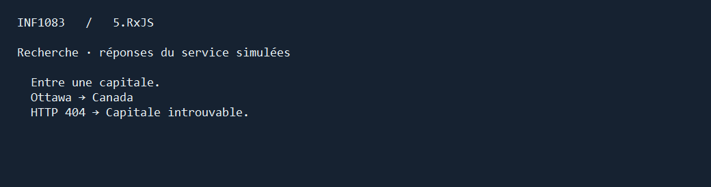

# Recherche par capitale

Zakaria Mamssi · INF1083 · Groupe 06

Patron Angular à onglets. Dans Search, ngModel lie le champ au composant. Un service HttpClient transforme la réponse en Observable<Country[]> avec map. La liste affiche le pays et la capitale. Le service du cours est interrogé sans clé dans son exemple.

## Code source

Télécharger et extraire [b300155462.zip](b300155462.zip) avant de lancer les commandes.

## Exécution

Avec Node.js, npm, la CLI NativeScript et un appareil Android ou un émulateur configuré, depuis ce dossier :

```powershell
cd b300155462
npm install
ns run android
```

## Vérification sur appareil

Dans Search, essayer Ottawa, une valeur vide et une capitale inexistante. Vérifier aussi le message quand le réseau est coupé.

## Vérification effectuée

Capture des résultats locaux — Recherche · réponses du service simulées.


