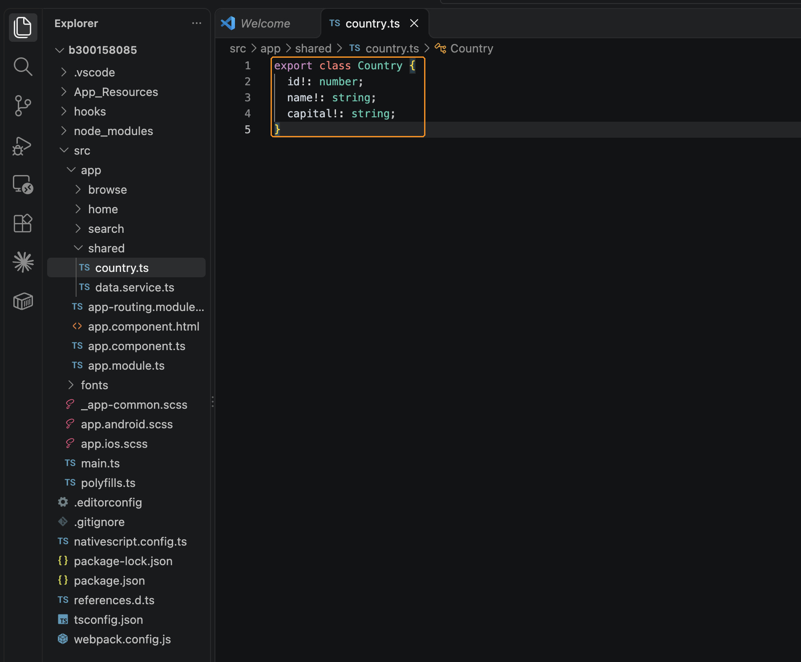
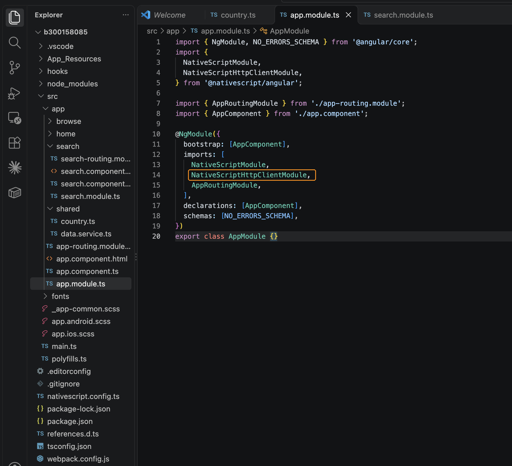
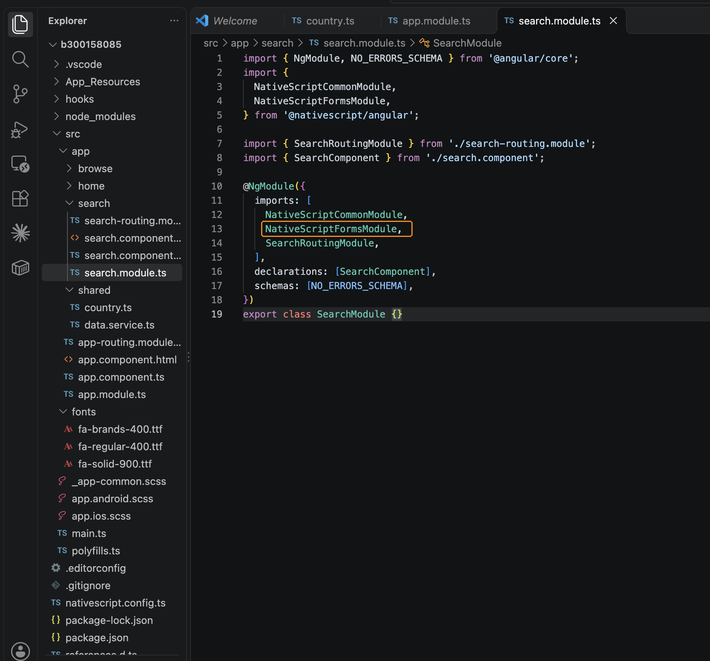
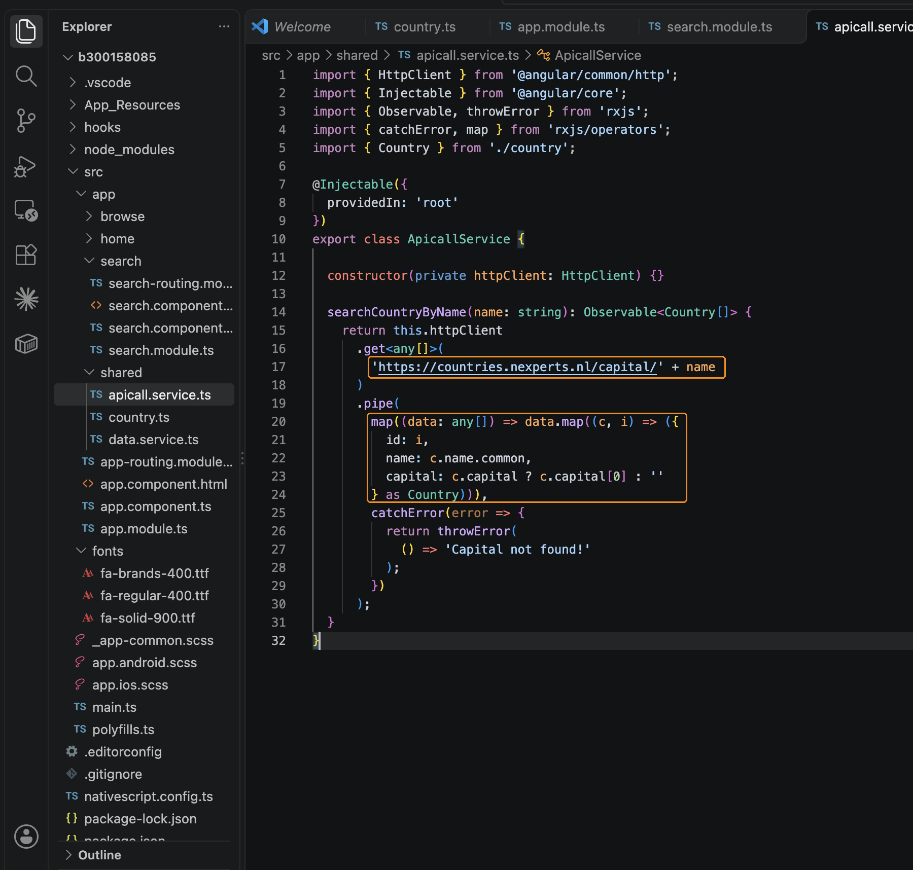
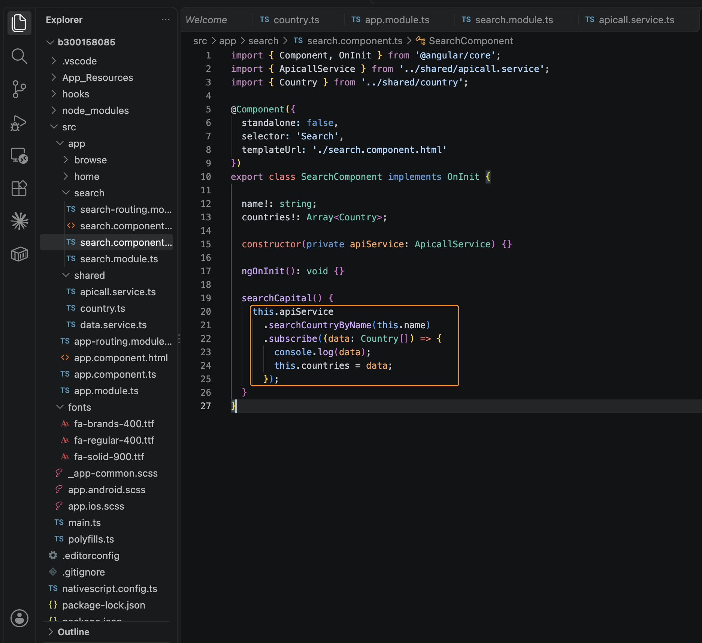
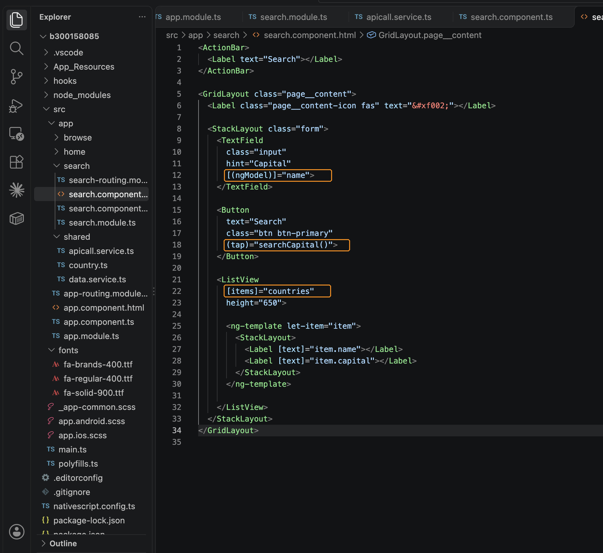
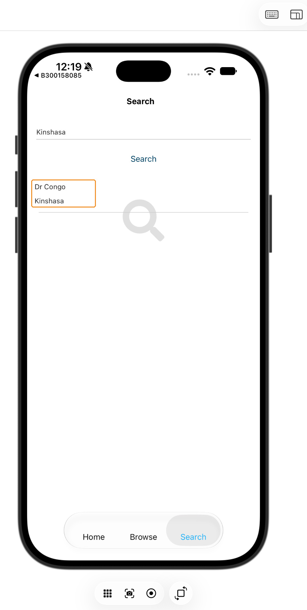
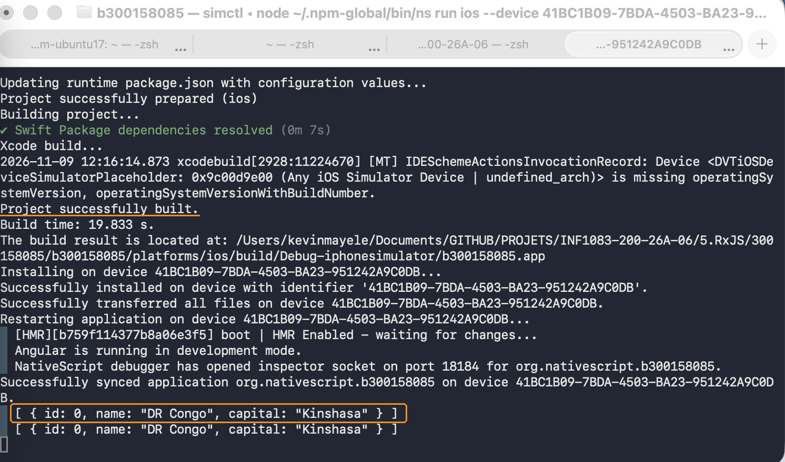
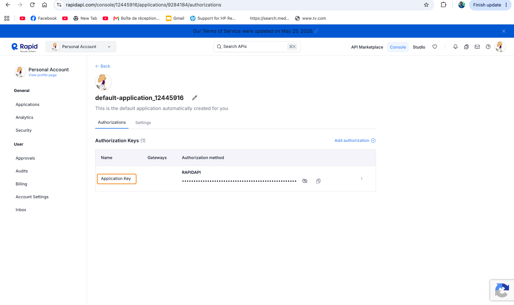

# Recherche d’un pays à partir de sa capitale

**Kevin Mayele - 300158085**  
**INF1083 | Laboratoire RxJS**

## Présentation

Pour ce laboratoire, j’ai travaillé sur l’onglet **Search** d’une application NativeScript Angular. L’utilisateur saisit une capitale, appuie sur **Search**, puis consulte le pays correspondant dans une liste.

J’ai utilisé **Kinshasa** pour le test. L’application a affiché le pays et sa capitale, et les mêmes données sont apparues dans le terminal.

## Création de l’application

Le projet a été créé avec le modèle à onglets demandé :

```bash
ns create b300158085 --template @nativescript/template-tab-navigation-ng
```

Le travail se trouve dans `5.RxJS/300158085/`. Ce répertoire contient le projet `b300158085`, le README et le dossier `images`.

Les modifications concernent la page Search, les modules nécessaires aux formulaires et aux requêtes HTTP, ainsi que deux fichiers créés dans `src/app/shared`.

## Modèle Country

J’ai créé `country.ts` pour définir les données utilisées dans l’application :

```typescript
export class Country {
  id!: number;
  name!: string;
  capital!: string;
}
```

Chaque résultat contient un identifiant, un nom de pays et une capitale. Les propriétés sont déclarées avec `!` pour permettre leur initialisation ultérieure avec la configuration TypeScript du projet.



## Ajout des modules

Dans `app.module.ts`, j’ai ajouté `NativeScriptHttpClientModule` aux imports pour permettre au service d’utiliser `HttpClient`.



Dans `search.module.ts`, j’ai ajouté `NativeScriptFormsModule`. Ce module permet d’utiliser `[(ngModel)]` pour relier le champ de saisie à la propriété `name`.



## Service d’accès aux données

Le fichier `src/app/shared/apicall.service.ts` contient le service `ApicallService`.

Sa méthode `searchCountryByName()` reprend le nom donné dans les consignes, mais la recherche porte bien sur une **capitale**. Elle ajoute la valeur saisie à l’adresse suivante :

```text
https://countries.nexperts.nl/capital/
```

Pour mon test, l’adresse appelée était donc :

```text
https://countries.nexperts.nl/capital/Kinshasa
```

La méthode retourne un `Observable<Country[]>`. Dans le `pipe`, l’opérateur RxJS `map` transforme la réponse reçue en une liste d’objets contenant les propriétés du modèle `Country`.

L’identifiant est attribué à partir de la position du résultat dans le tableau. Le nom du pays provient de `c.name.common`, et la capitale correspond au premier élément de `c.capital` lorsqu’il existe.

Le service reprend aussi le `catchError` fourni dans l’exercice, qui transmet le message `Capital not found!` en cas d’erreur.



## Appel du service depuis Search

Dans `search.component.ts`, j’ai injecté `ApicallService` dans le constructeur et ajouté les propriétés `name` et `countries`.

Le bouton appelle cette méthode :

```typescript
searchCapital() {
  this.apiService
    .searchCountryByName(this.name)
    .subscribe((data: Country[]) => {
      console.log(data);
      this.countries = data;
    });
}
```

Le `subscribe()` reçoit les données de la recherche. Elles sont affichées dans la console, puis affectées à `countries` pour alimenter la liste.

J’ai conservé `standalone: false`, déjà présent dans le composant du modèle.



## Champ de recherche et liste

Dans `search.component.html`, j’ai remplacé le texte d’attente par le formulaire demandé, en conservant la barre de titre et la structure de la page.

Le champ **Capital** utilise :

```html
[(ngModel)]="name"
```

Le bouton **Search** déclenche :

```html
(tap)="searchCapital()"
```

Le `ListView` reçoit le tableau avec `[items]="countries"`. Pour chaque résultat, deux labels affichent le nom du pays et sa capitale. Sa hauteur est fixée à `650`, comme dans l’exemple du professeur.



## Test avec Kinshasa

J’ai lancé le projet sur le simulateur **iPhone 18 Pro**, ouvert dans Device Hub sur mon Mac :

```bash
ns run ios --device 41BC1B09-7BDA-4503-BA23-951242A9C0DB
```

Cet identifiant correspond à mon simulateur. Sur un autre appareil, la commande `ns device` permet de retrouver l’identifiant à utiliser.

Après la compilation, j’ai ouvert l’onglet **Search**, saisi **Kinshasa**, puis appuyé sur le bouton.

La liste a affiché **Dr Congo** et **Kinshasa**.



Dans le terminal, les données reçues étaient :

```text
[ { id: 0, name: "DR Congo", capital: "Kinshasa" } ]
```



Ce test confirme que la saisie est transmise au service et que les données retournées sont affichées dans la liste. Le scénario d’erreur n’a pas été testé.

## Compte RapidAPI

J’ai créé mon compte RapidAPI avec GitHub et accédé à la clé de l’application créée automatiquement. La capture montre sa présence, avec sa valeur masquée.



Le service fourni dans les consignes appelle directement `countries.nexperts.nl` et ne transmet pas de clé RapidAPI. Je n’ai donc pas ajouté cette clé au code du projet.
