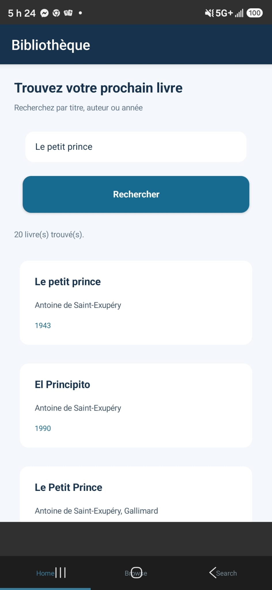
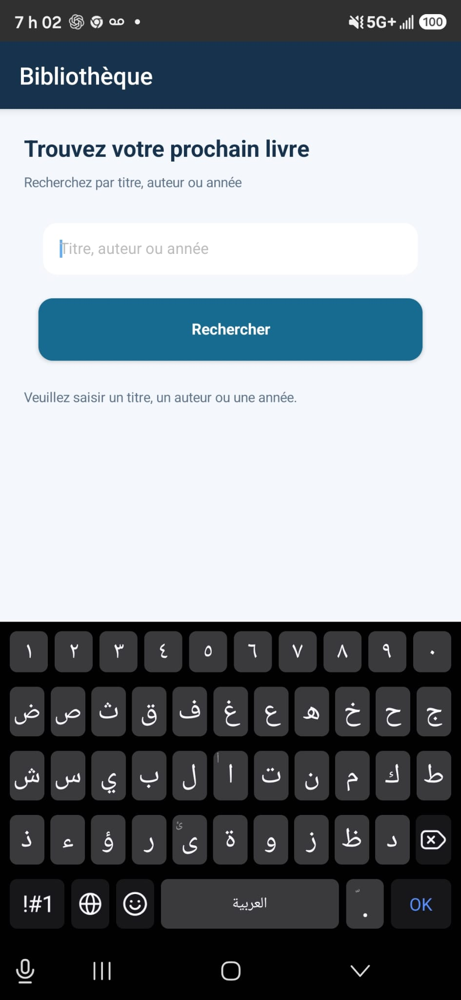
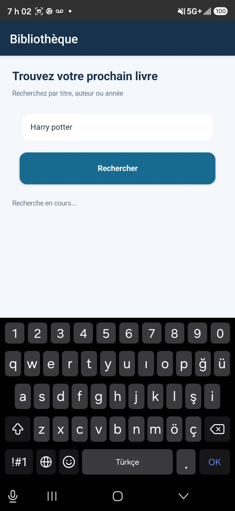

# Bibliothèque — Recherche de livres

## Présentation du projet

Bibliothèque est une application mobile Android développée avec NativeScript et Angular. Elle permet de rechercher des livres en saisissant un titre, un auteur ou une année, puis de consulter les résultats dans une liste.

Les informations sur les livres sont obtenues depuis l’API publique Open Library.

## Fonctionnalités

- Recherche de livres à partir d’un mot-clé.
- Vérification de la saisie avant de lancer une recherche.
- Affichage d’un message pendant le chargement.
- Présentation des résultats sous forme de cartes.
- Affichage du titre, des auteurs et de la première année de publication.
- Message adapté lorsqu’aucun livre n’est trouvé ou lorsqu’une erreur survient.

## Technologies utilisées

| Technologie | Utilisation |
| --- | --- |
| NativeScript | Création et exécution de l’application Android. |
| Angular | Organisation des composants, des services et de l’interface. |
| TypeScript | Programmation de la logique de l’application. |
| RxJS | Traitement asynchrone de la réponse de recherche. |
| HttpClient | Envoi de la requête à l’API Open Library. |

## Fonctionnement de l’application

### 1. Recherche sans saisie

Si l’utilisateur appuie sur *Rechercher* sans écrire de titre, d’auteur ou d’année, l’application lui demande de remplir le champ. Aucune recherche n’est envoyée dans ce cas.

![Message affiché lorsque le champ est vide]

### 2. Recherche en cours

Après la saisie d’un mot-clé, l’application affiche *« Recherche en cours... »* pendant qu’elle attend la réponse de l’API.

![Recherche en cours]

### 3. Affichage des résultats

Lorsque la réponse arrive, les livres trouvés s’affichent dans une liste. Chaque carte contient le titre du livre, ses auteurs lorsqu’ils sont disponibles et sa première année de publication.

La recherche *« Le petit prince »* a permis de vérifier l’affichage des résultats sur un appareil Android.

![Liste des livres trouvés]

 

## Utilisation de l’API et de RxJS

Le service de recherche interroge l’adresse https://openlibrary.org/search.json. Il transmet le texte saisi par l’utilisateur et demande les informations nécessaires à l’affichage des livres.

La requête retourne un observable. Le composant s’abonne à cet observable avec subscribe() pour recevoir les résultats ou traiter une erreur. Une limite de temps évite qu’une recherche reste indéfiniment en cours si l’API ne répond pas.

## Structure des principaux fichiers

| Fichier dans b300159195 | Rôle |
| --- | --- |
| src/app/home/home.component.html | Champ de recherche, bouton, messages et liste des livres. |
| src/app/home/home.component.ts | Gestion de la saisie et des résultats de recherche. |
| src/app/shared/book-search.service.ts | Communication avec l’API Open Library. |
| src/app/shared/book.ts | Structure des informations d’un livre. |
| src/app/app-routing.module.ts | Navigation vers la page principale de l’application. |
| images/ | Captures d’écran utilisées dans ce README. |

## Lancer l’application

Ouvrir un terminal dans le dossier b300159195, puis exécuter :

bash
npm install
ns run android

Un appareil Android connecté ou un émulateur configuré est nécessaire. Une connexion Internet est requise pour effectuer les recherches.

## Bilan

Ce projet met en pratique la création d’une interface mobile avec NativeScript et Angular, l’utilisation d’une API externe et le traitement asynchrone des données avec RxJS. L’application gère également la saisie vide, l’attente de la réponse et l’affichage des résultats.