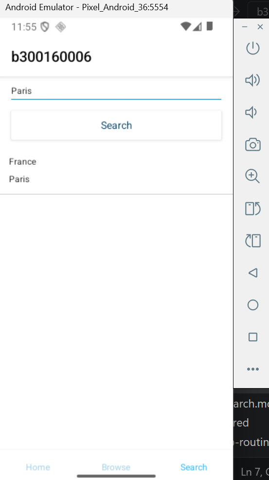
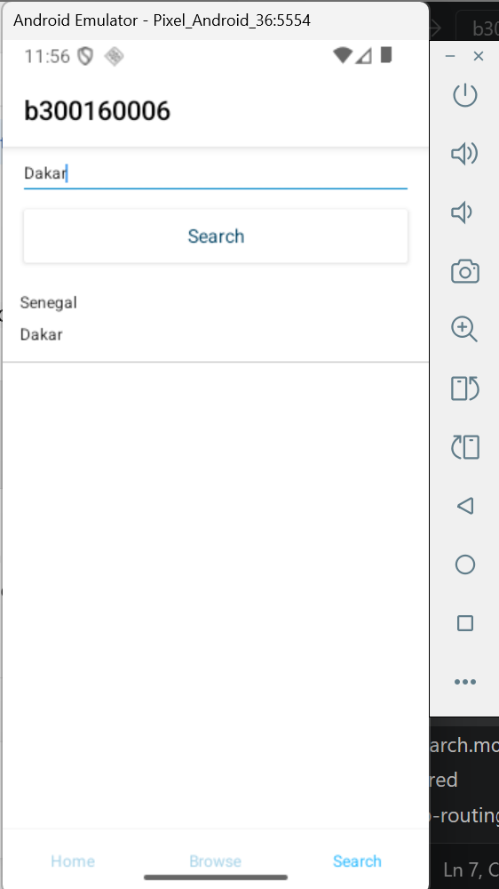

# 300160006
  # TP – Application mobile NativeScript et RxJS

## 1. Présentation du projet

Dans le cadre de ce TP, nous avons réalisé une application mobile avec **NativeScript, Angular et TypeScript**.

L'objectif principal est de permettre à l'utilisateur de rechercher un pays à partir du nom de sa capitale en utilisant une API externe.

L'application est organisée en trois onglets :

- **Home :** page d'accueil de l'application.
- **Browser :** onglet de navigation.
- **Search :** page permettant de rechercher un pays à partir de sa capitale.

## 2. Objectifs du TP

Ce travail nous a permis de pratiquer plusieurs notions :

- Créer et organiser des composants Angular.
- Utiliser les modules et le système de navigation.
- Communiquer avec une API à l'aide de HttpClient.
- Comprendre le fonctionnement des Observables avec RxJS.
- Transformer les données reçues avec l'opérateur `map`.
- Gérer les erreurs avec `catchError`.
- Afficher les résultats dans une liste NativeScript.

## 3. Fonctionnement de l'application

Dans l'onglet Search, l'utilisateur saisit le nom d'une capitale dans un champ de texte, puis clique sur le bouton **Search**.

L'application effectue les opérations suivantes :

1. Récupération du nom de la capitale saisie.
2. Envoi d'une requête HTTP à l'API.
3. Réception des données sous forme de réponse JSON.
4. Traitement des données avec RxJS.
5. Affichage du nom du pays et de sa capitale dans une liste.

## 4. Technologies et outils utilisés

| Technologie | Utilisation |
|---|---|
| NativeScript | Développement de l'application mobile |
| Angular | Organisation des composants et des modules |
| TypeScript | Écriture du code |
| RxJS | Gestion des données asynchrones |
| HttpClient | Communication avec l'API |
| API REST | Récupération des informations sur les pays |

## Amélioration de l'interface Search

L'interface de recherche a été améliorée afin de la rendre plus claire et agréable à utiliser.

Les améliorations apportées sont :
- Ajout d'un titre et d'une courte description en français.
- Ajout d'icônes pour faciliter la compréhension.
- Amélioration du champ de saisie de la capitale.
- Ajout d'un bouton « Rechercher ».
- Présentation des résultats avec le nom du pays et sa capitale.

Cette amélioration a été réalisée directement dans le fichier HTML NativeScript, sans utiliser de CSS, car cette partie sera étudiée dans un prochain cours.
![images alt ](
## 5. Difficultés rencontrées

Pendant la réalisation du TP, nous avons rencontré plusieurs difficultés :

**1. Problème de composant standalone**

Angular indiquait que `SearchComponent` était un composant autonome et ne pouvait pas être déclaré dans `SearchModule`. Pour résoudre ce problème, nous avons ajouté `standalone: false` dans le décorateur `@Component`.

**2. Configuration des modules**

Nous avons dû vérifier les modules nécessaires, notamment `NativeScriptFormsModule`, afin de pouvoir utiliser `ngModel` dans le champ de saisie.

**3. Communication avec l'API**

Nous avons dû comprendre comment envoyer une requête HTTP et récupérer les informations retournées par l'API.

**4. Compréhension de RxJS**

L'utilisation des Observables et des opérateurs `map`, `catchError` et `subscribe` a demandé un effort de compréhension, notamment pour savoir comment récupérer, transformer et afficher les données.

## 6. Ce que nous avons appris

Grâce à ce TP, nous avons mieux compris :

- Comment une application mobile peut communiquer avec une API externe.
- Comment organiser un projet Angular avec des composants et des modules.
- Comment utiliser HttpClient pour récupérer des données.
- Comment RxJS permet de traiter les réponses de manière asynchrone.
- Comment afficher les résultats dans une interface NativeScript.

## 7. Conclusion

Ce TP nous a permis de mettre en pratique nos connaissances en NativeScript, Angular et RxJS. Nous avons appris à créer une fonctionnalité de recherche, à communiquer avec une API et à afficher les données récupérées.

Malgré les difficultés rencontrées, notamment avec la configuration des composants et la gestion des Observables, ce travail nous a permis de mieux comprendre le développement d'une application mobile.
