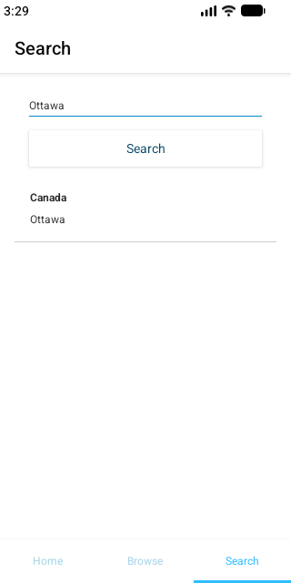

# TP 5.RxJS — Recherche par capitale

INF1083 · Yanis Belhadi · 300160733

## Lancer le projet

Démarrer l’émulateur Android `Boreal_TP4` puis exécuter les commandes suivantes depuis ce dossier.

~~~powershell
cd b300160733
npm ci
npm exec --no -- ngc --noEmit
npx --yes nativescript@9.1.2 run android
~~~

## Fonctionnement

Dans l’onglet **Search**, le champ **Capital** met à jour la saisie avec `ngModel`. Le bouton **Search** appelle `ApicallService`, qui envoie une requête HTTP à `https://countries.nexperts.nl/capital/` avec la capitale encodée dans l’URL.

Le service utilise `HttpClient` et l’opérateur RxJS `map` pour convertir la réponse en `Observable<Country[]>`. La `ListView` affiche le nom du pays et sa capitale. L’écran signale aussi une absence de résultat ou une erreur de requête. Le projet utilise `provideNativeScriptHttpClient()` et `NativeScriptFormsModule` avec Angular 22.

## Test sur Boreal_TP4

Sur l’émulateur Android, j’ai saisi **Ottawa** dans **Capital** et appuyé sur **Search**. La liste a affiché **Canada** et **Ottawa**. La requête a abouti sans erreur.

[Consignes du TP 5.RxJS](../)
