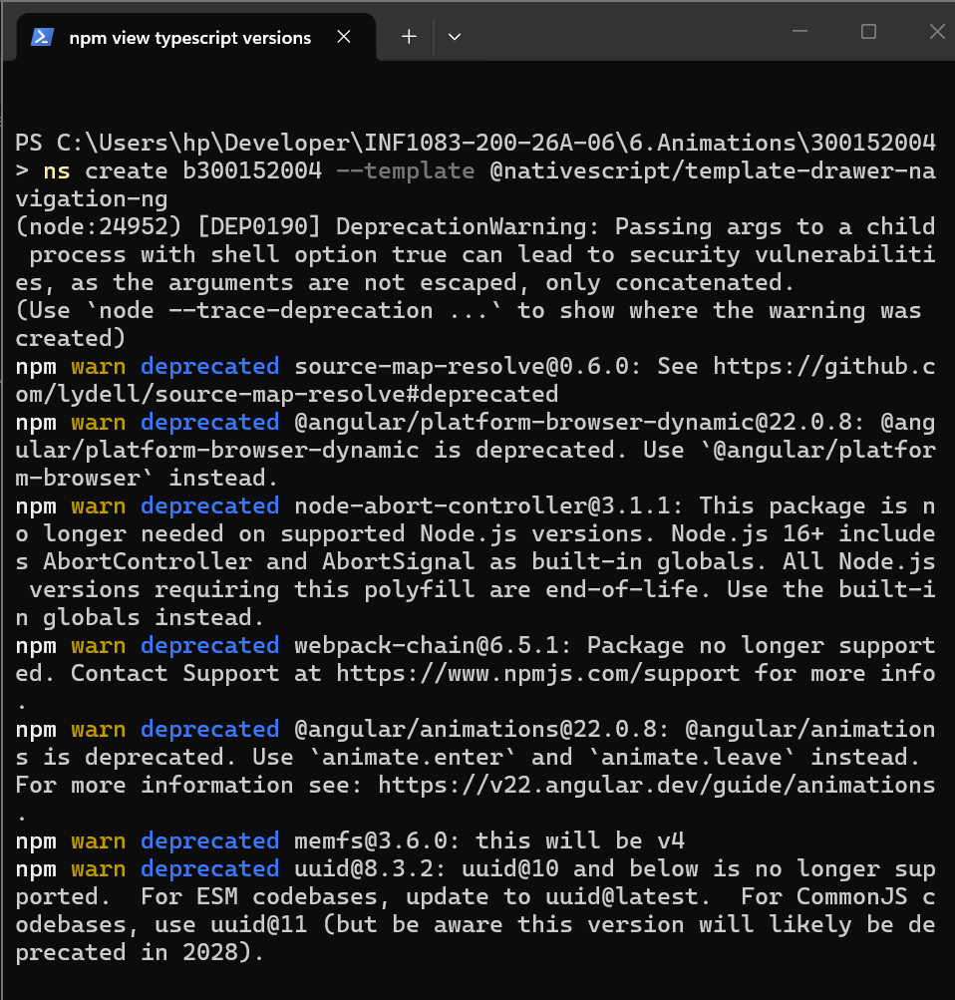
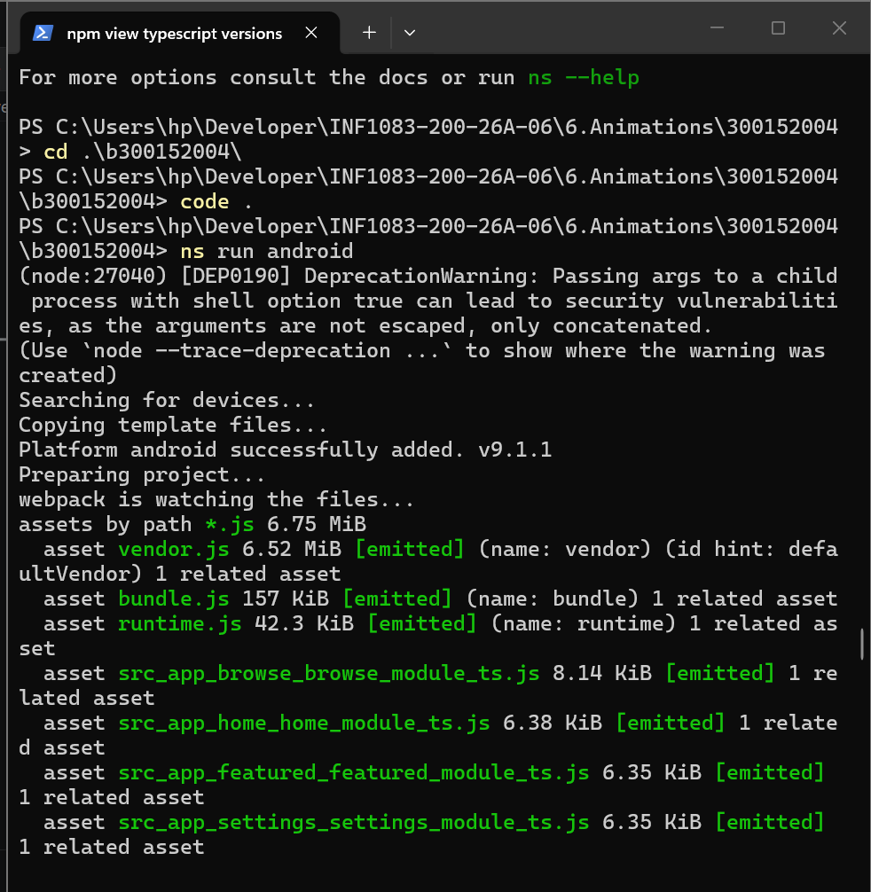
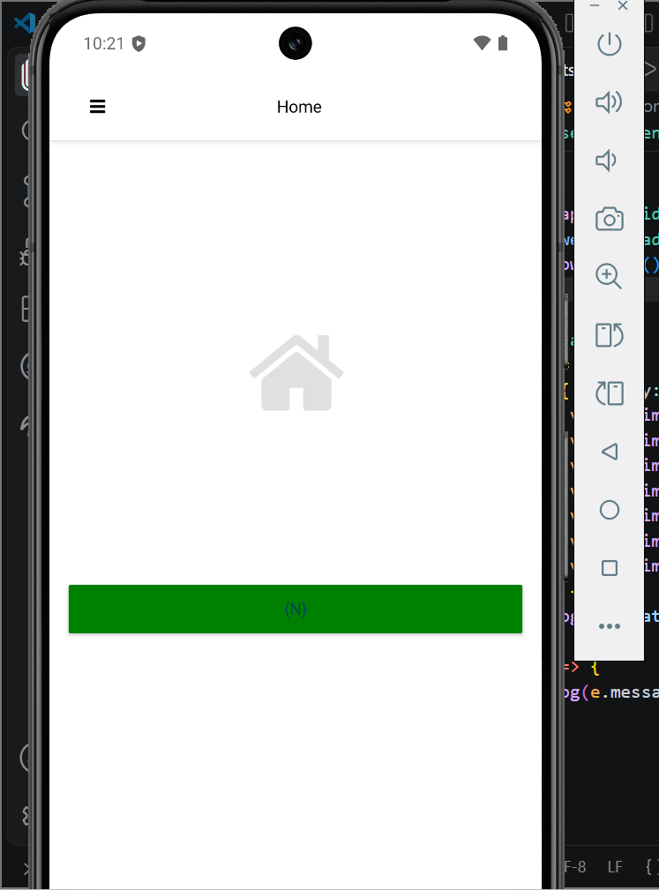
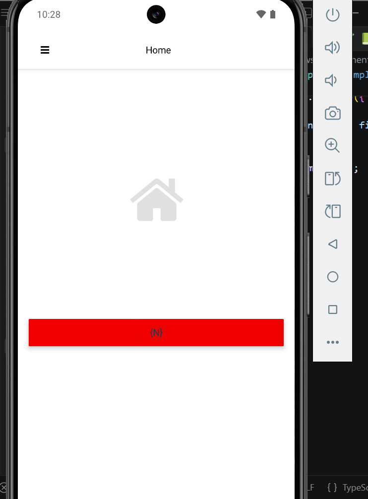

# Animations NativeScript
# 300152004

Étape 1 Créer le projet

Je me place dans mon dossier `300152004` et je crée le projet avec la commande `ns create b300152004 --template @nativescript/template-drawer-navigation-ng`, un modèle avec menu tiroir, Angular et SCSS. Les avertissements `npm warn deprecated` ne bloquent rien : ils concernent seulement des paquets du modèle qui sont devenus obsolètes.

Étape 2 Ouverture du projet et lancement sur Android

Je me déplace dans le dossier `b300152004` avec `cd`, j'ouvre le projet dans VS Code avec `code .`, puis je lance l'application avec `ns run android`. NativeScript ajoute la plateforme Android (version 9.1.1) et webpack compile les modules de l'application, notamment `home`, `browse`, `featured` et `settings`.

Étape 3 Animation déclarative (CSS)

Dans `home.component.html`, je remplace le libellé par défaut par un bouton `<Button text="{N}" class="background">`. Je crée ensuite le fichier `home.component.scss`, où je définis une animation `@keyframes bgAnimation` qui fait passer la couleur de fond du rouge au vert. La classe `.background` applique cette animation avec une durée de 2 secondes et la propriété `animation-fill-mode: forwards`, ce qui garde le bouton vert à la fin. Pour que le style soit pris en compte, j'ajoute enfin `styleUrls: ["./home.component.scss"]` dans le décorateur `@Component` de `home.component.ts`.
Au lancement de la page Home, le bouton `{N}` est vert, c'est-à-dire la couleur de départ de l'animation.

Après 2 secondes, le bouton est devenu rouge et le reste, ce qui confirme que l'animation déclarative fonctionne.
