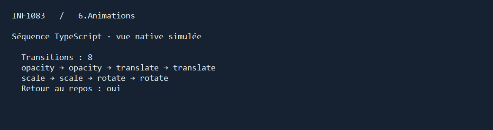

# Deux façons d’animer une vue

Zakaria Mamssi · INF1083 · Groupe 06

Patron Angular à tiroir avec nativescript-ui-sidedrawer. Sur la page Couleur, les images clés CSS font passer le bouton du rouge au vert en deux secondes. La page Mouvement enchaîne opacité, translation, échelle et rotation en TypeScript.

## Code source

Télécharger et extraire [b300155462.zip](b300155462.zip) avant de lancer les commandes.

## Exécution

Avec Node.js, npm, la CLI NativeScript et un appareil Android ou un émulateur configuré, depuis ce dossier :

```powershell
cd b300155462
npm install
ns run android
```

## Vérification sur appareil

Ouvrir le menu et sélectionner Mouvement. Appuyer sur Animer. Le Z doit revenir à son état initial et le bouton redevenir actif.

## Vérification effectuée

Capture des résultats locaux — Séquence TypeScript · vue native simulée.


