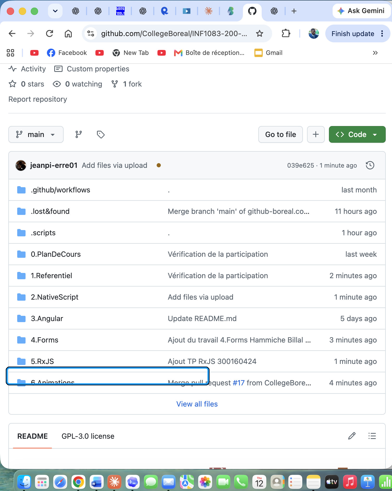
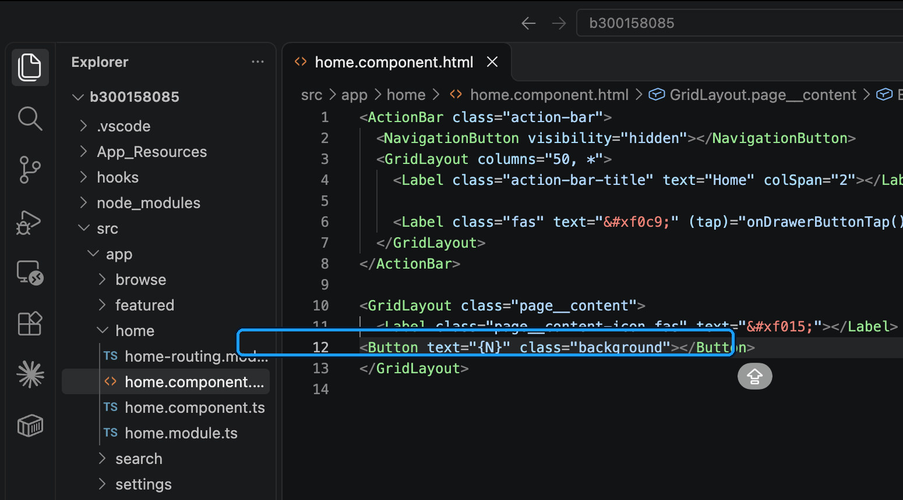
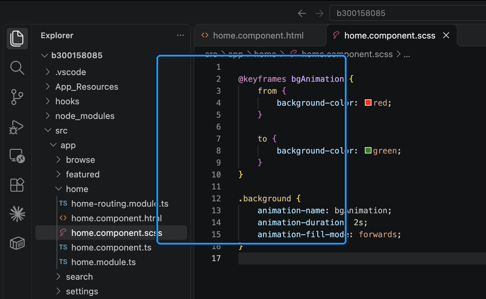
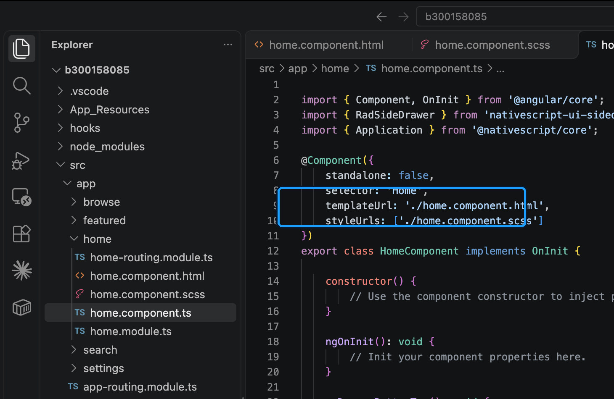
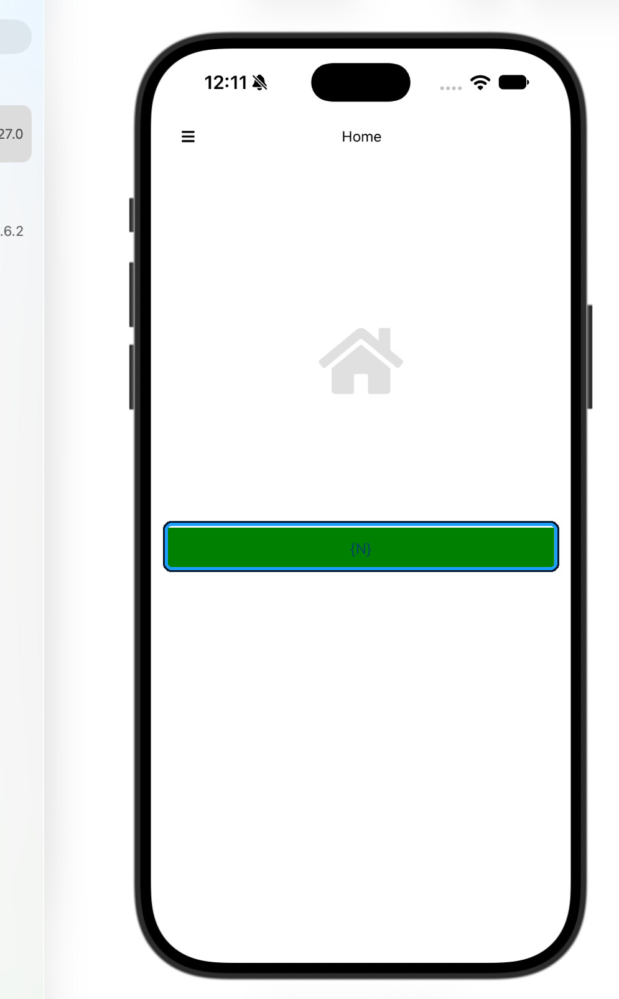
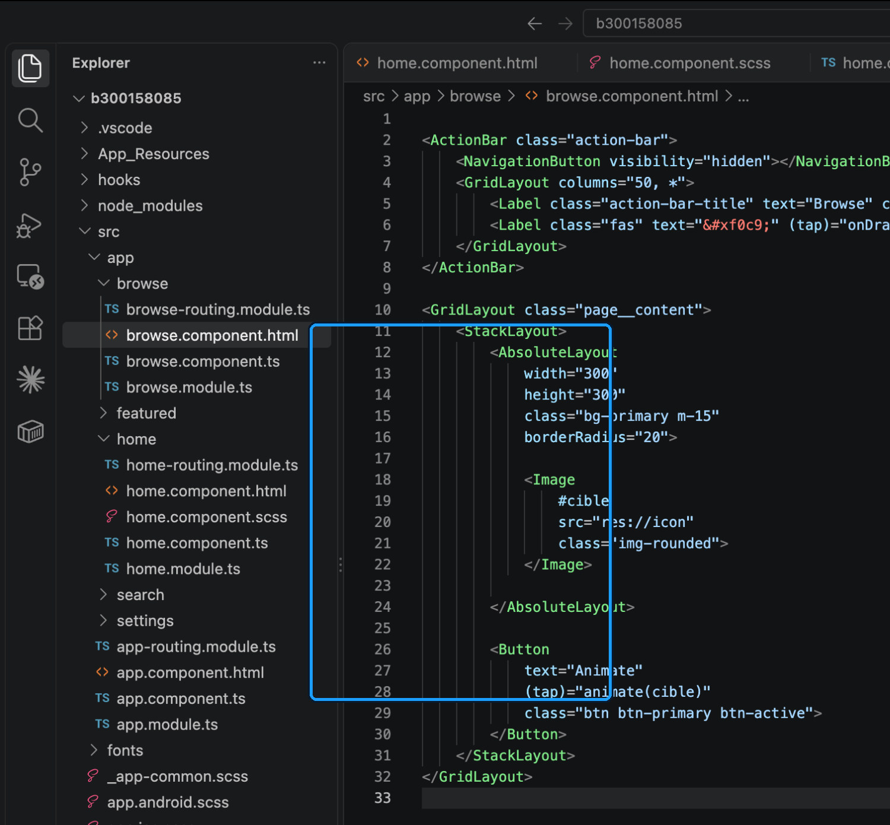
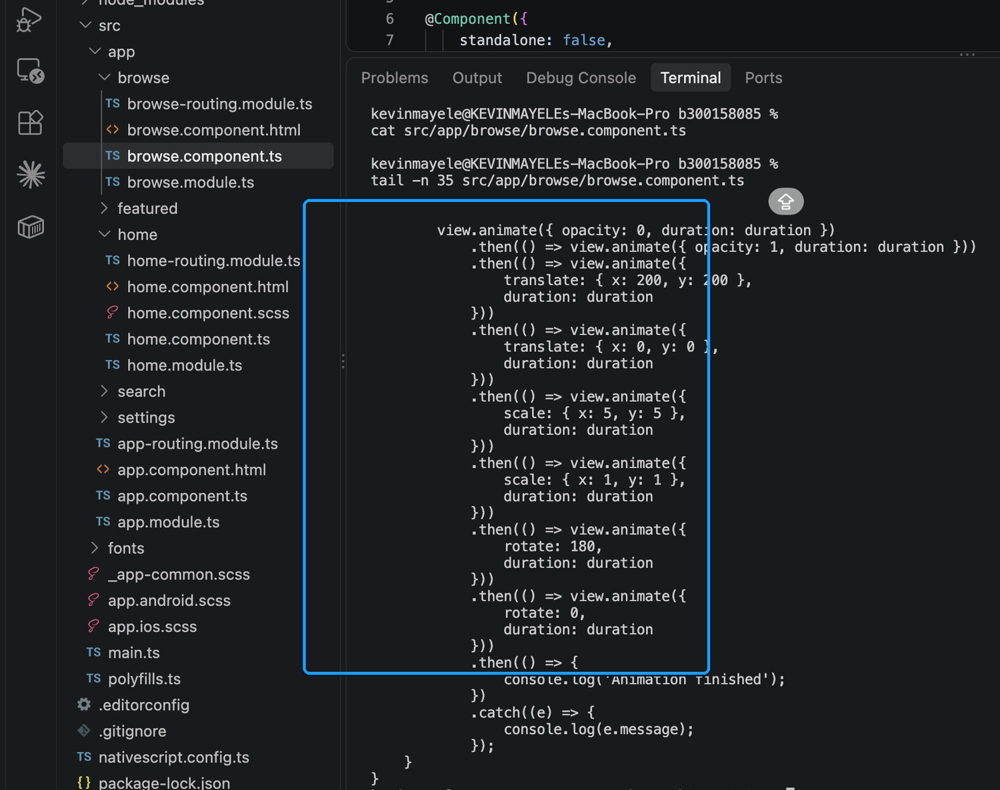
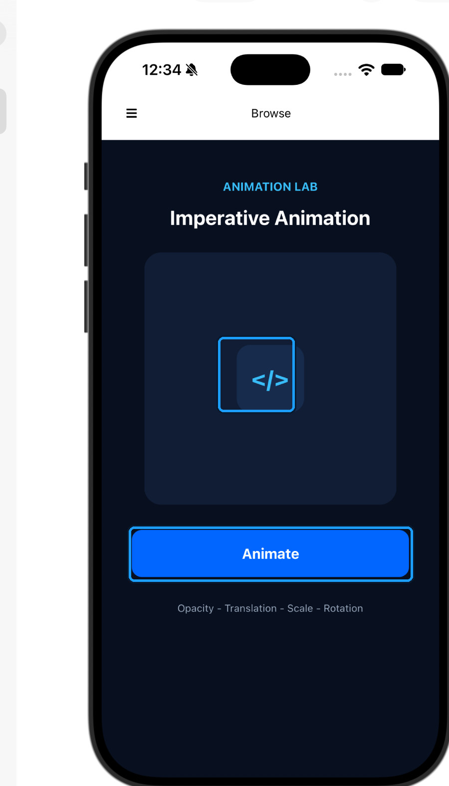
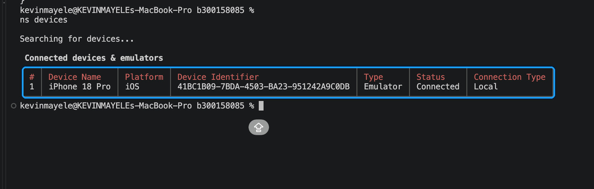
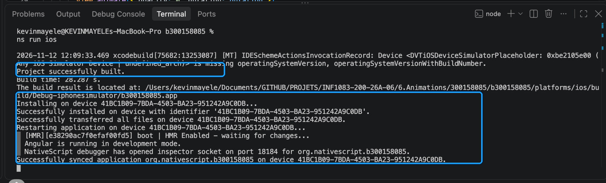

# INF1083 - Animations NativeScript Angular

**Collège Boréal | Techniques des systèmes informatiques**  
**Étudiant :** Kevin Mayele  
**Numéro étudiant :** 300158085  
**Projet :** `b300158085`  
**Environnement de test :** macOS - iPhone 18 Pro Simulator (iOS 27.0)

---

## 1. Objectif du laboratoire

Ce laboratoire porte sur l'implémentation de deux méthodes d'animation dans une application mobile développée avec NativeScript Angular.

Les deux approches étudiées sont :

- **Animation déclarative :** une transition de couleur définie avec `@keyframes` dans un fichier SCSS.
- **Animation impérative :** une séquence de transformations exécutée depuis un composant TypeScript après une interaction avec l'utilisateur.

Les comportements et les durées demandés dans les consignes ont été conservés. Des améliorations ont ensuite été apportées à la présentation, à la fluidité et à la gestion des interactions.

## 2. Préparation du répertoire

Le laboratoire se trouve dans le dépôt GitHub du cours INF1083, sous le répertoire `6.Animations`.

Le dossier étudiant `300158085`, contenant initialement un fichier `README.md` et un dossier `images`, a été récupéré depuis le dépôt distant.

Cette opération a été réalisée sans fusionner les modifications locales des laboratoires précédents.



*Figure 1 - Emplacement du laboratoire Animations dans le dépôt GitHub du cours.*

## 3. Création et configuration du projet

Le projet a été créé avec le template NativeScript Angular à navigation latérale demandé dans l'énoncé.

```bash
ns create b300158085 --template @nativescript/template-drawer-navigation-ng
```

Après la création, le projet a été ouvert dans Visual Studio Code :

```bash
cd b300158085
code .
```

Le template contient notamment les composants `Home` et `Browse`, utilisés pour les deux exercices.

### 3.1. Environnement de développement

| Outil | Version |
|---|---|
| Visual Studio Code | 1.141.0 |
| NativeScript CLI | 9.1.1 |
| NativeScript Core | 9.1.3 |
| Node.js | 24.15.0 |
| npm | 11.12.1 |
| Plateforme | iOS |
| Simulateur | iPhone 18 Pro - iOS 27.0 |

La version de NativeScript Core a été vérifiée avec :

```bash
npm list @nativescript/core
```


*Figure 2 - Vérification de NativeScript Core 9.1.3 dans le projet.*

## 4. Animation déclarative - Home

### 4.1. Modification du composant HTML

Dans `home.component.html`, le texte provisoire du template a été remplacé par un bouton NativeScript.

```html
<Button text="{N}" class="background"></Button>
```

La classe `background` permet d'appliquer l'animation CSS au bouton.

La barre d'action, le titre Home et la navigation latérale ont été conservés.



*Figure 3 - Modification de `home.component.html` avec le bouton `{N}`.*

### 4.2. Création du fichier SCSS

Le fichier `home.component.scss` a été ajouté au composant Home.

Il définit une animation nommée `bgAnimation`, qui modifie progressivement la couleur d'arrière-plan du bouton.

```scss
@keyframes bgAnimation {
    from {
        background-color: red;
    }

    to {
        background-color: green;
    }
}

.background {
    animation-name: bgAnimation;
    animation-duration: 2s;
    animation-fill-mode: forwards;
}
```

L'animation passe du rouge au vert en deux secondes.

La propriété `animation-fill-mode: forwards` permet de conserver la couleur finale après la transition.



*Figure 4 - Déclaration `@keyframes` et configuration de la transition CSS.*

### 4.3. Liaison du SCSS au composant Angular

Le fichier de style est associé au composant dans `home.component.ts` avec la propriété `styleUrls`.

```typescript
@Component({
    standalone: false,
    selector: 'Home',
    templateUrl: './home.component.html',
    styleUrls: ['./home.component.scss']
})
```

La propriété `standalone: false`, présente dans le template Angular utilisé, a été conservée.

Cette approche sépare le comportement visuel de la logique TypeScript.



*Figure 5 - Association du fichier SCSS au composant Home.*

### 4.4. Résultat sur le simulateur

L'application a été exécutée sur le simulateur iPhone 18 Pro.

Le bouton `{N}` apparaît en vert après la transition, conformément à l'état final défini dans le fichier SCSS.



*Figure 6 - Résultat final de l'animation déclarative sur iOS.*

## 5. Animation impérative - Browse

### 5.1. Modification du composant HTML

La deuxième partie du laboratoire utilise une animation déclenchée par l'utilisateur.

Le composant Browse contient une zone `AbsoluteLayout`, un élément cible identifié par `#cible` et un bouton permettant d'appeler la méthode `animate()`.

L'implémentation initiale utilisait une image provenant de `res://icon`.

Cette image ne s'affichait pas correctement sur le simulateur iOS, malgré l'exécution de la méthode.

Pour rendre les transformations visibles, elle a été remplacée par un `Label` affichant le symbole `</>`.

```html
<Label
    #cible
    text="&lt;/&gt;"
    width="80"
    height="80"
    left="110"
    top="110"
    color="#38BDF8"
    backgroundColor="#172B4D"
    borderRadius="16"
    fontSize="28"
    fontWeight="bold"
    textAlignment="center"
    verticalAlignment="middle">
</Label>
```

Le déclenchement de l'animation reste associé au bouton :

```html
<Button
    text="Animate"
    (tap)="animate(cible)">
</Button>
```

La référence `#cible` désigne l'élément sur lequel les transformations sont appliquées.



*Figure 7 - Structure du composant Browse et configuration de la cible d'animation.*

### 5.2. Programmation des animations

La méthode `animate(view: View)` permet de modifier les propriétés visuelles de l'élément.

La séquence demandée comprend huit transformations :

| Étape | Transformation | Valeur | Durée |
|---|---|---|---|
| 1 | Disparition | `opacity: 0` | 300 ms |
| 2 | Réapparition | `opacity: 1` | 300 ms |
| 3 | Déplacement | `x: 200, y: 200` | 300 ms |
| 4 | Retour | `x: 0, y: 0` | 300 ms |
| 5 | Agrandissement | `scale: 5` | 300 ms |
| 6 | Taille initiale | `scale: 1` | 300 ms |
| 7 | Rotation | `rotate: 180` | 300 ms |
| 8 | Retour | `rotate: 0` | 300 ms |

La première version utilisait une chaîne de promesses `.then()` pour exécuter les animations successivement.



*Figure 8 - Première implémentation des transformations dans `browse.component.ts`.*

### 5.3. Amélioration de la fluidité

La version finale conserve les huit transformations et leur durée de 300 millisecondes.

L'exécution a été réorganisée avec `async/await` afin de rendre l'enchaînement des mouvements plus lisible.

La courbe `easeInOut` a été ajoutée pour obtenir des accélérations et des décélérations progressives.

```typescript
const duration = 300;
const curve = CoreTypes.AnimationCurve.easeInOut;
```

Cette modification améliore la fluidité sans supprimer les mouvements exigés dans le laboratoire.

### 5.4. Gestion des interactions répétées

Une propriété privée empêche le lancement de plusieurs animations simultanées.

```typescript
private isAnimating = false;
```

Avant chaque exécution, la méthode vérifie si une animation est déjà en cours.

```typescript
if (this.isAnimating) {
    return;
}

this.isAnimating = true;
```

Cette vérification évite les chevauchements lorsque l'utilisateur appuie rapidement plusieurs fois sur le bouton Animate.

### 5.5. Rétablissement de l'état initial

Un bloc `finally` permet de restaurer les propriétés visuelles après la séquence.

```typescript
finally {
    view.opacity = 1;
    view.translateX = 0;
    view.translateY = 0;
    view.scaleX = 1;
    view.scaleY = 1;
    view.rotate = 0;

    this.isAnimating = false;
}
```

L'élément retrouve ainsi sa position, sa taille et son orientation initiales.

Cette remise à zéro permet de rejouer l'animation dans des conditions identiques.

### 5.6. Présentation de l'interface

La page Browse utilise une palette sombre composée de bleu nuit, de bleu électrique et de texte clair.

L'interface distingue trois zones : le titre de la démonstration, l'espace contenant la cible et le bouton de déclenchement.

Le symbole `</>` reste centré dans la zone d'animation lorsque celle-ci n'est pas en cours d'exécution.

Cette présentation rend les transformations plus faciles à observer tout en conservant le fonctionnement demandé.



*Figure 9 - Interface Browse sur iPhone 18 Pro avec la cible et le bouton Animate.*

## 6. Vérification et tests

### 6.1. Détection du simulateur

La commande suivante a été utilisée pour vérifier les appareils disponibles :

```bash
ns devices
```

NativeScript a détecté un simulateur iPhone 18 Pro connecté localement.



*Figure 10 - Détection du simulateur iOS depuis le terminal NativeScript.*

### 6.2. Compilation et installation iOS

L'application a été compilée et exécutée avec :

```bash
ns run ios
```

Le terminal a confirmé la compilation, l'installation et la synchronisation de l'application sur le simulateur.



*Figure 11 - Messages confirmant la compilation et la synchronisation réussies.*

### 6.3. Vérification TypeScript

La commande suivante a été exécutée pour contrôler le code TypeScript :

```bash
npx tsc --noEmit --project tsconfig.json
```

Elle s'est terminée sans afficher d'erreur.


*Figure 12 - Vérification statique TypeScript terminée sans erreur.*

### 6.4. Résultats des tests

| Vérification | Résultat |
|---|---|
| Compilation iOS | Réussie |
| Affichage de Home | Réussi |
| État final de l'animation CSS | Confirmé |
| Affichage de Browse | Réussi |
| Huit transformations impératives | Réussies |
| Fluidité des mouvements | Validée |
| Appuis rapides sur Animate | Aucun chevauchement observé |
| Retour à l'état initial | Validé |
| Vérification TypeScript | Aucune erreur |
| Erreurs pendant les derniers tests | Aucune observée |

Les captures présentent les éléments du code et les résultats statiques. Les mouvements ont été vérifiés directement sur le simulateur pendant l'exécution.

## 7. Organisation du projet

```text
6.Animations/
└── 300158085/
    ├── README.md
    ├── images/
    │   ├── 01-depot-animations.jpg
    │   ├── 02-home-html.jpg
    │   ├── 03-home-scss.jpg
    │   ├── 04-home-typescript.jpg
    │   ├── 05-browse-html.jpg
    │   ├── 06-browse-typescript.jpg
    │   ├── 07-simulateur-connecte.jpg
    │   ├── 08-compilation-ios.jpg
    │   ├── 09-home-resultat.jpg
    │   ├── 10-browse-resultat.jpg
    │   ├── 11-verification-typescript.jpg
    │   └── 12-version-nativescript.jpg
    └── b300158085/
        ├── src/
        │   └── app/
        │       ├── home/
        │       │   ├── home.component.html
        │       │   ├── home.component.scss
        │       │   └── home.component.ts
        │       └── browse/
        │           ├── browse.component.html
        │           └── browse.component.ts
        ├── package.json
        ├── package-lock.json
        └── tsconfig.json
```

Les autres fichiers nécessaires au fonctionnement du template NativeScript sont conservés dans le projet.

Les répertoires générés, notamment `node_modules` et `platforms`, sont exclus du suivi Git par le fichier `.gitignore`.

## 8. Reproduction des tests

Depuis le répertoire du projet :

```bash
cd b300158085
```

Installer les dépendances :

```bash
npm ci
```

Vérifier le code TypeScript :

```bash
npx tsc --noEmit --project tsconfig.json
```

Exécuter l'application sur le simulateur iOS :

```bash
ns run ios
```

Une fois l'application lancée, utiliser le menu latéral pour accéder aux composants Home et Browse.

Sur Home, observer la transition du bouton `{N}`.

Sur Browse, appuyer sur Animate pour déclencher les huit transformations.

## 9. Conclusion

Ce laboratoire m'a permis de mettre en pratique deux approches d'animation avec NativeScript Angular.

L'animation déclarative permet de définir une transition directement dans une feuille de style, tandis que l'animation impérative offre davantage de contrôle sur l'ordre des transformations et les interactions avec l'utilisateur.

Les essais sur iOS ont également permis d'identifier et de corriger un problème d'affichage de la cible animée.

L'ajout d'une courbe de transition, la prévention des exécutions simultanées et le rétablissement des propriétés initiales ont amélioré la stabilité de la démonstration.

Le projet conserve les fonctionnalités demandées dans l'énoncé tout en proposant une interface plus lisible et une exécution plus fluide.

