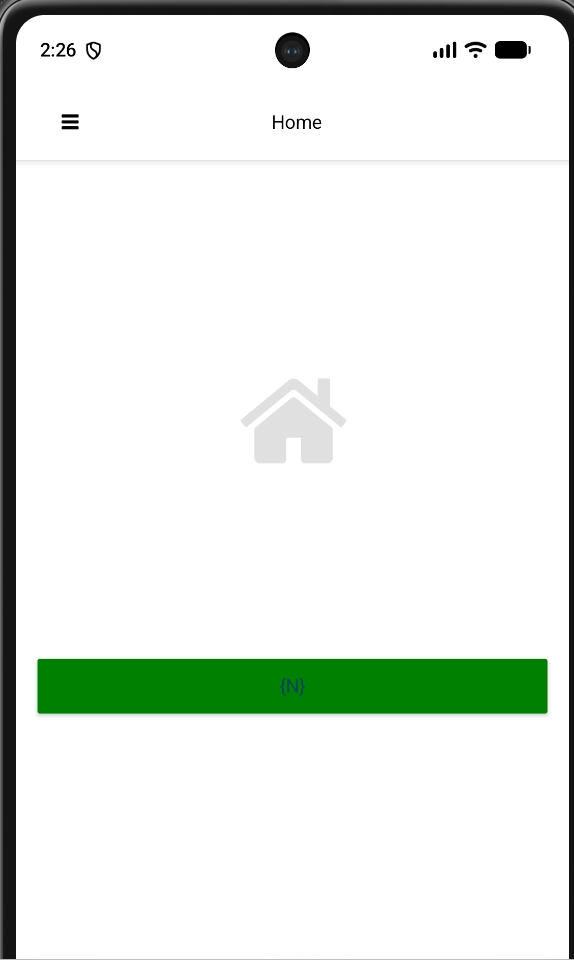

# 🎬 Animations avec NativeScript + Angular

> **Étudiant :** _Ton nom_ — **🆔 :** 300159437
> **Projet :** `b300159437` — template `@nativescript/template-drawer-navigation-ng` (Tiroirs, Angular et SaSS)

Cet exercice présente les deux grands types d'animations dans NativeScript :

| Type | Aussi appelée | Où est-elle définie ? | Composant |
|------|---------------|-----------------------|-----------|
| **Déclarative** | CSS Animation | Dans une feuille de styles (`@keyframes`) | `Home` |
| **Impérative** | Animation par code | Dans le code TypeScript du composant (`view.animate()`) | `Browse` |

---

## 🅰️ Création du projet

```bash
ns create b300159437 --template @nativescript/template-drawer-navigation-ng
cd b300159437
code .
```

Lancer l'application :

```bash
ns run android    # ou : ns run ios
```

---

## 🅱️ Animation déclarative (CSS) — composant **Home**

### 1. Template — `src/app/home/home.component.html`

Le `Label` placeholder est remplacé par un bouton qui porte la classe `background` :

```xml
<Button text="{N}" class="background"></Button>
```

### 2. Styles — `src/app/home/home.component.scss` (nouveau fichier)

```scss
@keyframes bgAnimation {
    from { background-color: red; }
    to { background-color: green; }
}

.background {
    animation-name: bgAnimation;
    animation-duration: 2s;
    animation-fill-mode: forwards;
}
```

- `@keyframes bgAnimation` décrit les étapes : du **rouge** (`from`) au **vert** (`to`).
- `animation-duration: 2s` : la transition dure 2 secondes.
- `animation-fill-mode: forwards` : le bouton **reste vert** une fois l'animation terminée.

### 3. Classe — `src/app/home/home.component.ts`

On relie la feuille de styles au composant avec la propriété `styleUrls` (une liste, qui peut donc contenir plusieurs fichiers `.scss`) :

```ts
@Component({
    selector: "Home",
    templateUrl: "./home.component.html",
    styleUrls: ["./home.component.scss"]
})
```

✅ **Résultat :** au chargement de la page Home, le bouton `{N}` passe du rouge au vert en 2 s.



---

## 🅱️ Animation impérative — composant **Browse**

### 1. Template — `src/app/browse/browse.component.html`

```xml
<StackLayout>
    <AbsoluteLayout width="300" height="300" class="bg-primary m-15" borderRadius="20">
        <Image #cible src="res://icon" class="img-rounded"></Image>
    </AbsoluteLayout>
    <Button text="Animate" (tap)="animate(cible)" class="btn btn-primary btn-active"></Button>
</StackLayout>
```

- `#cible` est une **variable de référence de template** Angular : elle désigne l'`Image`.
- `(tap)="animate(cible)"` : au toucher du bouton (geste _tap_), on passe l'image à la méthode `animate`.

### 2. Classe — `src/app/browse/browse.component.ts`

On importe `View` depuis `@nativescript/core` puis on ajoute la méthode :

```ts
animate(view: View) {
    let duration = 300;
    view.animate({ opacity: 0, duration: duration })
        .then(() => view.animate({ opacity: 1, duration: duration }))
        .then(() => view.animate({ translate: { x: 200, y: 200 }, duration: duration }))
        .then(() => view.animate({ translate: { x: 0, y: 0 }, duration: duration }))
        .then(() => view.animate({ scale: { x: 5, y: 5 }, duration: duration }))
        .then(() => view.animate({ scale: { x: 1, y: 1 }, duration: duration }))
        .then(() => view.animate({ rotate: 180, duration: duration }))
        .then(() => view.animate({ rotate: 0, duration: duration }))
        .then(() => console.log("Animation finished"))
        .catch((e) => console.log(e.message));
}
```

`view.animate()` retourne une **Promise** ; chaque `.then()` lance l'étape suivante une fois la précédente terminée. Ça donne une suite de 8 animations de 300 ms :

| # | Propriété | Effet |
|---|-----------|-------|
| 1–2 | `opacity` 0 → 1 | L'image disparaît puis réapparaît |
| 3–4 | `translate` (200, 200) → (0, 0) | Elle se déplace en diagonale puis revient |
| 5–6 | `scale` ×5 → ×1 | Elle grossit 5 fois puis reprend sa taille |
| 7–8 | `rotate` 180° → 0° | Elle fait un demi-tour puis revient |

À la fin, la console affiche `Animation finished` ; en cas d'erreur, le `.catch()` affiche le message.

✅ **Résultat :** chaque tap sur **Animate** joue la séquence complète sur l'icône.


---

## 🧠 Déclaratif vs Impératif — en bref

- **Déclaratif (CSS)** : simple, lisible, idéal pour des effets visuels automatiques (couleurs, apparition…). On décrit **quoi** animer, pas **comment**.
- **Impératif (code)** : plus de contrôle — déclenchement sur un geste, enchaînement d'étapes, logique conditionnelle, gestion d'erreurs.

---

## 📚 Références

- Anime : https://github.com/m-abs/anime — juliangarnier/anime#617
- NS Animations : https://nativescripting.com/posts/using-angular-animations-in-nativescript
- https://nativescripting.com/posts/animations-using-angular-directives
- Gestures : https://v7.docs.nativescript.org/angular/ui/ng-components/gestures
