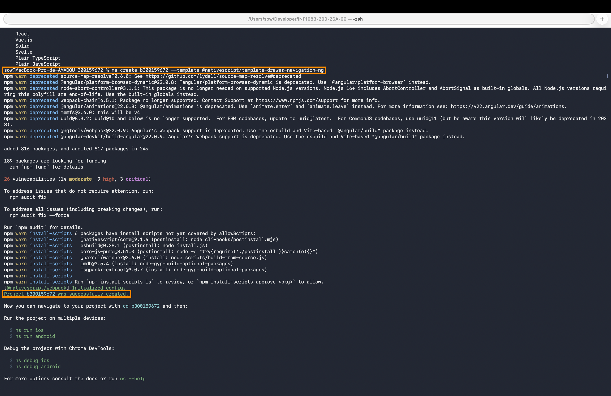
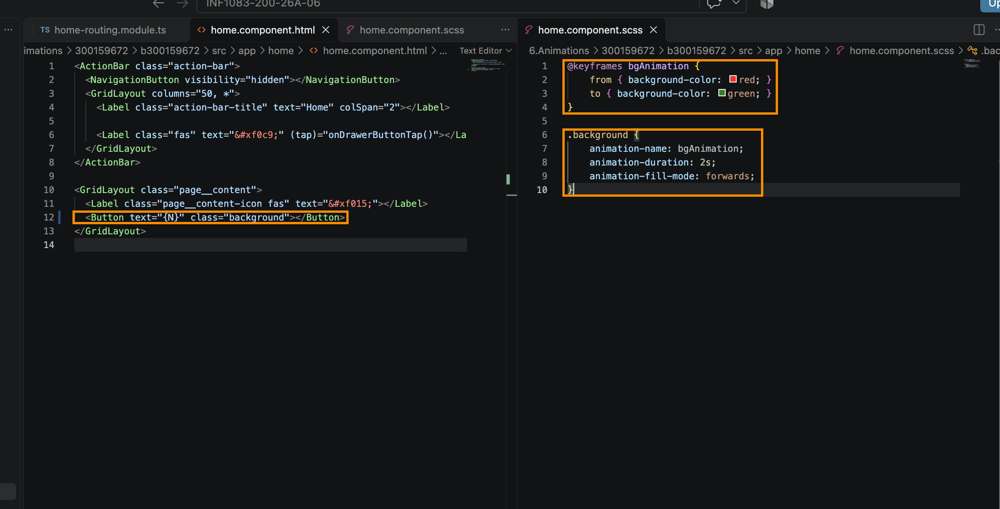
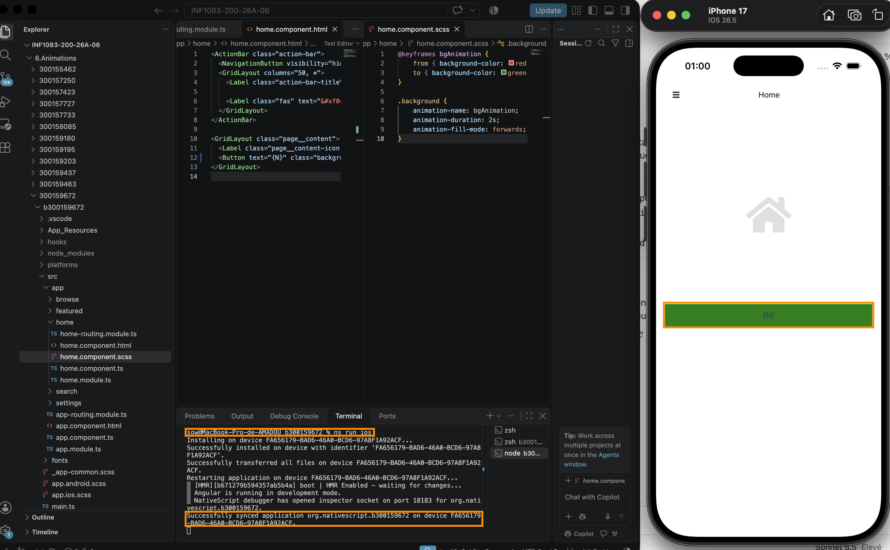
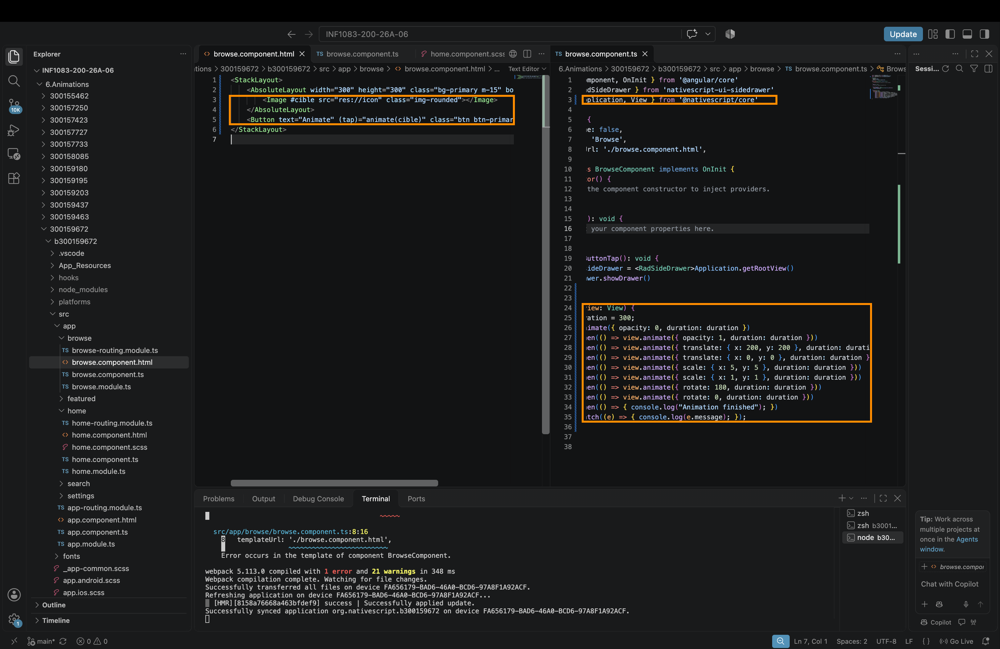
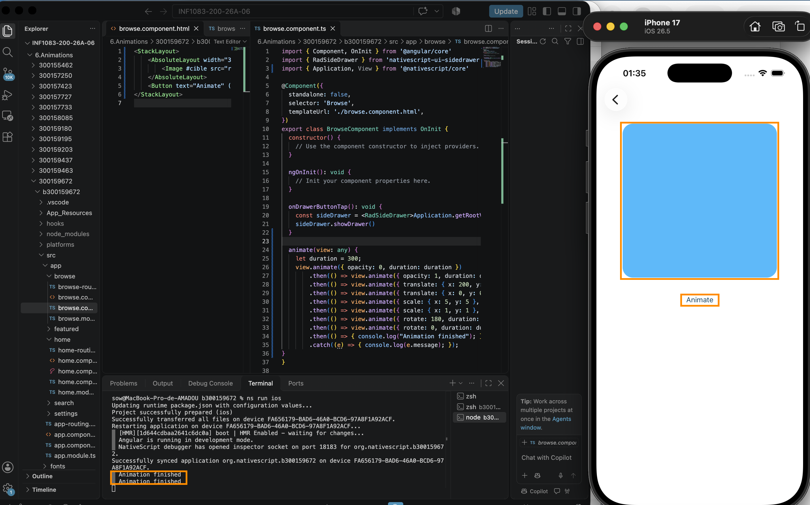

# Laboratoire 6 — Animations

**Cours :** INF1083 — Développement d'application  
**Étudiant :** Amadou Sow  
**Numéro d'étudiant :** 300159672  
**Projet :** b300159672  
**Environnement :** MacBook Pro, VS Code, simulateur iOS (iPhone 17)

## 1. Présentation

Dans ce laboratoire, j'ai créé une application NativeScript + Angular avec un menu latéral (*drawer*) et j'ai réalisé deux animations :

- une animation **déclarative** (CSS) sur la page **Home** : un bouton dont la couleur de fond passe du rouge au vert ;
- une animation **impérative** (code TypeScript) sur la page **Browse** : une image qui s'efface, se déplace, grossit et tourne, au toucher d'un bouton.

## 2. Objectifs

- Comprendre la différence entre une animation déclarative et une animation impérative.
- Définir une animation CSS avec `@keyframes` et les propriétés `animation-*`.
- Animer un composant par le code avec la méthode `animate()` d'une vue NativeScript.
- Enchaîner plusieurs animations avec des promesses (`.then()`).

## 3. Création du projet

J'ai créé mon dossier `300159672` dans `6.Animations`, avec le `README.md` et le dossier `images`. J'ai ensuite créé le projet avec le modèle à menu latéral :

```bash
ns create b300159672 --template @nativescript/template-drawer-navigation-ng
```



## 4. Partie 1 — Animation déclarative (Home)

L'animation est décrite en CSS, dans un fichier `home.component.scss` que j'ai créé et relié au composant avec `styleUrls`.

**`home.component.html`** : j'ai ajouté un bouton avec la classe `background` :

```html
<Button text="{N}" class="background"></Button>
```

**`home.component.scss`** :

```scss
@keyframes bgAnimation {
    from { background-color: red; }
    to { background-color: green; }
}

.background {
    animation-name: bgAnimation;
    animation-duration: 2s;
    animation-fill-mode: forwards;
}
```

**`home.component.ts`** : j'ai ajouté la ligne suivante dans le décorateur `@Component` :

```ts
styleUrls: ["./home.component.scss"],
```

| Propriété | Rôle |
|---|---|
| `@keyframes bgAnimation` | Définit l'état de départ (rouge) et l'état d'arrivée (vert) |
| `animation-name` | Choisit l'animation à appliquer |
| `animation-duration: 2s` | L'animation dure 2 secondes |
| `animation-fill-mode: forwards` | Le bouton reste vert à la fin |



### Résultat

Dans le simulateur, à l'ouverture de la page **Home**, le bouton **{N}** passe du rouge au vert en 2 secondes et reste vert.



## 5. Partie 2 — Animation impérative (Browse)

**`browse.component.html`** : un carré contenant une image, et un bouton **Animate**. L'image a une référence de template `#cible`, passée à la méthode `animate()` au toucher (`tap`) :

```html
<StackLayout>
    <AbsoluteLayout width="300" height="300" class="bg-primary m-15" borderRadius="20">
        <Image #cible src="res://icon" class="img-rounded"></Image>
    </AbsoluteLayout>
    <Button text="Animate" (tap)="animate(cible)" class="btn btn-primary btn-active"></Button>
</StackLayout>
```

**`browse.component.ts`** : j'ai importé `View` et ajouté la méthode `animate()`. Chaque animation démarre quand la précédente est terminée grâce à `.then()` :

```ts
import { Application, View } from '@nativescript/core'

animate(view: any) {
    let duration = 300;
    view.animate({ opacity: 0, duration: duration })
        .then(() => view.animate({ opacity: 1, duration: duration }))
        .then(() => view.animate({ translate: { x: 200, y: 200 }, duration: duration }))
        .then(() => view.animate({ translate: { x: 0, y: 0 }, duration: duration }))
        .then(() => view.animate({ scale: { x: 5, y: 5 }, duration: duration }))
        .then(() => view.animate({ scale: { x: 1, y: 1 }, duration: duration }))
        .then(() => view.animate({ rotate: 180, duration: duration }))
        .then(() => view.animate({ rotate: 0, duration: duration }))
        .then(() => { console.log("Animation finished"); })
        .catch((e) => { console.log(e.message); });
}
```

| Étape | Effet |
|---|---|
| `opacity` 0 puis 1 | L'image disparaît puis réapparaît |
| `translate` (200, 200) puis (0, 0) | L'image se déplace puis revient |
| `scale` 5 puis 1 | L'image grossit puis revient à sa taille |
| `rotate` 180 puis 0 | L'image fait un demi-tour puis revient |



### Résultat

Dans le simulateur, j'ouvre le menu puis **Browse** et je touche **Animate**. L'image enchaîne les huit animations pendant environ 2,4 secondes. À la fin, le terminal affiche `Animation finished`.



## 6. Technologies utilisées

| Élément | Utilité |
|---|---|
| `@keyframes` et `animation-*` (CSS) | Animation déclarative du bouton sur Home |
| `styleUrls` | Relier le fichier `.scss` au composant |
| `view.animate()` (`@nativescript/core`) | Animation impérative d'une vue |
| Promesses (`.then`, `.catch`) | Enchaîner les animations et gérer les erreurs |
| Référence de template `#cible` | Passer l'image à la méthode `animate()` |
| `(tap)` | Lancer l'animation au toucher du bouton |

## 7. Exécution du projet

Depuis le dossier `6.Animations/300159672` :

```bash
cd b300159672
npm install
ns run ios
```

## 8. Difficultés rencontrées

- **Mauvais projet lancé** : mon terminal était dans le projet `b300159672` du laboratoire RxJS (même nom de projet, dossier `5.RxJS`). Le simulateur affichait donc une liste « Item 1, 2, 3… » au lieu de mon bouton. J'ai vérifié le dossier avec `pwd`, puis je me suis placé dans `6.Animations/300159672/b300159672` avant de relancer `ns run ios`.
- **Erreur TypeScript `TS2345`** sur la page Browse : `Argument of type 'HTMLElement' is not assignable to parameter of type 'View'`. Angular considère `#cible` comme un `HTMLElement`. J'ai changé le type du paramètre de `view: View` à `view: any` dans la méthode `animate()`, et l'application se compile.
- **Styles non appliqués sur Home** : il faut ajouter `styleUrls: ["./home.component.scss"]` dans `home.component.ts`, sinon le fichier `.scss` n'est pas pris en compte.
- **Git** : le dépôt de la classe est partagé. J'ai dû faire un `git pull --no-edit` avant chaque `git push` pour récupérer le travail des autres étudiants.

## 9. Ce que j'ai appris

- Une animation **déclarative** se décrit en CSS (`@keyframes`) sans écrire de logique : le système la joue tout seul.
- Une animation **impérative** se pilote par le code avec `view.animate()`, ce qui permet de la déclencher à un moment précis, par exemple au toucher d'un bouton.
- `animate()` retourne une promesse : en enchaînant des `.then()`, chaque animation commence quand la précédente est terminée.
- Il faut toujours vérifier dans quel dossier on lance `ns run ios`, surtout quand plusieurs projets ont le même nom.

## 10. Conclusion

J'ai réalisé les deux types d'animations demandés : un bouton qui passe du rouge au vert avec du CSS sur la page Home, et une image animée par le code sur la page Browse. Ce laboratoire m'a permis de comprendre quand utiliser une animation déclarative ou impérative dans une application NativeScript.
