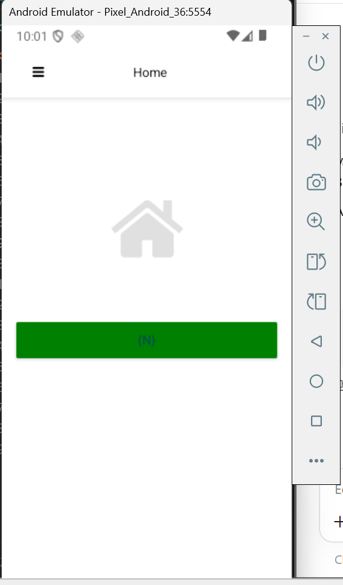
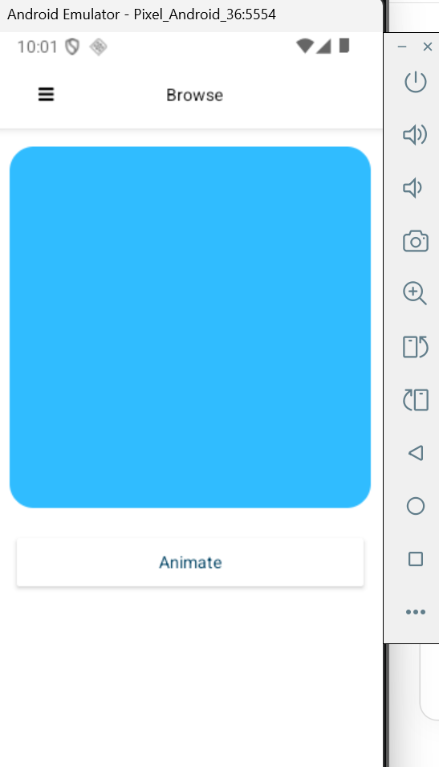

# Animations

**Numéro étudiant :** 300160006
**Projet :** b300160006

## Animation déclarative (Home)

L'animation est faite en CSS. Le bouton `{N}` passe du rouge au vert en 2 secondes.

Fichiers modifiés : `home.component.html`, `home.component.scss` (nouveau) et `home.component.ts` (ajout de `styleUrls`).

## Animation impérative (Browse)

L'animation est faite dans le code TypeScript. Quand on appuie sur le bouton **Animate**, le carré disparaît puis réapparaît, se déplace, grossit et tourne, puis revient à son état normal.

Fichiers modifiés : `browse.component.html` et `browse.component.ts` (nouvelle méthode `animate`).

## Problème rencontré

L'erreur `Argument of type 'HTMLElement' is not assignable to parameter of type 'View'` est apparue. Je l'ai réglée en changeant le paramètre en `animate(target: any)` et en ajoutant `const view = target as View`.
