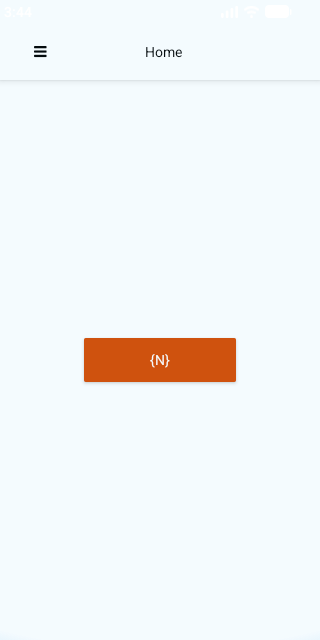
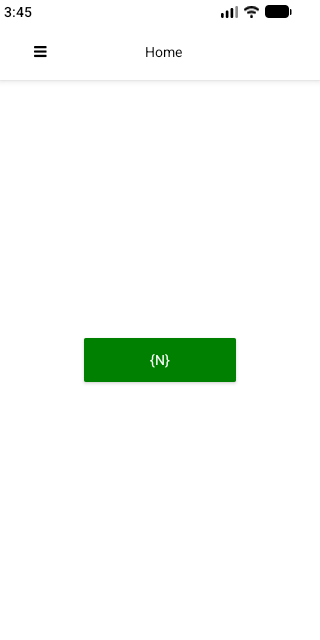
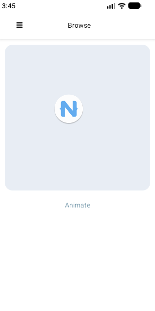
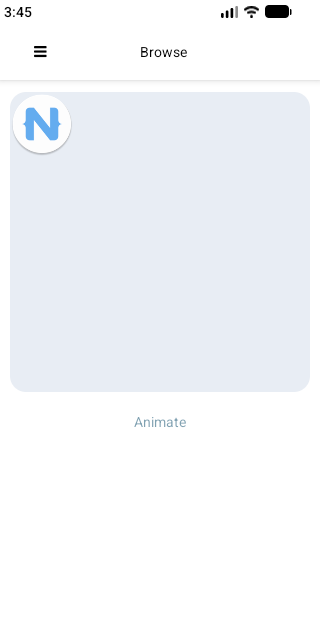

# TP 6.Animations

INF1083 · Yanis Belhadi · 300160733

## Lancer le projet

Démarrer l’émulateur Android `Boreal_TP4`, puis exécuter ces commandes depuis ce dossier.

~~~powershell
cd b300160733
npm ci
npm exec --no -- ngc --noEmit
npx --yes nativescript@9.1.2 run android
~~~

## Home

Le composant charge `home.component.scss` avec `styleUrls`. L’animation `bgAnimation` fait passer le bouton **{N}** du rouge au vert en deux secondes. Le bouton reste vert grâce à `animation-fill-mode: forwards`.

## Browse

Depuis le menu latéral, ouvrir **Browse** et toucher **Animate**. L’image `#cible` est placée dans un `AbsoluteLayout` de 300 × 300. Le composant attend la fin de chaque étape de 300 ms. L’image disparaît, réapparaît, se déplace en (200, 200), revient en (0, 0), passe à l’échelle ×5, revient à ×1, pivote à 180°, puis revient à 0°.

## Résultat du test Android

Sur `Boreal_TP4`, le bouton **{N}** est passé d’une teinte rouge orangé au vert, puis est resté vert. Depuis le menu latéral, j’ai ouvert **Browse** et touché **Animate**. L’image a bougé puis est revenue à son état initial. Logcat a enregistré le message suivant.

~~~text
CONSOLE LOG: Animation finished
~~~

[Consignes du TP 6.Animations](../)
