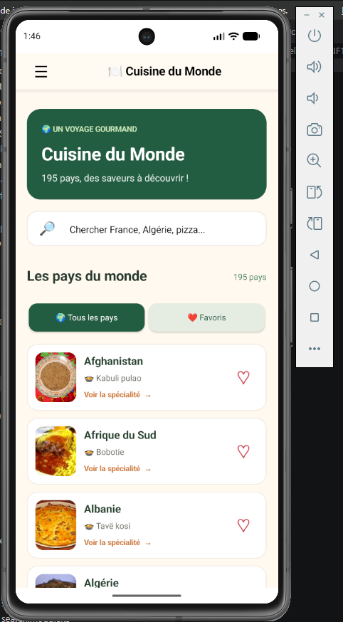
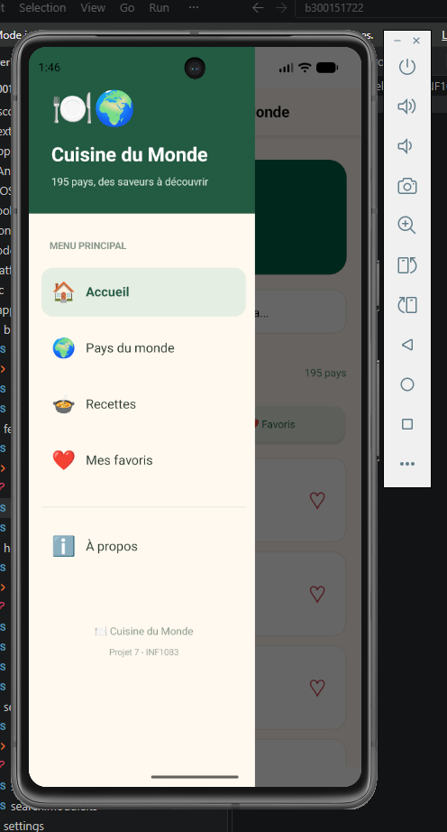
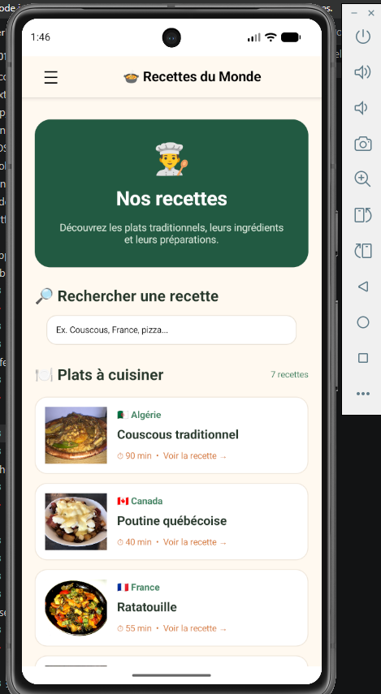
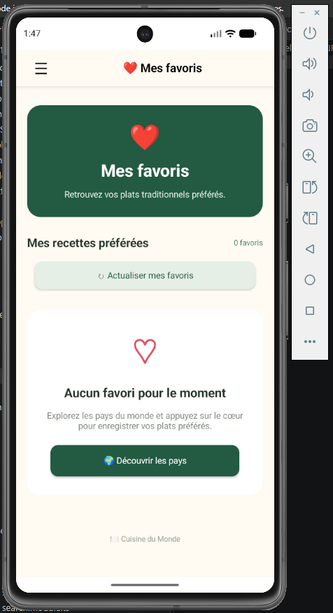

# 🍽️🌍 Cuisine du Monde

## Présentation du projet

**Nom :** Cuisine du Monde  
**Étudiant :** Oustani Islam  
**Numéro étudiant :** 300151722  
**Cours :** INF1083 — Développement d'applications  
**Projet :** 7.Projects  
**Plateforme :** Android

## 🌍 Description

Cuisine du Monde est une application mobile qui permet de découvrir les spécialités culinaires traditionnelles de **195 pays**.

L'utilisateur peut rechercher des pays et des plats, découvrir leurs spécialités, consulter des recettes détaillées et enregistrer ses favoris.

L'application propose également des recherches sur YouTube pour découvrir les méthodes de préparation.

## ✨ Fonctionnalités

- 🌍 Découverte de 195 pays et de leurs spécialités.
- 📸 173 photos de plats téléchargées automatiquement.
- 🔎 Recherche par pays ou spécialité.
- 👨‍🍳 7 recettes détaillées avec ingrédients et étapes de préparation.
- ❤️ Ajout et suppression des favoris, sauvegardés sur l'appareil.
- ▶️ Recherche de vidéos de préparation sur YouTube.
- 📱 Menu personnalisé et interface adaptée à Android.

## 🛠️ Technologies utilisées

- NativeScript
- Angular
- TypeScript
- HTML et SCSS
- Android SDK
- Android Studio et émulateur Pixel 7
- PowerShell
- Git et GitHub

**Template :** `@nativescript/template-drawer-navigation-ng`

**Bibliothèques principales :** `@nativescript/angular`, `@nativescript/core` et `nativescript-ui-sidedrawer`.


## 📸 Captures d'écran

### 1. Accueil — Les pays du monde



### 2. Menu de navigation



### 3. Recettes traditionnelles



### 4. Mes favoris




## 📱 Test de l'application

L'application a été compilée en APK Android et installée avec succès sur un émulateur Pixel 7.

La liste des pays, les photos et la navigation ont été vérifiées sur l'appareil.

## 📷 Photos et crédits

Les images ont été recherchées automatiquement sur Wikimedia Commons.

Les informations relatives aux sources et aux licences sont conservées dans le fichier `b300151722/CREDITS_PHOTOS.md`.

Les pays sans photo disponible conservent leur drapeau. Les images doivent être vérifiées avant une publication publique.

## 🚀 Lancer le projet

Ouvrir PowerShell dans le dossier `b300151722`, puis exécuter :

```powershell
npm install
ns run android
```

Pour générer une APK de test :

```powershell
ns build android
```

## ✅ Conclusion

Ce projet m'a permis de développer une application mobile Android avec NativeScript et Angular, de créer une interface personnalisée, de gérer les favoris et d'intégrer des photos et des recettes traditionnelles du monde entier.
