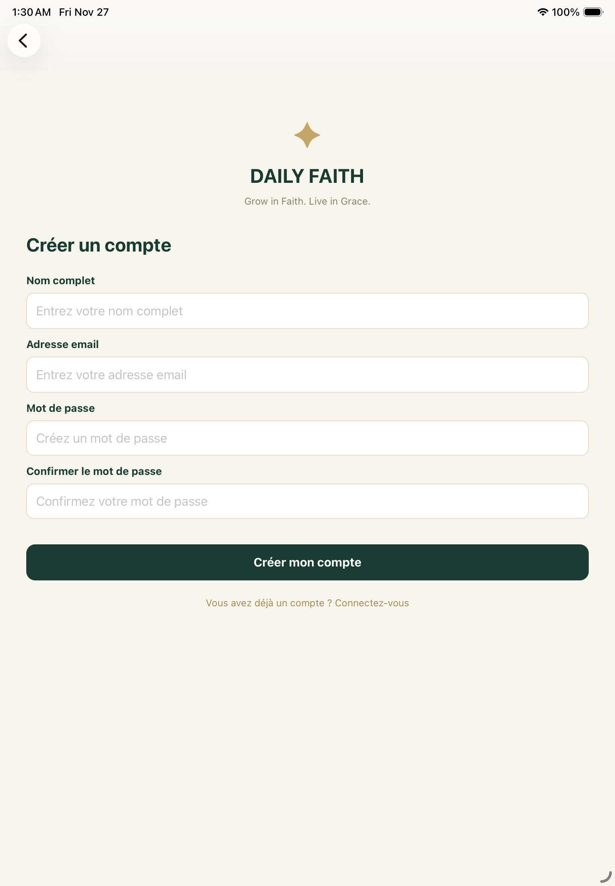
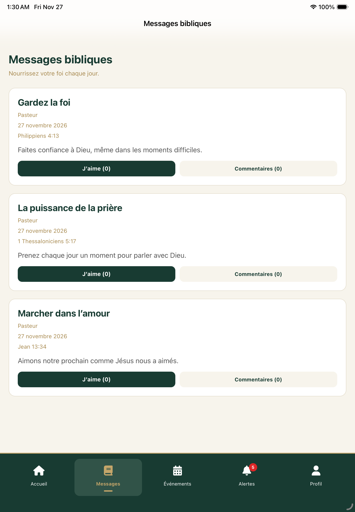
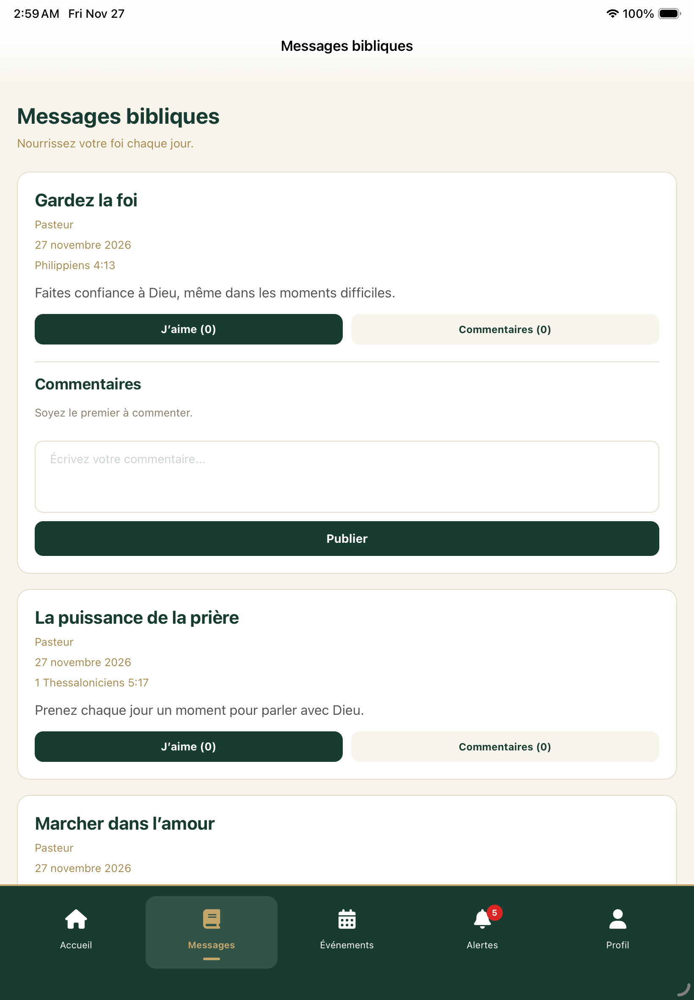
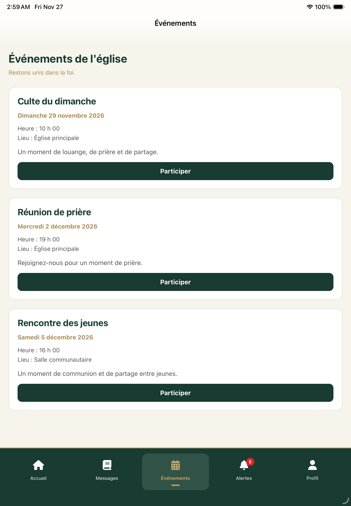
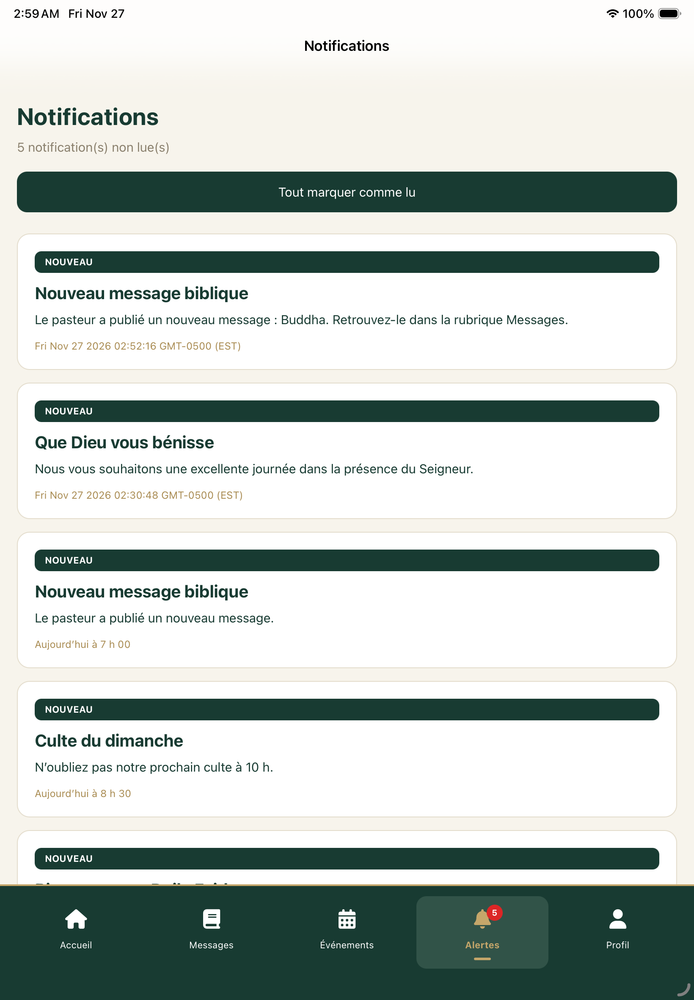
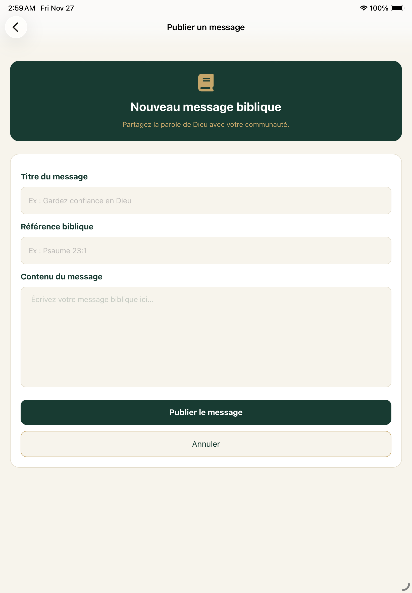
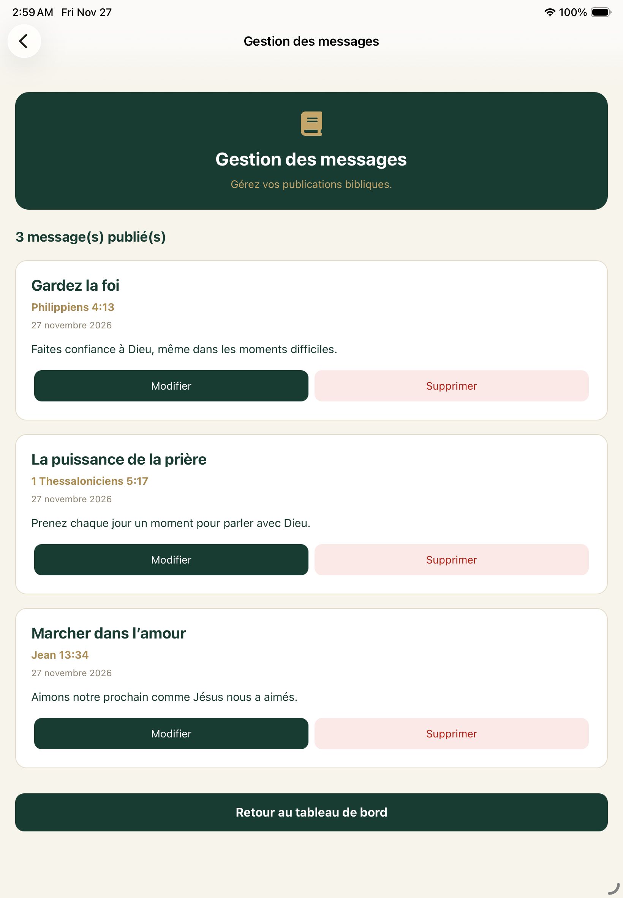
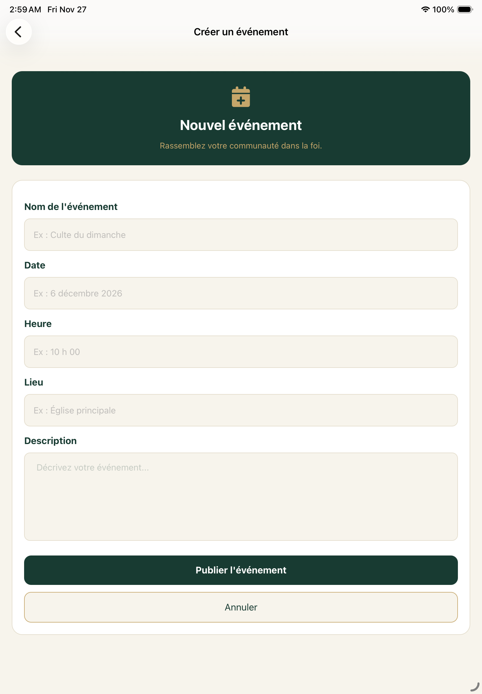
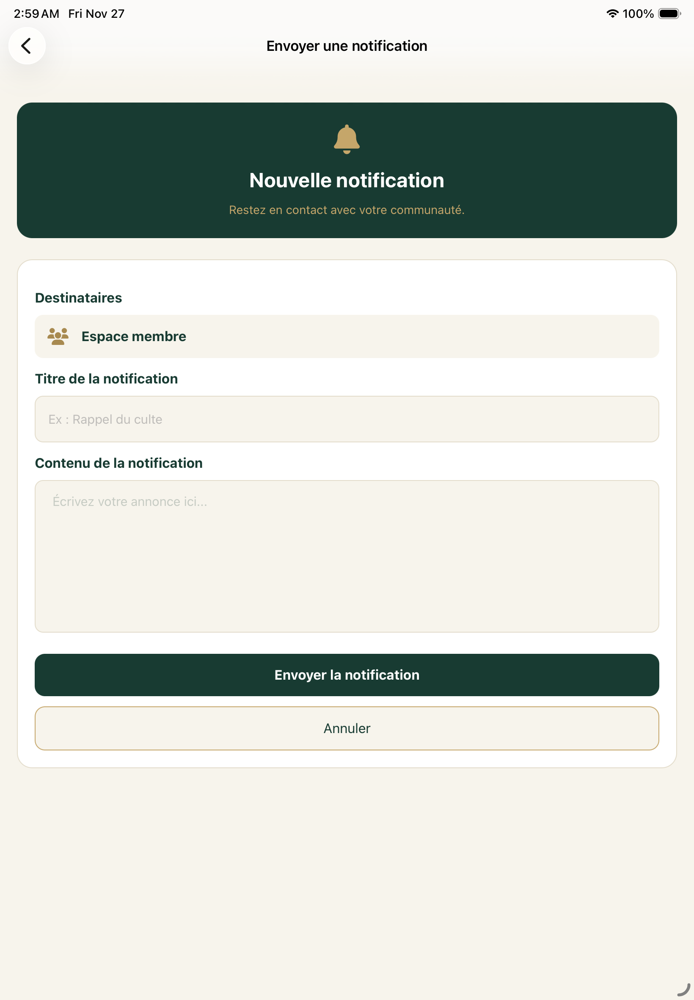

# ✝️ Daily Faith

> Grow in Faith. Live in Grace.

## 👨‍💻 Informations du projet

- **Étudiant :** 300157250
- **Cours :** INF1083 – Développement d'applications
- **Session :** Automne 2026
- **Nom de l'application :** Daily Faith
- **Framework :** NativeScript avec Angular

## 📖 Description du projet

Daily Faith est une application mobile chrétienne conçue
pour renforcer la communication entre les pasteurs et
les membres d'une communauté chrétienne.

Elle permet aux pasteurs de partager des messages bibliques,
de publier des événements et d'envoyer des notifications.

Les membres peuvent consulter les enseignements bibliques,
aimer les publications, ajouter des commentaires et
participer aux événements de l'église.

## 🎯 Objectifs

- Encourager la méditation quotidienne de la Bible.
- Renforcer la communication au sein de l'église.
- Faciliter le partage des enseignements bibliques.
- Informer les membres des activités de l'église.
- Centraliser la gestion des publications et des événements.

## 🛠️ Technologies utilisées

| Technologie | Rôle |
|---|---|
| NativeScript | Développement mobile |
| Angular | Framework applicatif |
| TypeScript | Langage de programmation |
| XML | Interfaces NativeScript |
| CSS | Personnalisation du design |
| Node.js | Environnement de développement |
| Font Awesome | Icônes |
| ApplicationSettings | Stockage local |
| Git et GitHub | Gestion des versions |
| Xcode | Simulation iOS |

## 🧩 Plugins et modules

- `@nativescript/core`
- `@nativescript/angular`
- `@nativescript/tailwind`
- `@fortawesome/fontawesome-free`
- `@angular/router`

## 🏗️ Architecture de l'application

L'application utilise une architecture modulaire basée
sur les composants Angular autonomes (standalone).

### Patrons de conception

- Architecture basée sur les composants.
- Injection de dépendances.
- Services partagés.
- Navigation par routes.
- Guards pour le contrôle d'accès.
- Séparation de la présentation et de la logique métier.

### Structure du code

```text
src/
├── app/
│   ├── admin/
│   │   ├── publish-message/
│   │   ├── manage-messages/
│   │   ├── create-event/
│   │   ├── manage-events/
│   │   └── send-notification/
│   ├── auth/
│   │   ├── login/
│   │   └── register/
│   ├── events/
│   ├── guards/
│   │   ├── auth.guard.ts
│   │   └── admin.guard.ts
│   ├── home/
│   ├── messages/
│   ├── navigation/
│   ├── notifications/
│   ├── profile/
│   ├── services/
│   │   ├── auth.service.ts
│   │   ├── message.service.ts
│   │   ├── event.service.ts
│   │   └── notification.service.ts
│   └── app.routes.ts
└── fonts/
```

## 🎨 Design de l'application

Daily Faith possède une interface moderne, élégante
et inspirée de l'univers chrétien.

| Couleur | Code |
|---|---|
| Vert forêt | `#183B32` |
| Doré | `#C5A66A` |
| Crème | `#F7F4EC` |
| Blanc | `#FFFFFF` |

## 📱 Fonctionnalités et captures d'écran

### 1. Connexion

L'utilisateur peut se connecter avec son adresse email
et son mot de passe.


### 2. Inscription

Les nouveaux membres peuvent créer un compte.
Les informations sont validées et sauvegardées localement.



### 3. Accueil

La page d'accueil présente le dernier message biblique
et les événements de l'église.


### 4. Messages bibliques

Les membres peuvent consulter les enseignements
publiés par le pasteur.



### 5. Likes et commentaires

Les membres peuvent aimer les publications
et ajouter des commentaires.



### 6. Événements

Les membres peuvent consulter les activités
de l'église et confirmer leur participation.



### 7. Notifications

Les membres peuvent consulter les notifications internes
et les marquer comme lues.



### 8. Profil utilisateur

Le profil affiche les informations du membre connecté
et permet de fermer sa session.


## 🔐 Espace administrateur

### 9. Tableau de bord

Le pasteur dispose d'un espace réservé permettant
de gérer les publications et les événements.


### 10. Publication d'un message biblique

Le pasteur peut publier un message contenant un titre,
une référence biblique et un enseignement.



### 11. Gestion des messages

Le pasteur peut modifier ou supprimer les publications.



### 12. Création d'un événement

Le pasteur peut créer un événement en indiquant
son titre, sa date, son heure, son lieu et sa description.



### 13. Gestion des événements

Le pasteur peut modifier ou supprimer les événements.


### 14. Envoi d'une notification

Le pasteur peut créer une notification interne
pour informer les membres.



## 🔑 Comptes de démonstration

### Compte membre

- Email : `test@dailyfaith.com`
- Mot de passe : `123456`

### Compte pasteur

- Email : `admin@dailyfaith.com`
- Mot de passe : `Admin123`

Ces identifiants sont fictifs et réservés à la démonstration.

## 💾 Persistance des données

L'application utilise ApplicationSettings pour conserver :

- Les comptes utilisateurs.
- Les messages bibliques.
- Les likes et les commentaires.
- Les événements.
- Les participations aux événements.
- Les notifications.

Les données restent disponibles après le redémarrage
de l'application sur le même appareil.

## 🚀 Installation et exécution

### Prérequis

- Node.js
- npm
- NativeScript CLI
- Xcode pour iOS
- Android Studio pour Android

### Installation de NativeScript CLI

```bash
npm install -g nativescript
```

### Accéder au projet depuis la racine du dépôt

```bash
cd 7.Projects/300157250/DailyFaith/DailyFaith
```

### Installer les dépendances

```bash
npm install
```

### Vérifier l'environnement

```bash
ns doctor
```

### Lancer sur le simulateur iOS

```bash
ns run ios --emulator
```

### Lancer sur Android

```bash
ns run android
```

### Nettoyer le projet

```bash
ns clean
```

## 🧪 Tests réalisés

| Test | Résultat |
|---|---|
| Connexion membre | Réussi |
| Connexion pasteur | Réussi |
| Création de compte | Réussi |
| Déconnexion | Réussi |
| Publication de messages | Réussi |
| Modification de messages | Réussi |
| Suppression de messages | Réussi |
| Likes et commentaires | Réussi |
| Création d'événements | Réussi |
| Modification d'événements | Réussi |
| Suppression d'événements | Réussi |
| Envoi de notifications internes | Réussi |
| Persistance des données | Réussi |

Les tests ont été réalisés sur un simulateur iPad Air
11 pouces (M3).

## ⚠️ Limites actuelles

Daily Faith est un prototype scolaire.

- Les données sont stockées localement.
- Les mots de passe sont stockés en clair.
- Les sessions sont conservées en mémoire.
- Les notifications ne sont pas des notifications push.
- Les interactions ne sont pas individualisées par compte.
- La synchronisation entre plusieurs appareils
  n'est pas disponible.
- Les Guards sont intégrés, mais les restrictions
  d'accès direct restent à tester.
- L'exécution sur Android reste à vérifier.

## 🔮 Améliorations futures

- Intégration de Firebase.
- Authentification sécurisée.
- Base de données distante.
- Notifications push.
- Publication automatique des versets quotidiens.
- Personnalisation du profil.
- Synchronisation entre plusieurs appareils.
- Gestion de plusieurs communautés chrétiennes.

## 📌 Conclusion

Daily Faith est une application mobile chrétienne
développée dans le cadre du cours INF1083.

Ce projet permet de mettre en pratique le développement
mobile, la navigation, la gestion des données,
les services Angular et la gestion des rôles utilisateurs.

---

**Daily Faith — Grow in Faith. Live in Grace. ✝️**
