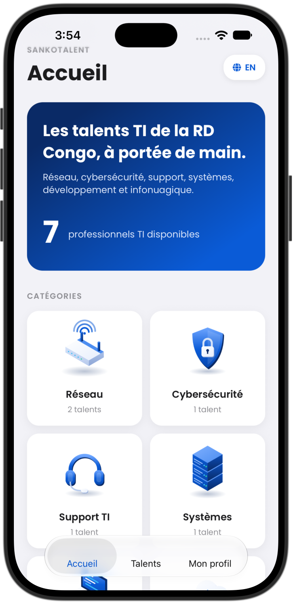
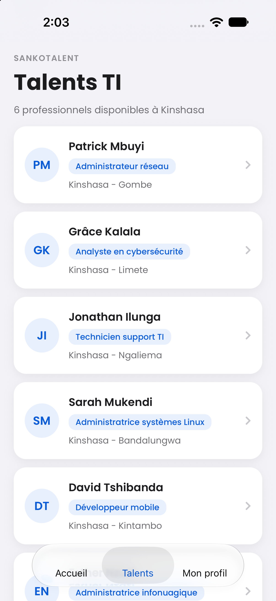
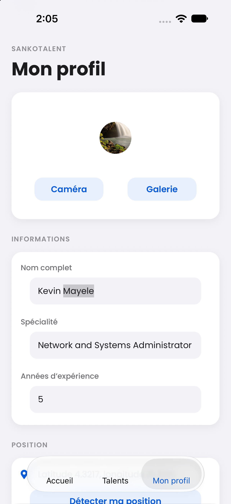

# SankoTalent

**Application mobile bilingue (français / anglais) de mise en relation avec des professionnels des TI en République démocratique du Congo**

| | |
|---|---|
| **Étudiant** | Kevin Mayele |
| **Identifiant** | 300158085 |
| **Cours** | INF1083 |
| **Établissement** | Collège Boréal, campus de Toronto |
| **Technologies** | NativeScript 9, Angular 22, TypeScript |
| **Version** | 1.2 |



---

## Table des matières

1. [Résumé du projet](#1-résumé-du-projet)
2. [Nom de l'application](#2-nom-de-lapplication)
3. [Fonctionnalités](#3-fonctionnalités)
4. [Design](#4-design)
5. [Pages de l'application](#5-pages-de-lapplication)
6. [Animations](#6-animations)
7. [Bilinguisme](#7-bilinguisme)
   - [Liste des talents en ligne, catégories et carte](#7-bis-liste-des-talents-en-ligne-catégories-et-carte)
8. [Template](#8-template)
9. [Plugins](#9-plugins)
10. [Modules NativeScript utilisés sans plugin](#10-modules-nativescript-utilisés-sans-plugin)
11. [Structure du code](#11-structure-du-code)
12. [Environnement de développement](#12-environnement-de-développement)
13. [Installation et lancement](#13-installation-et-lancement)
14. [Difficultés rencontrées et solutions](#14-difficultés-rencontrées-et-solutions)
15. [Fichiers non versionnés](#15-fichiers-non-versionnés)
16. [Historique des versions](#16-historique-des-versions)
17. [Limites connues et évolutions prévues](#17-limites-connues-et-évolutions-prévues)

---

## 1. Résumé du projet

SankoTalent met en relation les entreprises de la République démocratique du Congo avec des professionnels des technologies de l'information : réseau, cybersécurité, support technique, systèmes, développement et infonuagique.

L'application répond à un besoin concret. En RD Congo, une PME qui cherche un administrateur réseau ou un technicien de support passe le plus souvent par le bouche-à-oreille. SankoTalent rassemble ces profils au même endroit, présente pour chacun la spécialité, la ville, l'expérience et les compétences, puis permet de contacter le professionnel en un geste.

Deux types d'utilisateurs sont prévus. Une **entreprise** parcourt les profils, ouvre une fiche et envoie un courriel prérempli. Un **professionnel** crée son profil avec sa photo, sa spécialité, ses années d'expérience et sa position GPS.

L'application est entièrement bilingue, en français et en anglais. Elle reprend les codes visuels d'iOS : grands titres, cartes arrondies, couleur d'accent unique et animations discrètes.

## 2. Nom de l'application

**SankoTalent** associe *Sanko*, tiré de SANKOVEYA, la plateforme de mise en relation dont ce projet est le prototype mobile, et *Talent*, qui résume la mission : rendre visibles les talents TI congolais.

Le nom s'affiche dans l'en-tête de chaque onglet. L'identifiant technique de l'application est `org.nativescript.sankotalent`.

## 3. Fonctionnalités

| Fonctionnalité | Description |
|---|---|
| Annuaire de talents | Professionnels répartis dans plusieurs provinces : Kinshasa, Haut-Katanga, Kasaï-Oriental, Nord-Kivu, Sud-Kivu, Tshopo et Kongo-Central |
| Catégories illustrées | Six domaines des TI présentés par des illustrations 3D originales ; un toucher filtre la liste des talents |
| Liste en ligne | Talents chargés depuis un fichier JSON public sur GitHub, actualisables sans publier de nouvelle version |
| Fiche détaillée | Ville, années d'expérience, adresse courriel et compétences de chaque professionnel |
| Contact par courriel | Courriel prérempli dans la langue de l'utilisateur (plugin email) |
| Carte | Bouton « Voir sur la carte » : la ville du professionnel, ou sa propre position, s'ouvre dans Plans (iPhone) ou Google Maps (Android) |
| Photos du métier | Vraie photo du domaine en bandeau sur la fiche d'un talent et sur la liste filtrée par catégorie |
| Profil personnel | Nom, spécialité, expérience, enregistrés sur l'appareil |
| Photo de profil | Prise avec la caméra ou choisie dans la galerie (plugins camera et imagepicker) |
| Géolocalisation | Détection de la position GPS (plugin geolocation) |
| Bilinguisme | Bascule français / anglais en un geste, mémorisée entre deux lancements |
| Animations | Apparition en cascade, zoom et retour visuel au toucher |

## 4. Design

### 4.1 Navigation

L'application est organisée en trois onglets. Une page de détail s'ouvre depuis la liste des talents.

```
+-------------------------------------------------+
|  SANKOTALENT                          [ EN ]    |
|  Accueil                                        |
|                                                 |
|          (contenu de l'onglet actif)            |
|                                                 |
|   +-----------------------------------------+   |
|   |  Accueil  |   Talents   |  Mon profil   |   |
|   +-----------------------------------------+   |
+-------------------------------------------------+
                        |
                        v
               Fiche d'un talent
          (bouton Contacter -> courriel)
```

### 4.2 Charte graphique

| Élément | Choix | Justification |
|---|---|---|
| Police | **Poppins** (Google Fonts, licence libre OFL) en quatre graisses | Typographie géométrique, lisible sur petit écran, plus distinctive que la police système |
| Couleur principale | Bleu `#0A5BD7` | Couleur unique pour tous les éléments interactifs : l'utilisateur sait immédiatement ce qui se touche |
| Bandeau d'accueil | Dégradé `#0A2A66` vers `#0A5BD7` | Donne de la profondeur sans ajouter de couleur |
| Fond | Gris `#F2F2F7` | Fond standard des réglages d'iOS ; il fait ressortir les cartes blanches |
| Cartes | Blanches, rayon de 18 points, ombre légère | Regroupent les informations par bloc logique |
| Icônes | Font Awesome, incluse dans le template | Aucune dépendance supplémentaire |

Tous les styles sont centralisés dans `src/_app-common.scss` sous forme de classes réutilisables (`.carte`, `.titre-xl`, `.badge`, `.bouton`, etc.). Aucune couleur n'est écrite directement dans les pages.

## 5. Pages de l'application

L'application compte **quatre pages** : trois onglets et une page de détail. La consigne en demande au moins trois.

| Accueil | Talents | Fiche d'un talent | Mon profil |
|---|---|---|---|
|  |  |  |  |

### 5.1 Accueil

La page présente l'application. Un bandeau en dégradé affiche le nombre de professionnels disponibles. La section **Catégories** présente six domaines des TI (Réseau, Cybersécurité, Support TI, Systèmes, Développement, Infonuagique), chacun illustré par une image 3D et accompagné du nombre de talents correspondants ; un toucher ouvre la liste des talents filtrée sur ce domaine. Ce nombre est calculé à partir des données, et non écrit en dur. Trois cartes expliquent le fonctionnement : parcourir, contacter, créer son profil. Le bandeau et les cartes sont interactifs : un toucher ouvre directement l'onglet concerné (Talents ou Mon profil), grâce au service `NavigationService` lié à la propriété `selectedIndex` du `TabView`.

### 5.2 Talents

Chaque professionnel apparaît dans une carte avec une pastille à ses initiales, sa spécialité dans une étiquette bleue et sa ville. Sous le titre, l'application indique la date de la dernière mise à jour de la liste (« Mis à jour il y a 5 min ») ; le bouton circulaire à côté du sélecteur de langue relance le téléchargement. Lorsqu'une catégorie est active, une pastille bleue l'indique et permet de revenir à la liste complète. Un toucher sur une carte ouvre la fiche correspondante. La navigation utilise `nsRouterLink` avec un paramètre d'identifiant (`item/:id`).

### 5.3 Fiche d'un talent

La fiche s'ouvre sur une photo du domaine du professionnel (réseau, serveurs, réparation…), puis reprend son identité, ses informations (ville, expérience, courriel) et ses compétences. Le bouton **Voir sur la carte** ouvre sa ville dans l'application de cartes du téléphone. Le bouton **Contacter** ouvre l'application Mail avec un objet et un message préremplis dans la langue choisie.

### 5.4 Mon profil

Le professionnel saisit son nom, sa spécialité et ses années d'expérience. Il ajoute une photo par la caméra ou la galerie, puis détecte sa position. Le profil est enregistré sur l'appareil avec `ApplicationSettings` et rechargé au lancement suivant. Une fois la position détectée, le bouton **Voir sur la carte** l'affiche dans l'application de cartes.

### 5.5 Démonstration

Parcours complet de la version 1.2 sur le simulateur iPhone 18 Pro (iOS 27.2) : accueil et catégories illustrées, filtre par catégorie, liste des talents actualisée en ligne, fiche d'un talent et page Mon profil.


Version vidéo : [images/demo.mp4](images/demo.mp4)

## 6. Animations

Les animations reposent sur l'API `view.animate()` du cœur de NativeScript, sans plugin. Elles sont regroupées dans un seul fichier, `src/app/shared/animations.ts`, qui expose trois fonctions réutilisables. Chaque page déclenche ses animations sur l'événement `(loaded)` des vues : elles se rejouent donc à chaque retour sur l'onglet.

| Animation | Fonction | Où | Effet | Durée |
|---|---|---|---|---|
| Apparition en cascade | `apparaitre(args, rang)` | Cartes de l'Accueil, liste des Talents, blocs de la fiche et du profil | La vue monte de 24 points avec un fondu ; chaque élément est décalé de 70 ms par rapport au précédent | 450 ms, courbe `easeOut` |
| Zoom avec rebond | `zoomer(args, delai)` | Bandeau d'accueil, pastille d'initiales de la fiche, photo de profil | La vue passe de 60 % à 100 % de sa taille avec un fondu | 550 ms, courbe `spring` |
| Pulsation au toucher | `pulser(vue)` | Cartes de l'Accueil, bouton de langue, Contacter, Caméra, Galerie, Position, Enregistrer | Enfoncement à 94 % puis retour avec rebond, pour confirmer le toucher | 90 ms + 200 ms |

Extrait de la fonction d'apparition :

```typescript
export function apparaitre(args: any, rang = 0): void {
  const vue = args?.object as View
  if (!vue) return
  vue.opacity = 0
  vue.translateY = 24
  vue
    .animate({
      opacity: 1,
      translate: { x: 0, y: 0 },
      duration: 450,
      delay: 70 * rang,
      curve: CoreTypes.AnimationCurve.easeOut,
    })
    .catch(() => {})
}
```

Utilisation dans un gabarit, ici sur la liste des talents, où l'index de la boucle crée l'effet de cascade :

```html
<GridLayout *ngFor="let item of items; let i = index" class="carte" (loaded)="apparaitre($event, i)">
```

## 7. Bilinguisme

Toute l'interface est disponible en français et en anglais : titres, onglets, boutons, messages, spécialités, compétences et courriel prérempli. Un bouton **EN / FR** en haut à droite de chaque onglet fait basculer l'application entière.

Le mécanisme repose sur un service Angular unique, `src/app/shared/langue.service.ts` :

| Élément | Rôle |
|---|---|
| Dictionnaire `TEXTES` | Toutes les phrases de l'interface, chacune en `fr` et `en` |
| `t('cle')` | Renvoie une phrase de l'interface dans la langue active |
| `tr(texte)` | Renvoie une donnée bilingue (spécialité, description) dans la langue active |
| `basculer()` | Change de langue et enregistre le choix avec `ApplicationSettings` |

Le service est injecté dans chaque composant. Comme les gabarits appellent `l.t(...)` directement, Angular met à jour toutes les pages au moment de la bascule. Ajouter une troisième langue, le lingala par exemple, se limite à compléter le dictionnaire.

## 7 bis. Liste des talents en ligne, catégories et carte

### Liste en ligne

Depuis la version 1.2, la liste des professionnels n'est plus figée dans le code. Elle est publiée dans un dépôt GitHub public distinct, [kevinmayele/sankotalent-data](https://github.com/kevinmayele/sankotalent-data), sous forme d'un fichier `talents.json`. Ajouter un professionnel dans ce fichier met l'application à jour sans recompilation ni nouvelle version.

| Situation | Comportement |
|---|---|
| Démarrage de l'application | Téléchargement de la liste avec `Http.getJSON` du cœur de NativeScript |
| Bouton d'actualisation (page Talents) | Nouveau téléchargement ; l'icône tourne pendant l'opération |
| Téléchargement réussi | Liste enregistrée sur l'appareil (`ApplicationSettings`) avec sa date |
| Pas de connexion | Dernière liste enregistrée conservée, mention « Hors connexion » en orange |
| Premier lancement sans connexion | Liste intégrée à l'application, utilisée en secours |
| Fichier en ligne mal formé | Rejeté par une validation du format ; l'application garde la liste précédente et ne plante pas |

Cette résilience a été vérifiée en conditions réelles : un ajout mal placé dans `talents.json` (un profil collé après la fermeture du tableau) a été rejeté par l'application sans erreur, puis accepté une fois le fichier corrigé.

### Catégories illustrées

Les six catégories sont définies dans `src/app/shared/categories.ts`. Chaque catégorie possède un nom bilingue, une illustration et des mots clés. La catégorie d'un talent est lue dans son champ `categorie` s'il existe ; sinon elle est déduite de sa spécialité. Un professionnel ajouté sur GitHub se range ainsi automatiquement dans le bon domaine.

Les six illustrations (`src/assets/categories/`) sont des créations originales, dessinées en vectoriel dans un style 3D isométrique aux couleurs de l'application, puis exportées en PNG transparent : routeur Wi-Fi, bouclier et cadenas, casque de support, baie de serveurs, ordinateur portable et nuage. Elles sont libres de droits.

### Photos du métier et carte

Chaque catégorie possède aussi une vraie photo professionnelle (baie de brassage, salle de serveurs, réparation d'ordinateur…). Les photos proviennent de Pexels ou d'Unsplash, dont les licences autorisent l'utilisation gratuite ; elles sont publiées dans le dossier `photos/` du dépôt [sankotalent-data](https://github.com/kevinmayele/sankotalent-data), avec la liste de leurs auteurs dans `photos/CREDITS.md`. Comme la liste des talents, elles peuvent être remplacées sans publier de nouvelle version. Tant qu'une photo n'est pas disponible, le bandeau affiche le dégradé bleu de l'application.

La carte ne demande ni plugin ni clé d'accès : `src/app/shared/carte.ts` construit une adresse Plans (iPhone) ou Google Maps (Android) et l'ouvre avec `Utils.openUrl`.


| Catégorie | Illustration |
|---|---|
| Réseau |  |
| Cybersécurité |  |
| Support TI |  |
| Systèmes |  |
| Développement |  |
| Infonuagique |  |

## 8. Template

| Template | Rôle |
|---|---|
| `@nativescript/template-tab-navigation-ng` | Patron officiel Angular avec navigation par onglets : un `TabView` et trois `page-router-outlet` |

Commande de création :

```bash
ns create sankotalent --template @nativescript/template-tab-navigation-ng
```

Le routage du template a été conservé tel quel, pour ne pas le fragiliser. Seuls le contenu et le libellé des onglets ont été remplacés :

| Onglet affiché | Module Angular d'origine | Dossier |
|---|---|---|
| Accueil | `browse` | `src/app/browse/` |
| Talents et fiche | `home` | `src/app/home/` |
| Mon profil | `search` | `src/app/search/` |

## 9. Plugins

Tous les plugins proviennent de [market.nativescript.org](https://market.nativescript.org).

| Plugin | Version | Utilisation | Installation |
|---|---|---|---|
| `@nativescript/camera` | ^7.0.0 | Prendre la photo de profil | `ns plugin add @nativescript/camera` |
| `@nativescript/imagepicker` | ^5.0.0 | Choisir la photo de profil dans la galerie | `ns plugin add @nativescript/imagepicker` |
| `@nativescript/geolocation` | ^9.0.0 | Détecter la position du professionnel | `ns plugin add @nativescript/geolocation` |
| `@nativescript/email` | ^2.1.0 | Ouvrir un courriel prérempli vers un talent | `ns plugin add @nativescript/email` |

Ces plugins accèdent à des fonctions protégées d'iOS. Chaque accès est justifié auprès de l'utilisateur dans `App_Resources/iOS/Info.plist` :

| Clé | Message affiché |
|---|---|
| `NSCameraUsageDescription` | SankoTalent utilise la caméra pour la photo de votre profil. |
| `NSPhotoLibraryUsageDescription` | SankoTalent accède à vos photos pour choisir la photo de votre profil. |
| `NSLocationWhenInUseUsageDescription` | SankoTalent utilise votre position pour indiquer votre ville sur votre profil. |

Sur Android, les autorisations équivalentes sont déclarées dans `App_Resources/Android/src/main/AndroidManifest.xml` : `CAMERA`, `READ_MEDIA_IMAGES`, `ACCESS_FINE_LOCATION`, `ACCESS_COARSE_LOCATION`, ainsi qu'un bloc `<queries>` qui permet au plugin email de détecter une application de courriel (Android 11 et plus). La caméra et le GPS sont déclarés facultatifs (`required="false"`) pour que l'application s'installe aussi sur un appareil qui n'en possède pas.

L'application demande uniquement l'accès à la position **pendant son utilisation**, jamais en arrière-plan : c'est le niveau minimal nécessaire.

## 10. Modules NativeScript utilisés sans plugin

| Module | Utilisation |
|---|---|
| `view.animate()` et `CoreTypes.AnimationCurve` | Animations |
| `ApplicationSettings` | Enregistrement du profil, de la langue choisie et de la dernière liste de talents |
| `Http.getJSON` | Téléchargement de la liste des talents en ligne |
| `Image` | Affichage des illustrations et des photos des catégories |
| `Utils.openUrl`, `isIOS` | Ouverture de Plans ou de Google Maps |
| `Dialogs` | Messages de confirmation et d'information |
| `Page` | Masquage de la barre de titre sur les onglets à grand titre |
| `TabView`, `ScrollView`, `GridLayout`, `StackLayout` | Mise en page |
| `NativeScriptRouterModule` (`nsRouterLink`) | Navigation vers la fiche d'un talent |

## 11. Structure du code

```
300158085/
├── README.md
├── images/                         Captures d'écran utilisées dans ce document
└── sankotalent/                    Projet NativeScript
    ├── App_Resources/iOS/Info.plist
    ├── package.json
    └── src/
        ├── _app-common.scss
        ├── assets/categories/
        ├── fonts/
        └── app/
            ├── app.component.*
            ├── app-routing.module.ts
            ├── shared/
            ├── browse/
            ├── home/
            │   └── item-detail/
            └── search/
```

| Fichier | Rôle |
|---|---|
| `src/main.ts` | Point d'entrée : démarrage de l'application Angular |
| `src/app/app.component.html` | Barre d'onglets ; titres traduits par le service de langue ; onglet actif lié à `NavigationService` |
| `src/app/app-routing.module.ts` | Routage principal : un module par onglet, chargé à la demande |
| `src/app/shared/data.service.ts` | Liste des talents : téléchargement en ligne, validation, cache sur l'appareil et liste intégrée de secours ; modèle `DataItem` bilingue |
| `src/app/shared/langue.service.ts` | Dictionnaire français / anglais et bascule de langue |
| `src/app/shared/animations.ts` | Fonctions d'animation `apparaitre`, `zoomer` et `pulser` |
| `src/app/shared/navigation.service.ts` | Onglet actif et catégorie filtrée, partagés entre la barre d'onglets et les pages |
| `src/app/shared/carte.ts` | Ouverture de l'application de cartes (ville d'un talent, position de l'utilisateur) |
| `src/app/shared/categories.ts` | Les six catégories : nom bilingue, illustration, mots clés, déduction de la catégorie d'un talent |
| `src/assets/categories/*.png` | Illustrations 3D des six catégories |
| `src/app/browse/browse.component.*` | Page Accueil |
| `src/app/home/home.component.*` | Page Talents |
| `src/app/home/home-routing.module.ts` | Routes de l'onglet Talents : liste (`default`) et fiche (`item/:id`) |
| `src/app/home/item-detail/item-detail.component.*` | Fiche d'un talent et envoi de courriel |
| `src/app/search/search.component.*` | Page Mon profil : caméra, galerie, géolocalisation, enregistrement |
| `src/_app-common.scss` | Système de design : police, couleurs, cartes, boutons, champs |
| `src/fonts/Poppins-*.ttf` | Police Poppins (4 graisses) |
| `App_Resources/iOS/Info.plist` | Autorisations iOS (caméra, photos, position) |

## 12. Environnement de développement

| Élément | Version |
|---|---|
| Poste | MacBook Pro, Apple Silicon (ARM64) |
| NativeScript CLI | 9.1.2 |
| `@nativescript/core` | ~9.1.0 |
| `@nativescript/ios` | 9.1.1 |
| Angular / `@nativescript/angular` | ~22.0.0 |
| TypeScript | ~6.0.0 |
| Node.js | 24.15.0 |
| Xcode | 27.2 |
| Appareil de test | Simulateur iPhone 18 Pro, iOS 27.2 |

## 13. Installation et lancement

Prérequis : Node.js, NativeScript CLI (`npm install -g nativescript`) et Xcode avec un simulateur iOS. Pour Android : Android Studio, le SDK Android et la variable `ANDROID_HOME`.

```bash
git clone <URL_DU_DEPOT>
cd 7.Projects/300158085/sankotalent
npm install
ns run ios        # ou : ns run android
```

Après l'ajout d'un plugin natif ou une modification d'`Info.plist`, il faut relancer `ns run` : le rechargement à chaud (HMR) ne recompile pas le code natif.

Pour tester la géolocalisation sur le simulateur iOS, on lui attribue une position, ici le centre de Kinshasa :

```bash
xcrun simctl location <UDID_DU_SIMULATEUR> set 4.3217,15.3126
```

## 14. Difficultés rencontrées et solutions

| Problème | Cause | Solution |
|---|---|---|
| Simulateur inutilisable (« Malformed bundle ») | Composant simulateur iOS 27.0 corrompu | Suppression puis réinstallation avec `xcodebuild -downloadPlatform iOS` (iOS 27.2) |
| Bibliothèque Xcode manquante (« Mercury.framework ») | Composants de premier lancement de Xcode non installés | `sudo xcodebuild -runFirstLaunch` |
| Projet créé dans `/tmp` | Dépôt cloné dans un dossier temporaire, vidé à chaque redémarrage | Dépôt déplacé vers un emplacement permanent |
| Échec de signature de `QBImagePickerController.framework` (« detritus not allowed ») | Métadonnées ajoutées par la synchronisation iCloud du dossier Documents | Projet déplacé dans `~/Developer`, hors synchronisation, puis `xattr -cr` |
| `Property 'value' does not exist on type 'Event'` | Typage plus strict des gabarits dans Angular 22 | `$any($event).value` dans les liaisons `(textChange)` |
| Plantage au bouton Galerie (`EXC_BREAKPOINT`) | Interblocage : `authorize()` exécute du JavaScript sur un fil secondaire pendant que le fil principal attend le moteur V8 | Appel supprimé ; le sélecteur natif gère lui-même l'autorisation |
| Plantage au bouton Caméra sur simulateur | Le simulateur déclare une caméra qui n'existe pas | Détection du simulateur (`SIMULATOR_DEVICE_NAME`) et message explicatif |
| Position jamais détectée, sans erreur | Demande d'autorisation « Toujours » sans la clé `Info.plist` correspondante : iOS ignore la demande | Demande limitée à « Pendant l'utilisation de l'app » |
| Police Poppins ignorée | iOS ne trouvait pas la police par son seul nom PostScript | Déclaration de la famille (`Poppins`) et de la graisse (`font-weight`) |
| Majuscule automatique sur chaque mot | Transformation de texte appliquée par le thème | `text-transform: none` sur les composants texte |
| Cartes de l'Accueil sans effet au toucher | Cartes conçues comme de simples encadrés, sans gestionnaire `(tap)` | Service `NavigationService` lié au `selectedIndex` du `TabView` ; chaque carte ouvre l'onglet concerné |
| Profil ajouté sur GitHub invisible dans l'application | Profil collé après la fermeture du tableau `talents` : JSON invalide, rejeté par la validation | Profil replacé à l'intérieur du tableau ; la validation a protégé l'application pendant l'erreur |
| Accord « 1 professionnels » | Texte toujours au pluriel | Libellé au singulier quand la liste filtrée ne contient qu'un talent |
| Avertissements Sass dans le terminal | Syntaxe ancienne dans `@nativescript/theme` | Sans effet sur l'application ; aucune action requise |

## 15. Fichiers non versionnés

Le fichier `sankotalent/.gitignore` exclut du dépôt les dossiers générés automatiquement :

| Dossier | Contenu | Recréé par |
|---|---|---|
| `node_modules/` | Dépendances npm (plusieurs centaines de Mo) | `npm install` |
| `platforms/` | Projets natifs iOS et Android générés | `ns run` ou `ns build` |
| `hooks/` | Scripts internes de NativeScript | `ns run` |

Le dépôt ne contient donc que le code source, les ressources et la configuration. Il reste léger, et chaque modification est facile à relire.

## 16. Historique des versions

| Version | Contenu |
|---|---|
| 1.0 | Structure à trois onglets ; annuaire de talents ; fiche avec contact par courriel ; profil avec caméra, galerie et géolocalisation ; design inspiré d'iOS avec la police Poppins |
| 1.1 | Couverture de toute la RD Congo (six provinces) ; application bilingue français / anglais ; animations d'apparition, de zoom et de pulsation ; cartes de l'Accueil interactives |
| 1.2 | Catégories illustrées en 3D avec filtre ; liste des talents publiée en ligne et actualisable ; mention de la dernière mise à jour et mode hors connexion ; autorisations Android ; photos du métier en bandeau ; bouton « Voir sur la carte » |

## 17. Limites connues et évolutions prévues

**Limites connues**

- Sur le simulateur, la caméra et l'envoi de courriel ne sont pas disponibles. L'application l'indique par un message clair ; ces deux fonctions s'utilisent normalement sur un iPhone réel.
- Les profils de professionnels sont des données fictives de démonstration.
- L'application a été testée sur iOS uniquement. Le code et les autorisations sont prêts pour Android, mais l'application n'a pas été vérifiée sur un émulateur Android.

**Évolutions prévues**

- Publication du profil personnel dans la liste des talents.
- Écran « Nouveautés » présentant le contenu de chaque version.
- Photo de chaque professionnel, publiée avec la liste en ligne.
