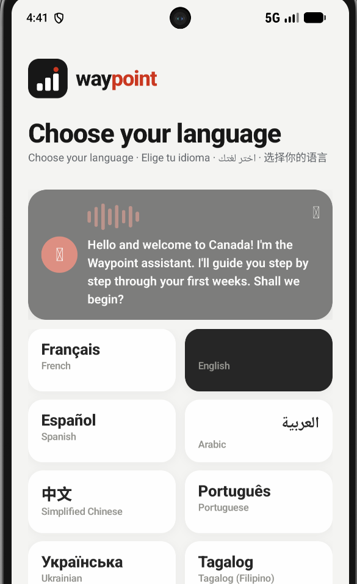
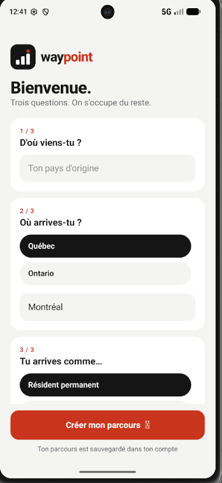
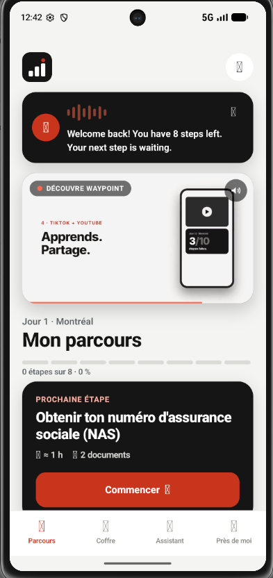
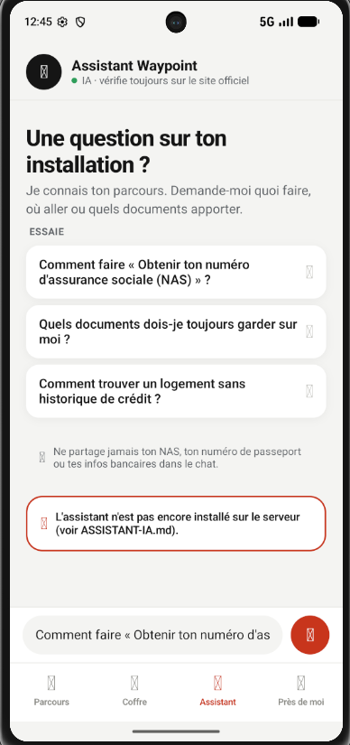
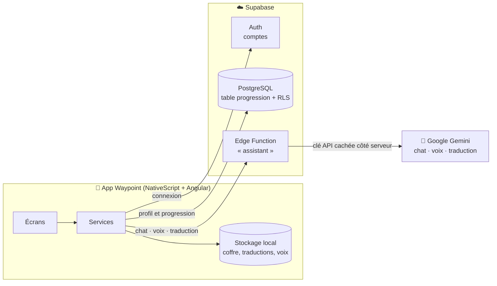

<div align="center">

# 📍 Waypoint

### Ta nouvelle vie, une étape à la fois.

**L'application mobile qui guide les nouveaux arrivants au Canada pendant leurs premières semaines,<br>dans leur langue, avec un assistant IA qui leur parle.**


[Le problème](#-le-problème) · [La solution](#-la-solution) · [Fonctionnalités](#-fonctionnalités) · [Architecture](#-architecture) · [Installation](#-installation) · [Feuille de route](#-feuille-de-route)

</div>

<br>

<div align="center">

| Choisis ta langue | Trois questions | Ton parcours | L'assistant IA |
|:---:|:---:|:---:|:---:|
|  |  |  |  |
| 10 langues, accueil à voix haute | Un profil en 30 secondes | Les étapes dans le bon ordre | Des réponses adaptées à ton parcours |

</div>

---

## 🎯 Le problème

Chaque année, **des centaines de milliers de personnes** s'installent au Canada : résidents permanents, étudiants, travailleurs, réfugiés. Dès les premiers jours, ils doivent :

- obtenir un **numéro d'assurance sociale (NAS)** ;
- ouvrir un **compte bancaire** ;
- demander leur **carte d'assurance maladie** ;
- trouver un **logement** sans historique de crédit ;
- s'inscrire à des **cours de langue**, échanger leur **permis de conduire**, faire leurs **impôts**…

L'information existe, mais elle est **dispersée** sur des dizaines de sites, souvent **dans une langue qu'ils ne maîtrisent pas encore**, et **rien n'indique dans quel ordre** faire les choses. Résultat : du stress, des allers-retours inutiles et des semaines perdues.

## 💡 La solution

**Waypoint transforme l'arrivée au Canada en un parcours clair, personnel et rassurant.**

> Trois questions (d'où tu viens, où tu t'installes, ton statut), et Waypoint construit **ton** parcours : les bonnes étapes, dans le bon ordre, avec les documents à apporter et les adresses près de chez toi.

| | |
|---|---|
| 🗺️ **Un parcours sur mesure** | Les étapes changent selon la province (Québec, Ontario…) et le statut (résident permanent, étudiant, travailleur, réfugié). |
| 🤖 **Un assistant IA qui parle** | Il répond aux questions, connaît ta progression et te salue à voix haute à chaque ouverture. |
| 🌍 **Dans ta langue** | 10 langues : toute l'app (écrans, étapes, messages) est traduite par l'IA. |
| 🗂️ **Un coffre à documents** | Photo des documents importants, avec une alerte avant leur expiration. |

---

## ✨ Fonctionnalités

### 🌐 Accueil multilingue
- **Choix de la langue** au premier lancement : français, anglais, espagnol, arabe, chinois, portugais, ukrainien, tagalog, hindi et persan.
- L'assistant **se présente à voix haute** (voix d'IA naturelle) dans la langue choisie.
- **Toute l'application est traduite** par l'IA la première fois, puis gardée sur le téléphone.

### 🗺️ Mon parcours
- **Vidéo de présentation** animée et commentée, en tête de l'écran (format 16:9).
- **Progression** en temps réel et **prochaine étape** mise en avant.
- Chaque étape explique **pourquoi** elle compte, **quels documents** apporter et **comment** faire, avec le lien vers la **source officielle**.

### 🤖 Assistant IA
- Chat qui répond en tenant compte du **profil** et des **étapes restantes**.
- Bouton **« Écouter »** : chaque réponse peut être lue à voix haute.
- Garde-fous intégrés : information générale (pas d'avis juridique), renvoi vers IRCC pour l'immigration, numéros d'urgence (**911**, **988**), refus de demander un NAS ou un numéro de passeport.

### 🗂️ Mon coffre
- Photo du passeport, du permis, de la carte de résident…
- **Alerte 6 mois avant l'expiration**.
- 🔒 Les photos **ne quittent jamais le téléphone**.

### 📍 Près de moi
- Ouvre la carte sur les bons lieux : Service Canada, banques, cliniques, organismes d'aide aux nouveaux arrivants.
- Bouton d'appel direct au **211** (services sociaux et communautaires).

### 🎬 Vidéos et partage
- Vidéos **TikTok** et **YouTube** sélectionnées pour chaque étape.
- **Image de progression** à partager sur les réseaux sociaux.

### ☁️ Compte et synchronisation
- Création de compte par courriel ; le profil et la progression sont **sauvegardés en ligne**.
- On retrouve son parcours sur n'importe quel téléphone.

---

## 🏗️ Architecture



**Principe de sécurité :** l'app ne contient **aucune clé secrète**. La clé de l'IA est gardée dans les secrets de Supabase, et la fonction serveur est la seule à appeler Gemini.

### Stack technique

| Couche | Technologie | Rôle |
|---|---|---|
| Mobile | **NativeScript 9.1** | Interface 100 % native sur Android et iOS |
| Framework | **Angular 22** | Composants standalone, détection de changements sans zone (*zoneless*) |
| Authentification | **Supabase Auth** | Inscription et connexion par courriel |
| Base de données | **Supabase PostgreSQL** | Profil et progression, protégés par *Row Level Security* |
| Serveur | **Supabase Edge Functions** (Deno) | Fonction `assistant` : chat, voix, traduction |
| IA | **Google Gemini** | Réponses (`gemini-3.5-flash`) et voix (`gemini-3.1-flash-tts-preview`) |
| Natif | `@nativescript/camera`, `social-share` | Photo des documents, partage |

---

## 🔐 Sécurité et vie privée

| Donnée | Où elle est gardée |
|---|---|
| Photos des documents (coffre) | 📱 Uniquement sur le téléphone |
| Profil et progression | ☁️ Supabase, chaque utilisateur ne voit **que ses propres données** (RLS) |
| Conversation avec l'assistant | 📱 Sur le téléphone ; les questions passent par Gemini pour obtenir une réponse |
| Clé de l'IA | ☁️ Secrets Supabase, **jamais dans l'app** |

> ⚠️ Avec l'offre **gratuite** de Gemini, Google peut utiliser les questions pour améliorer ses produits. L'app affiche donc un avertissement : *ne jamais écrire son NAS, son numéro de passeport ou ses informations bancaires*. Il faudra le préciser dans la politique de confidentialité avant la publication.

---

## 🚀 Installation

### Prérequis

- [Node.js](https://nodejs.org) 20 ou plus
- [NativeScript CLI](https://docs.nativescript.org/setup/) : `npm install -g nativescript`
- **Android Studio**, avec un émulateur ou un téléphone Android branché (débogage USB)
- Pour iOS : un Mac avec Xcode
- Un projet gratuit sur [supabase.com](https://supabase.com) et une clé [Google AI Studio](https://aistudio.google.com/apikey)

### 1. Installer les dépendances

```bash
cd Waypoint
npm install
```

### 2. Configurer Supabase

1. **SQL Editor** → coller `supabase/schema.sql` → **Run** (crée la table `progression` et ses règles de sécurité).
2. **Project Settings → API** → copier l'URL du projet et la clé `anon` dans `src/app/config.ts`.
3. Mettre la fonction IA en ligne :

```bash
npx supabase@latest login
npx supabase@latest functions deploy assistant --project-ref <ID_DU_PROJET> --use-api
npx supabase@latest secrets set GEMINI_API_KEY=<TA_CLE_GEMINI> --project-ref <ID_DU_PROJET>
```

### 3. Polices

Le dossier `src/fonts` doit contenir `MaterialIcons-Regular.ttf` (les icônes). Sur Windows, double-cliquer sur **`installer-police.bat`** suffit.
La police Inter est facultative : sans elle, celle du téléphone est utilisée.

### 4. Lancer l'app

```bash
ns run android    # Android
ns run ios        # iOS (Mac seulement)
```

> 💡 Après avoir ajouté une police ou changé une ressource native : `ns clean`, puis relancer.

---

## 📁 Structure du projet

```
Waypoint/
├── src/
│   ├── app.css                      Design (couleurs, cartes, boutons, animations)
│   ├── fonts/                       Material Icons (+ Inter, facultatif)
│   ├── assets/                      Vidéo d'introduction (intro.mp4 + intro.html)
│   └── app/
│       ├── config.ts                URL et clé publique Supabase
│       ├── models.ts                Types : profil, étape, document, vidéo
│       ├── app.routes.ts            Navigation entre les écrans
│       ├── data/                    Parcours Canada, langues, vidéo d'accueil
│       ├── i18n/                    Traduction : tr() et liste des textes
│       ├── services/                Auth, profil, parcours, coffre, synchro, assistant, langue, traduction
│       ├── pages/                   Un fichier par écran
│       └── shared/                  Logo, barre de navigation, voix, onde sonore, réseau
├── supabase/
│   ├── schema.sql                   Table « progression » + règles RLS
│   └── functions/assistant/         Fonction serveur : chat, voix, traduction (Gemini)
├── App_Resources/                   Nom, icônes, permissions Android / iOS
├── videos/                          Vidéos de présentation 16:9 et verticale
└── ASSISTANT-IA.md                  Guide détaillé de l'assistant, de la voix et de la traduction
```

---

## 🌍 Langues

| | | | | |
|---|---|---|---|---|
| 🇫🇷 Français | 🇬🇧 English | 🇪🇸 Español | 🇸🇦 العربية | 🇨🇳 中文 |
| 🇧🇷 Português | 🇺🇦 Українська | 🇵🇭 Tagalog | 🇮🇳 हिन्दी | 🇮🇷 فارسی |

Pour ajouter une langue, il suffit d'un bloc dans `src/app/data/langues.ts` : l'IA traduit le reste automatiquement.

---

## 🛣️ Feuille de route

- [x] Parcours personnalisé (province + statut)
- [x] Coffre à documents avec alertes d'expiration
- [x] Comptes et synchronisation en ligne
- [x] Assistant IA conversationnel
- [x] Voix d'IA et traduction complète en 10 langues
- [ ] Interface de droite à gauche pour l'arabe et le persan
- [ ] Connexion avec Google
- [ ] Chiffrement du coffre
- [ ] Notifications avant l'expiration des documents
- [ ] **Nouveaux pays** : France, Belgique, États-Unis…
- [ ] Publication sur **Google Play** et l'**App Store**

---

## 📦 Publication

| Store | Commande | À prévoir |
|---|---|---|
| **Google Play** | `ns build android --release --aab --key-store-path waypoint.jks …` | Compte Play Console ; garder le fichier `.jks` en lieu sûr |
| **App Store** | `ns build ios --release --for-device` | Mac, Xcode, compte Apple Developer |

Avant de publier :
- remplacer l'identifiant `org.nativescript.etape` par un identifiant définitif (ex. `com.waypoint.app`) dans `nativescript.config.ts` ;
- réactiver **« Confirm email »** dans Supabase ;
- mettre en ligne une **politique de confidentialité** ;
- faire relire chaque étape et vérifier ses sources officielles.

---

## 👤 Auteur

Projet réalisé par **300159437** dans le cadre du cours **INF1083** (développement mobile avec NativeScript + Angular).

<div align="center">

---

**Waypoint** · *Parce que personne ne devrait arriver dans un nouveau pays sans savoir par où commencer.*

</div>
