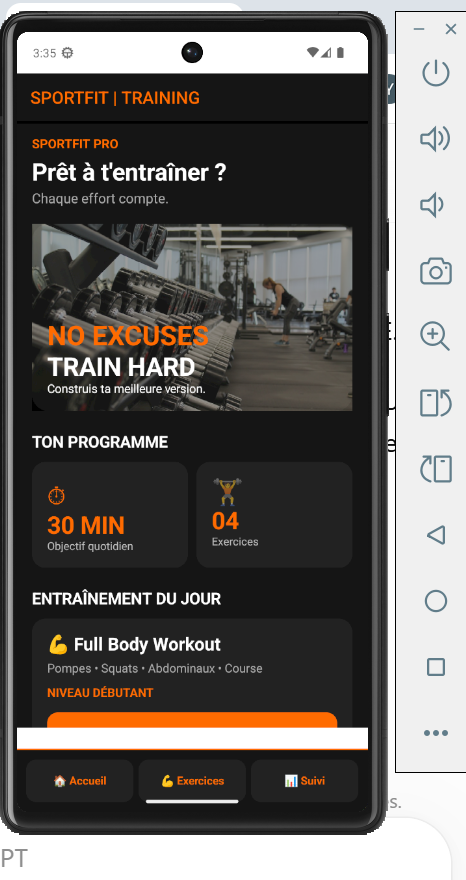
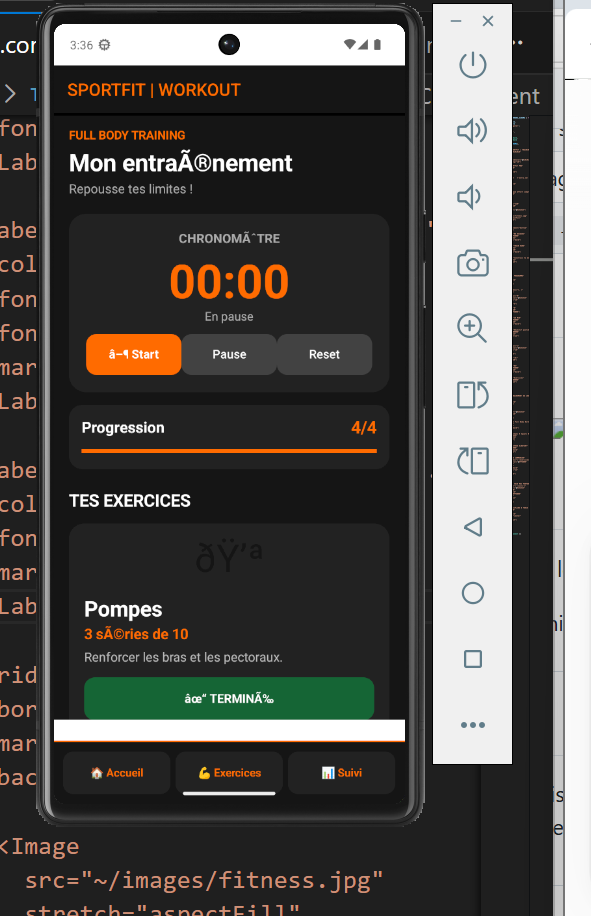
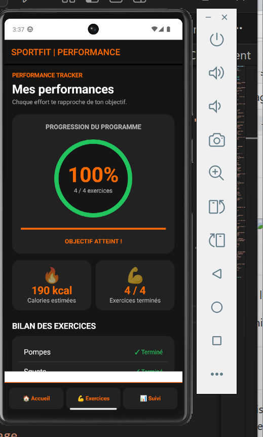

# 🏋️ SportFit

**Étudiant :** Youcef Laziz — 300160424  
**Cours :** INF1083 – Développement d'applications  
**Projet mobile :** NativeScript + Angular (Android)  
**Dossier du projet :** `b300160424`

---

## 📝 Résumé du projet

SportFit est une application mobile de fitness qui aide l'utilisateur à organiser son entraînement et à suivre ses performances.

Elle permet de :

- Consulter un programme de quatre exercices.
- Chronométrer la durée de son entraînement.
- Enregistrer les exercices terminés.
- Visualiser sa progression et ses calories indicatives.
- Obtenir des récompenses selon ses résultats.
- Réinitialiser son programme pour recommencer.

Les résultats sont enregistrés localement avec `ApplicationSettings`, sans API externe.

## 🏷️ Nom de l'application

**SportFit**, affiché sur la page d'accueil. Le dossier technique `b300160424` correspond à mon matricule étudiant.

## 🎨 Design

J'ai choisi un thème noir et vert, avec des cartes arrondies, des icônes sportives et des boutons colorés. Le menu inférieur permet de passer d'une page à l'autre.

---

## 📱 Les pages de l'application

### 1. Accueil

La première page présente un objectif quotidien de 30 minutes, un résumé du programme et un message de motivation.

Le bouton **Commencer mon entraînement** ouvre la page Exercices et **Voir mes progrès** permet d'accéder au suivi.

<p align="center">
  
</p>

### 2. Exercices

Cette page affiche le chronomètre et les cartes des exercices. Chaque carte indique le nom, le programme et un bouton pour terminer l'exercice.

| Exercice | Programme |
|---|---|
| 💪 Pompes | 3 séries de 10 |
| 🏋️ Squats | 3 séries de 15 |
| 🔥 Abdominaux | 3 séries de 20 |
| 🏃 Course | 15 minutes |

L'utilisateur appuie sur **Terminer exercice** pour enregistrer son activité. Le programme utilise une clé associée au nom de l'exercice pour éviter de compter deux fois le même exercice.

<p align="center">
  
</p>

### 3. Suivi

Cette page affiche le nombre d'exercices terminés, le pourcentage de progression, une barre de progression, les calories indicatives et les récompenses.

Le bouton **Actualiser mes progrès** permet de recalculer les résultats.

Le bouton **Réinitialiser l'entraînement** est prévu pour effacer les résultats du programme.

Pendant mon test, trois exercices sur quatre ont été enregistrés. L'application a affiché **75 %**, **160 kcal indicatives** et le niveau **Sportif confirmé**.

<p align="center">
  
</p>

---

## ⏱️ Fonctionnement du chronomètre

| Bouton | Fonction |
|---|---|
| Start | Démarrer ou reprendre le compteur |
| Pause | Suspendre le compteur |
| Reset | Remettre le compteur à zéro |

Le compteur affiche le temps en minutes et secondes. La capture de la page Exercices montre le compteur à 00:13.

## 💾 Stockage local

`ApplicationSettings` permet d'associer une valeur booléenne à chaque exercice.

```typescript
const cle = 'sportfit_' + nom;
ApplicationSettings.setBoolean(cle, true);
```

La page Suivi lit les valeurs enregistrées avec `getBoolean()` et compte les exercices terminés. La réinitialisation utilise `remove()` pour supprimer les clés correspondantes.

## 📊 Calcul de la progression

La progression est calculée à partir du nombre d'exercices terminés.

```
Progression = (exercices terminés / 4) × 100
Exemple : (3 / 4) × 100 = 75 %
```

Les récompenses encouragent l'utilisateur à terminer le programme. Les calories affichées sont des estimations de démonstration, et non des mesures réelles.

## 🧩 Template utilisé

| Template | Usage |
|---|---|
| NativeScript Angular | Structure initiale du projet et composants Angular |

J'ai créé le projet sous le nom SportFit, puis renommé son dossier en `b300160424`. J'ai ajouté trois composants pour remplacer la navigation de démonstration par les pages de fitness.

<p align="center">
  
</p>

## 🔌 Plugins et modules

Aucun plugin externe supplémentaire n'est identifié dans les fonctionnalités présentées.

| Module ou fonctionnalité | Usage |
|---|---|
| `@nativescript/core` | Composants et fonctionnalités natives |
| `ApplicationSettings` | Stockage local |
| `@nativescript/angular` | Intégration Angular et navigation native |
| `@angular/core` | Composants Angular |
| `@angular/router` | Configuration des routes |

## 🛠️ Technologies

- NativeScript, Angular et TypeScript
- Templates HTML et styles CSS
- Visual Studio Code
- Android Studio et émulateur Android
- Git et GitHub

## 🗂️ Structure du code

| Fichier | Rôle |
|---|---|
| `src/main.ts` | Démarrage de l'application |
| `src/app/accueil/accueil.component.ts` | Page d'accueil |
| `src/app/exercices/exercices.component.ts` | Exercices et chronomètre |
| `src/app/suivi/suivi.component.ts` | Statistiques et réinitialisation |
| `src/app/app.routes.ts` | Routes des trois pages |
| `src/app/app.component.html` | Menu de navigation |
| `src/app/app.component.ts` | Composant principal |

<p align="center">
  
</p>

## 🔀 Navigation

Les routes Angular relient les trois composants. La route vide redirige vers l'accueil.

```typescript
export const routes: Routes = [
  { path: '', redirectTo: '/accueil', pathMatch: 'full' },
  { path: 'accueil', component: AccueilComponent },
  { path: 'exercices', component: ExercicesComponent },
  { path: 'suivi', component: SuiviComponent }
];
```

<p align="center">
  
</p>

## ▶️ Lancer le projet

Prérequis : Node.js, NativeScript CLI et un environnement Android configuré avec un émulateur démarré.

Depuis le répertoire étudiant `300160424` :

```powershell
cd b300160424
npm install
ns run android
```

## 🧪 Tests réalisés

| Test | Résultat |
|---|---|
| Démarrage sur Android | ✅ Réussi |
| Affichage des trois pages | ✅ Réussi |
| Chronomètre à 00:13 | ✅ Observé |
| Enregistrement de trois exercices | ✅ Réussi |
| Progression à 75 % | ✅ Réussi |
| Récompense Sportif confirmé | ✅ Affichée |
| Progression à 100 % et réinitialisation | À confirmer |

## 🧯 Difficultés rencontrées et solutions

| Problème | Solution |
|---|---|
| Chemin du dépôt introuvable | Recherche du répertoire dans `C:\Users` |
| Commandes de création de fichiers collées ensemble | Exécution séparée des commandes PowerShell |
| Nom du dossier SportFit différent du matricule | Renommage en `b300160424` |
| Push refusé car le dépôt distant avait évolué | `git pull --rebase origin main`, puis `git push origin main` |

## 🚀 Publication sur GitHub

Le projet a été envoyé sur la branche `main` sans utiliser `--force`.

<p align="center">
  
</p>

## 📌 Limites et améliorations possibles

L'application a été testée sur Android. Elle ne mesure pas réellement les calories et ne possède pas de serveur externe.

Une prochaine version pourrait proposer des vidéos d'exercices, un historique des entraînements et des objectifs personnalisés.

---

## Conclusion

Ce projet m'a permis de développer une application mobile avec trois pages, un chronomètre, une navigation et un système de suivi local. J'ai également appris à tester mon application sur Android et à publier mon code sur GitHub.
