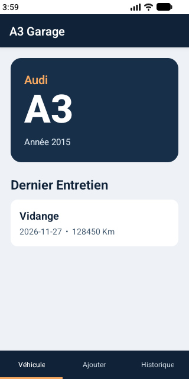
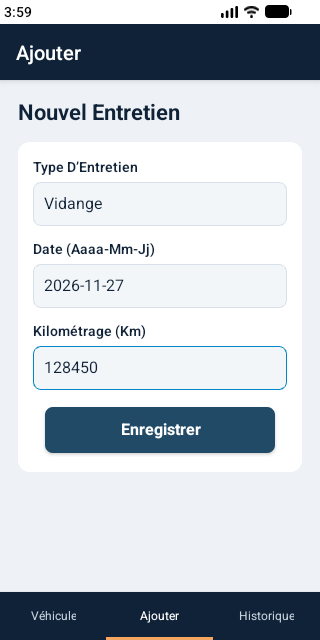
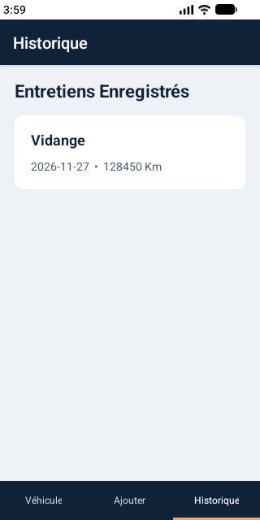

# A3 Garage

INF1083 · Yanis Belhadi · 300160733

A3 Garage est une application mobile NativeScript Angular qui conserve le carnet d’entretien d’une Audi A3 2015.

## Les trois onglets

- **Véhicule** présente l’Audi A3 2015 et affiche le dernier entretien par date.
- **Ajouter** permet d’enregistrer le type d’entretien, la date et le kilométrage.
- **Historique** affiche les entretiens du plus récent au plus ancien. Un message s’affiche si la liste est vide.

## Template, plugins et stockage

- Template exact `@nativescript/template-tab-navigation-ng`.
- Bibliothèques utilisées dans l’application `@nativescript/angular` pour Angular et la navigation, et `@nativescript/theme` pour le thème du modèle. Aucun plugin natif tiers ajouté.
- Le stockage repose uniquement sur `ApplicationSettings` de `@nativescript/core`. Les entretiens sont enregistrés localement sur l’appareil.

## Lancer sur Android

Démarrer `Boreal_TP4`, puis lancer les commandes suivantes depuis ce dossier.

~~~powershell
cd a3-garage
npm ci
npm exec --no -- ngc --noEmit
npx --yes nativescript@9.1.2 run android
~~~

## Test sur Boreal_TP4

J’ai d’abord vérifié le message « Aucun entretien enregistré. ». J’ai ensuite ajouté une **Vidange** le **27 novembre 2026** à **128 450 km**. Après l’arrêt complet et la relance de l’application, la vidange apparaissait toujours dans **Historique** et comme dernier entretien dans **Véhicule**.

### Véhicule

### Ajouter

### Historique

[Consignes du TP 7.Projects](../)
